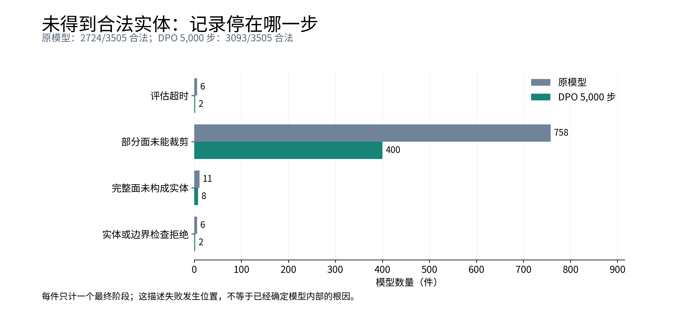
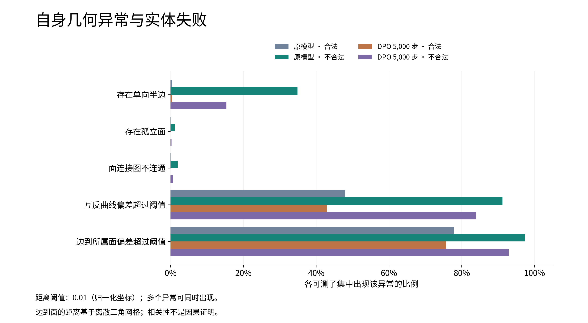
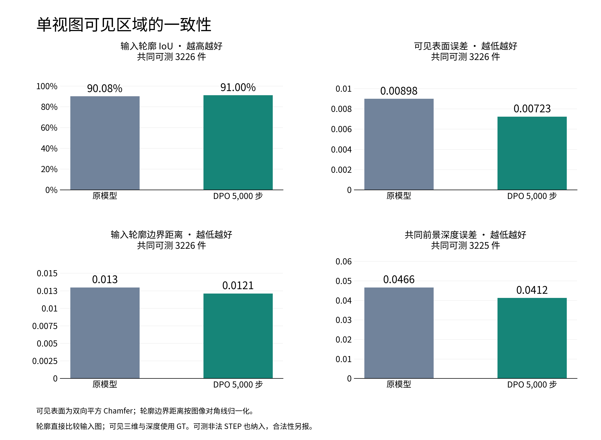

# 完整单视图验证：DPO 的收益与剩余失败

原SVR与DPO 5,000步各评估3,505件灰模单视图，全部生成成功。完整比较和7,010件失败分析均已完成，退出码均为0。
本轮使用原HoLa VAE、原1024维concat主干、每图一次生成、固定seed与同一recover_v1后处理；不是当前UV VAE或逐层cross-attention模型的评估。

**全量结果支持继续研究DPO：合法率和共同可测集合上的可见一致性同时改善。剩余失败主要停在裁剪阶段；预测面数下降也很明显，但尚不能判断减少的是冗余分面还是缺失结构。**

精确数值、分母、区间及来源hash见[RESULTS.json](RESULTS.json)。原指标的集合分解与错误来源见[FULL_COMPARISON_CONTEXT.md](FULL_COMPARISON_CONTEXT.md)。

## 1. 已有指标：修正100件试验的印象

下表均在每行标注的同一组对象上配对比较。面、边误差均为归一化坐标中的双向平方Chamfer，直接给原始数量级。

| 指标 | 配对数量 | 原SVR | DPO 5,000步 | DPO−原模型的95%区间 |
|---|---:|---:|---:|---:|
| 合法实体比例 ↑ | 3,505 | 77.7175% | 88.2454% | +9.2718～+11.8402个百分点 |
| 后处理前面误差 ↓ | 3,505 | 0.00701234 | 0.00666158 | −0.00133036～+0.00058052 |
| 后处理前边误差 ↓ | 3,505 | 0.01593340 | 0.01535894 | −0.00199336～+0.00085711 |
| 后处理前面F1 ↑ | 3,505 | 89.0425% | 89.9697% | +0.5014～+1.3666个百分点 |
| 后处理后面误差 ↓ | 2,462 | 0.00571457 | 0.00553690 | −0.00093357～+0.00068089 |
| 后处理后边误差 ↓ | 2,462 | 0.01068749 | 0.01006467 | −0.00158166～+0.00046291 |
| 后处理后面F1 ↑ | 2,462 | 93.0435% | 93.4573% | −0.0076～+0.8377个百分点 |

470件从确认非法变为合法，106件从合法变为确认非法；另有5件原先未知变为合法。
合法率提升10.53个百分点。四项Chamfer均值都小幅下降，但差值区间都跨0，不能宣称几何已经显著改善，也不支持沿用100件时“post几何变差”的判断。

各自成功子集的均值不能替代上面的配对比较。DPO独有520件完整post测量，其中446件原先非法、70件双方合法但原测量不全、4件原先未知；
这520件的DPO面误差均值为0.0188983，高于共同集合的0.00553690。它们进入DPO自己的成功集合后，会抬高其own均值。
“DPO自己的成功集合平均误差更高”和“同一组对象平均误差更高”是不同结论。

独立图：[合法率](figures/comparison_01_validity.png)、[后处理前几何](figures/comparison_02_geometry_before.png)、
[后处理后几何](figures/comparison_03_geometry_after.png)、[面F1](figures/comparison_04_face_matching.png)。旁边均有SVG。

## 2. 失败主要发生在哪里

| 最终记录阶段 | 原SVR | DPO |
|---|---:|---:|
| 合法实体 | 2,724 | 3,093 |
| 仍有面未完成裁剪 | 758 | 400 |
| 完整面未构成实体 | 11 | 8 |
| 实体重读或边界检查拒绝 | 6 | 2 |
| 未确认合法前耗尽预算 | 6 | 2 |
| 合计 | 3,505 | 3,505 |

每件只计一次，取最终恢复路径留下的证据；不能把该阶段直接等同于神经网络内部根因。
原模型和DPO的validity未知分别为7和2件，也保留在上表总数内。
DPO未确认合法的412件中，400件停在裁剪，占97.09%。记录到更早阶段的异常另存多标签，不与本表相加。

原始解码的内部检查给出以下线索，全部3,505件均可测：

| 一件模型中至少存在一次的异常 | 原SVR | DPO |
|---|---:|---:|
| 仅预测了一个方向的半边 | 282 | 79 |
| 面连接图不连通 | 19 | 3 |
| 孤立面 | 13 | 1 |
| 互反曲线偏差超过0.01 | 2,017 | 1,676 |
| 边到所属曲面网格的偏差超过0.01 | 2,882 | 2,727 |

在DPO的410件确认非法结果中，344件有互反曲线偏差，381件有边到所属面偏差，366件在恢复日志中出现过不闭合边界环。
相比之下，连接图不连通只有3件。**现有证据更支持优先研究边界能否闭合、曲线与两侧曲面是否相容。** 图连通远不足以保证合法实体。

这些距离是离散网格／折线代理，0.01是诊断阈值，不是OCC的合法性容差。
合法DPO结果中仍有75.78%触发owner距离阈值，说明不能拿它单独判非法。模型级“至少一条异常”也受面／边数量影响，减少计数不等于每条边都变好。
每件先平均边的P95距离、再跨对象平均时，owner偏差0.005228→0.004624，互反偏差0.004881→0.004406；这仍是观察证据。
未记录的拟合残差、优化位移和sewing内部过程保留为not_recorded。

## 3. 单图约束是否保住了

预测和GT分别用已核对的原SVR view0相机渲染，仅比较各自真正可见的表面。输入轮廓直接来自灰模图；可见三维和深度仍需配对GT。

| 指标 | 共同可测数量 | 原SVR | DPO | DPO−原模型的95%区间 |
|---|---:|---:|---:|---:|
| 输入轮廓IoU ↑ | 3,226 | 90.0823% | 91.0029% | +0.6092～+1.2311个百分点 |
| 轮廓边界距离 ↓ | 3,226 | 0.0129690 | 0.0121005 | −0.00132595～−0.00042060 |
| 可见表面平方Chamfer ↓ | 3,226 | 0.00898384 | 0.00722835 | −0.00298162～−0.00057956 |
| 共同前景深度绝对误差 ↓ | 3,225 | 0.0466137 | 0.0412137 | −0.00707146～−0.00372063 |
| 共同前景占GT前景比例 ↑ | 3,226 | 94.8113% | 95.0202% | −0.0954～+0.5209个百分点 |

可见表面平均误差下降约19.54%，输入轮廓也改善。因此，这次不能概括成“只提高合法率、牺牲图像一致性”。
但GT→预测的单向可见误差区间仍跨0，前景覆盖率区间也跨0，不能说所有可见结构的覆盖都已经显著改善。
区间采用10,000次CAD配对bootstrap、seed42，为逐项区间，未作多重比较校正。

可见指标各自覆盖原模型3,302件、DPO3,403件；不可测203/102件保留在完整分母，主要是预测STEP面无法三角化。
其中54/59件已通过原native合法性检查。可测的invalid STEP也纳入可见指标；这里既不是仅合法子集，也不是全3,505件均值。
原模型还有1件双方前景不相交，因此深度误差配对数量少1。
共同集合中GT自身重渲染对输入图的IoU为97.6485%，反映原OCC轮廓线与当前光栅化的基准差异，没有为此剔除对象。
外轮廓吻合也不保证内部孔槽正确；当前224²可见点按像素贡献误差，小孔和细槽容易被大平面稀释。
因此这些指标支持可见一致性的总体改善，不能证明所有可见细节都恢复了。

## 4. 面数变化与单图多解性

| 原始解码面数统计，全部3,505件 | 原SVR | DPO |
|---|---:|---:|
| 平均预测面数 | 12.3755 | 11.3506 |
| 平均预测−GT面数 | −0.1070 | −1.1318 |
| 预测少于GT的对象数 | 714 | 1,049 |
| 与GT相同 | 2,159 | 2,286 |
| 预测多于GT | 632 | 170 |
| 面数绝对误差均值 | 1.1826 | 1.3093 |

GT平均面数为12.4825。少面倾向、合法率提高和可见一致性改善同时出现，但本轮没有逐面对应证明删掉的是隐藏面、冗余面或重要细节。
同一个几何也可能有不同分面方式，单张图的背面更不能唯一确定。因此，面数差作为诊断保留，不据此认定某个补全一定错误。

## 5. 独特性和同图差异

两方法各3,505件，在h=0.0001、0.001、0.01三档raw点集量化指纹下均未发现重复。
这只能排除该严格指纹定义下的相同点集，不能排除近似重复，也不能证明B-Rep几何／拓扑独特性或没有多样性退化。
主对照每图K=1，无法衡量同一张图的不同补全。

已有原模型100图×8候选附录测完：800件中581合法、218非法、1未知。
全部2,800候选对按图片等权的平均平方Chamfer为面0.00411329、边0.01115063；
双方合法的1,728对来自91张图，面0.00375869、边0.01145344。
这些差异可能包含错误几何，不能直接称为合理多解；没有DPO对应K=8，不比较其同图多样性变化。
详情见[DIVERSITY_VALIDATION.json](DIVERSITY_VALIDATION.json)。

## 6. 可追溯案例

固定的三个工具验收ID在全量结果上重新绘制；它们用于解释现象，不用于估计发生率。
图与全部源文件hash保存在`../runs/20261023_full_case_gallery/`。

- `00000178`：原模型合法，DPO非法；两者轮廓IoU均约96.7%。DPO三条恢复路径均记录局部face_index=0未裁剪，出现面修复减少边界环。
  本轮raw阈值检查全部未触发。这说明轮廓相近、raw代理指标正常，仍不保证边界可构造。
- `00000894`：DPO合法但轮廓IoU42.55%，叠加图可见细长T形轮廓的偏移；原模型有面无法三角化。
  此例不能据不可测的原模型得出可见指标变差，只说明合法性与图像符合程度要分别看。
- `00003406`：原模型非法、DPO合法；可见误差0.09674→0.07646，但DPO仍有较大观测偏差。

逐件记录包含原inference、metrics、post_diagnostics与STEP路径/hash、最终阶段证据、每条恢复路径、失败face索引、具体异常边／owner编号。
这些编号属于各自预测／后处理记录，不冒充GT面对应关系。

## 7. 下一步判断

1. **保留DPO这条主线。** 全量收益覆盖合法性和可见一致性，当前没有依据因100件的均值就放弃它或更换主干。
2. **训练目标进一步强调“合法且符合输入图”。** 后续偏好对可以纳入输入轮廓与可见几何的连续评分，专门约束合法却偏离观测的结果；同时补充可见内边界／孔槽的细节检查，避免外轮廓指标掩盖细节丢失。完整GT误差继续单列，隐藏补全允许存在不同解释。
   本轮实际标签使用完整GT和post指标，没有显式可见评分；真实规则与训练权重见[TRAINING_CONTEXT.md](TRAINING_CONTEXT.md)。本次没有修改训练或重新定义标签。
3. **结构研究优先回答边界相容问题。** 目标是让同一条边及两侧面支持一致的闭合边界。现有阶段与偏差证据能支持这个研究目标，尚不足以在diffusion、VAE、拟合／裁剪之间作因果归责，或直接选定某个新模块。
4. **在进一步强化偏好前补齐同图K=8的DPO对照。** 用同一组图与seed，联合报告合法率、输入一致性和候选差异；不能用当前跨图指纹100%代替多样性验证。也不把GT面数直接用作隐藏结构的硬约束。

## 8. 工具与运行记录

- [工具说明与命令](../../../../src/brepnet/eval/SINGLE_VIEW_EVALUATION.md)：失败分析、观测指标、同图差异、拆图、案例查看均是仓库内CLI/API。
- [LAUNCH.json](LAUNCH.json)、[run.sh](run.sh)：本轮完整分析命令。原比较总运行约2小时11分53秒；新增7,010件CPU分析用时367.60秒。
- [VALIDATION.json](VALIDATION.json)：41项行为测试和真实集成检查；相机、指纹、拆图与gallery另有验证记录。
- 本轮审计源码hash与启动协议逐项一致；全部raw诊断完成，无source_mismatch、分析超时或崩溃。观测不可测项逐件保留。
- 原指标中合法但post测量不完整为86/111件，主要是预测面无法三角化／无正面积以及采样超时，没有把它们改成非法；没有发现明确的PythonOCC调用签名错误。
- 运行产物与完整CSV留在`../runs/20261023T105637Z_full/`，原比较位于`checkpoints/diffusion/preference_eval/20261023T090834Z`，均未改写。

PNG/SVG图及紧凑汇总随研究记录保存；权重、生成几何和缓存不提交。
