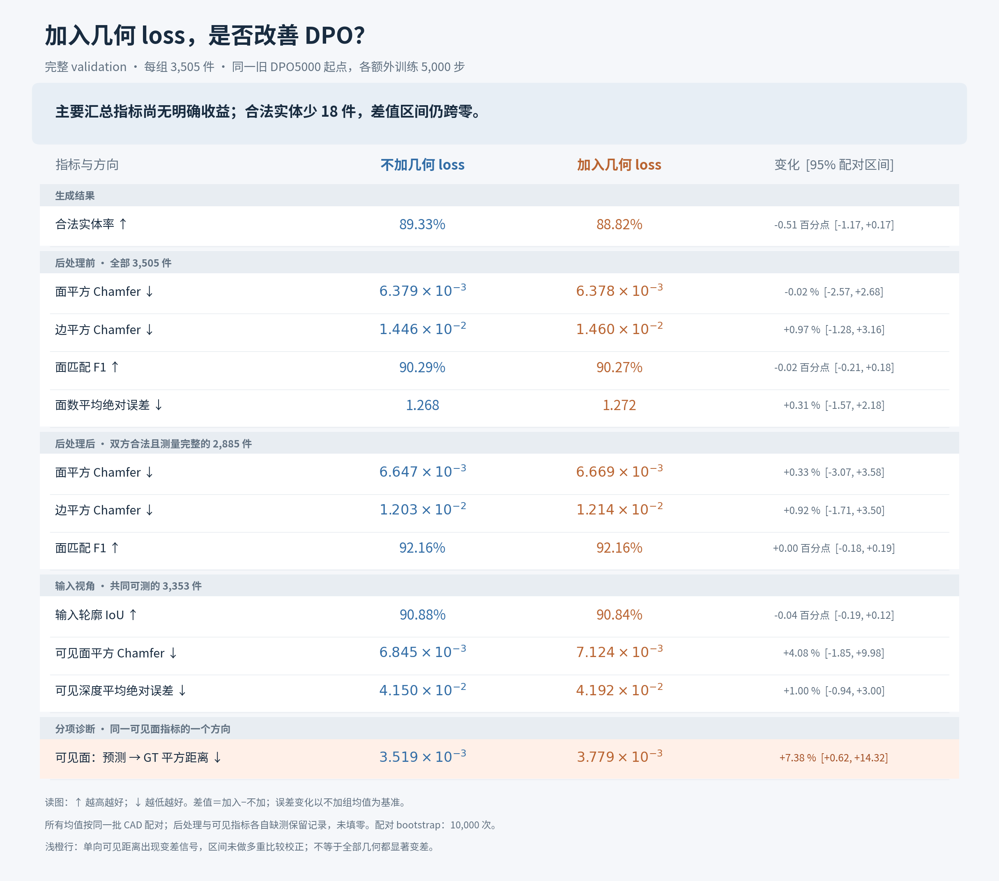

# 完整验证集：继续 DPO 与 DPO＋几何 loss

完整评估于北京时间2026-10-25 19:21:55完成。本报告替代中途2283件快照作为本轮结果入口；保留旧快照以记录当时状态。两组均从旧DPO5000初始化，各额外训练5000步，固定3505件validation、每图一次生成，无GT候选选择。

## 结果与分母

- 两组均成功生成3505/3505，产出可读取STEP3505/3505；没有超时或有效性unknown。
- 不加几何项：3131件合法（89.3295%）、374件非法；加入几何项：3113件合法（88.8160%）、392件非法。有效率变化−0.5136个百分点，配对95%区间[−1.1698，+0.1712]。
- 82件由合法变非法，64件由非法变合法；双方合法3049件，双方非法310件。
- 后处理前三项几何及面数指标均配对3505件。后处理几何各自完整测量3027/3007件，双方共同2885件；这些是双方合法且三次采样测量完整的对象，不代表全体输出。
- 可见观测各自成功3418/3402件，双方共同3353件。其余87/103件保留error/not_reached状态，不填零，不作为零误差。

主图主要汇总指标的95%差值区间均跨零，未显示几何辅助项的明确收益。单向“预测可见面→GT可见面”的平方距离均值由0.00351923增至0.00377896，差值0.000259724，配对95%区间[0.0000216669，0.000503875]。这是分项变差信号，未做多重比较校正；完整双向可见Chamfer的差值区间仍跨零，不能将该分项结论外推到所有几何指标。

## 图表口径

两组均值、配对差值与区间直接来自已经完成的正式报告。比例指标变化显示百分点；距离／面数误差变化显示相对不加组均值的百分比。后者将原始差值及区间除以固定不加组均值，便于读图，不是额外估计均值比置信区间。统计采用CAD配对bootstrap10000次、seed42。

主图显示12项；全部15项模型性能指标保存于[CSV](all_metrics.csv)，包括未在主图展开的轮廓边界距离、观测重叠覆盖和另一方向可见距离。GT渲染与输入图片的自检量未作为模型性能列入。输入文件SHA256、checkpoint摘要、固定分母与原始差值保存在[data.json](data.json)。

原始结果：

- `checkpoints/diffusion/preference_eval/geometry_v1_evaluation/comparison/report/summary.json`
- `checkpoints/diffusion/preference_eval/geometry_v1_evaluation/observation/report/summary.json`

产物：[PNG](comparison.png)、[SVG](comparison.svg)、[PDF](comparison.pdf)。生成脚本为[plot_comparison.py](plot_comparison.py)，仅读报告，没有改变模型或重做评估。
