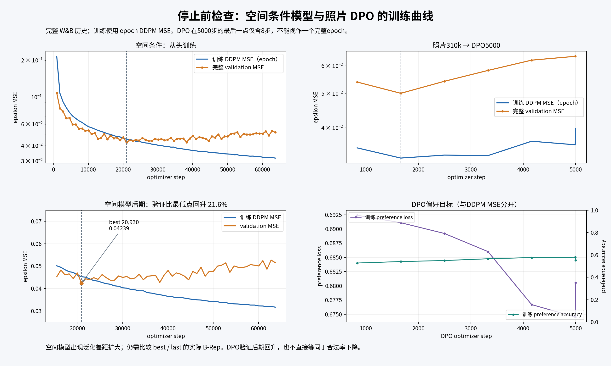

# 停训、曲线检查与照片模型完整 validation

2026-10-29 用户要求停止当前空间条件训练，检查曲线，并补测 photo310k → DPO5000。这里的照片均为 FLUX 合成真实感图像。

## 已确认的训练状态

- 北京时间 2026-10-29 09:36:45 请求停止空间训练；Lightning 收到 KeyboardInterrupt 后退出，随后确认8卡释放。退出码为 -9，源于本次用户要求的中断，不能写成此前自主训练崩溃。
- 空间模型最后完整 checkpoint 为 step63700 / epoch69；中断时没有得到更晚的完整 checkpoint。best 为 step20930 / epoch22；选择发生在本轮下游结果出现之前。
- 照片 DPO 正常完成5000步，退出码0；参考网络来自照片310k，无几何辅助 loss。它此前尚未完成下游重建评价。

## 曲线观察

完整 W&B 历史已导出，使用 epoch DDPM MSE 与完整 validation MSE 比较，DPO 偏好目标单列。PNG已实际打开检查，不只生成文件。



| 模型 | 最低验证MSE / step | 最后验证MSE / step | 相对最低点回升 |
|---|---:|---:|---:|
| 空间条件 | 0.042389 / 20930 | 0.051549 / 63700 | 21.61% |
| 照片DPO | 0.050093 / 1664 | 0.063836 / 4992 | 27.43% |

空间训练MSE最后完整epoch为0.031678，验证曲线后期上升，支持过拟合判断。DPO完整epoch训练MSE最后为0.035747；5000步末点0.039764只包含最后8步，不能当作完整epoch的突然恶化。DPO目标变化与合法率的关系需要下游结果判断，不能仅看MSE宣布DPO失败。

以后每次检查训练／选checkpoint／启动下游评价，固定先保存完整训练与验证曲线、打开图片检查，再说明选模理由；训练目标不同时分开画，不把总loss直接与DDPM MSE相比。

## 固定评价协议与入口

完整3505件 validation，K=1、DDPM1000、FP32、TF32关闭、逐对象相同seed、CPU初始噪声/GPU step noise。保留原VAE和两级去重；同一recover_v1后处理、drop_num=0、200次优化、每件整体180秒、合法STEP几何采样重复3次。

四组为照片baseline310k、photo310k→DPO5000、空间best20930、空间last63700。新架构从头训练，另外两组继承旧SVR，训练预算也不同；这是当前模型质量比较，不是隔离单一结构的因果消融。

照片baseline复用 `../photo_baseline/evaluation_full_20261026` 的photo_latest结果。3505件输入及17,525个已记录产物经过校验；旧源码三处变化经过实际调用函数AST比较，采样、VAE解码、OCC与指标计算保持一致。基准有效solid为2863/3505（81.68%）。

空间best/last的VAE 704个tensor与DINO 344个tensor均逐项与原SVR权重完全相等，见 `FROZEN_COMPONENTS.json`。DPO加载器必须确认reference等于照片310k，绝不能误用仅支持原SVR reference的加载器。

```bash
# 每个新checkpoint先跑一件完整链路；正式运行复用同一候选，不另抽seed。
bash checkpoints/diffusion/photo_model_comparison_20261029/run_evaluation.sh --preflight

# 持久运行：8GPU生成、32CPU评价；异常保留退出码。
tmux new-session -d -s photo-model-eval-20261029 \
  'bash /mnt/d/python/checkpoints/diffusion/photo_model_comparison_20261029/run_background.sh'
```

产物在 `run/`：`metadata/protocol.json` 固定协议，`status.json` 记录实际进度；完成后自动输出 `summary.json`、`per_object.csv`、`comparison.png/svg` 和 `VALIDATION.json`。未完成前不得把少量样本的合法率当完整结果。

实现检查：`test_photo_model_comparison.py` 9项通过，覆盖DPO reference/DINO错配、缺键、额外AE键、NaN拒绝、VAE保留、空间接口、失败分母与配对样本/seed检查。完整真实链路检查与运行状态继续记录在 `VALIDATION.json`。

截至北京时间2026-10-29 10:03，三个新checkpoint各一件的DDPM1000→VAE→OCC→metric链路已完成，latent均为有限FP32 `[30,32]`。全量任务已在 `photo-model-eval-20261029` tmux启动，8个GPU worker存活；总计新增10,515个候选，baseline3505件复用。全量结果尚未完成，当前不能据此宣布哪组最好。运行结束后以 `run/status.json`、`run/VALIDATION.json` 及实际产物为准。
