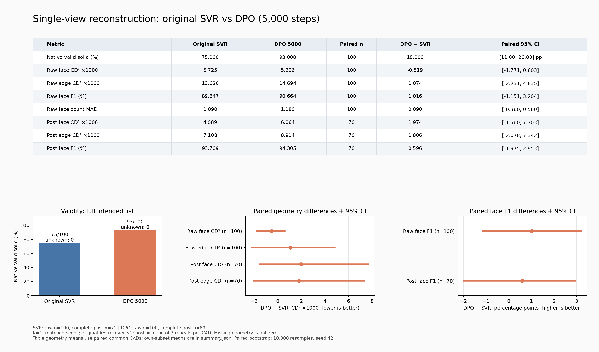

# 原 SVR 与 DPO 的固定100件比较

本轮由用户要求检查：训练中GT去噪验证loss上升，是否对应实际重建退步。
只比较原SVR和最终5,000步权重，不选中间checkpoint，不启动新训练。
协议在运行前写入[PLAN.md](PLAN.md)。

## 运行与实现检查

- Run：`/mnt/d/python/checkpoints/diffusion/preference_eval/20261023T062400Z`。
- 代码：`9abdc26a`；8卡分担两模型，各100件、每件仅c00、共同seed。
- 后处理：与偏好数据一致的recover_v1；旧2026-10-17表使用legacy后处理，
  因此本次两侧都重新生成及评估，不直接拼接那张旧表。
- 6项严格DPO加载测试和7项汇总测试通过；真实GPU检查见[VALIDATION.json](VALIDATION.json)。
  原SVR首件latent及raw与先前c00逐位一致；DPO装回原生模型后的完整采样latent与
  PreferenceDiffusion.sample_latents逐位一致。314个reference tensor与344个DINO tensor
  均逐值等于原权重，原AE保留。
- 完整命令、checkpoint/source/input哈希和逐件记录在run的metadata、raw_predictions、
  evaluations中。失败保留在100件分母；合法但post采样失败不抹掉已完成的native检查。

## 实测结果

已完成，进程退出码0，采样和后处理总耗时268.91秒。两边各100次推理成功、
100件可读STEP、零超时、零unknown。以下固定比较原权重与最终5,000步DPO，
同图同seed、K=1，不挑候选。

| 指标 | 原SVR | DPO 5,000 | 配对件数 |
|---|---:|---:|---:|
| 合法实体比例 ↑ | 75/100 | 93/100 | 100 |
| 后处理前：面几何误差 ↓ | 5.72×10⁻³ | 5.21×10⁻³ | 100 |
| 后处理前：边几何误差 ↓ | 1.36×10⁻² | 1.47×10⁻² | 100 |
| 后处理前：面匹配 F1 ↑ | 89.65% | 90.66% | 100 |
| 面数量平均绝对误差 ↓ | 1.09 个面 | 1.18 个面 | 100 |
| 后处理后：面几何误差 ↓ | 4.09×10⁻³ | 6.06×10⁻³ | 70 |
| 后处理后：边几何误差 ↓ | 7.11×10⁻³ | 8.91×10⁻³ | 70 |
| 后处理后：面匹配 F1 ↑ | 93.71% | 94.31% | 70 |

几何误差为归一化坐标下的双向平方 Chamfer 距离，表中直接显示原始数量级，
没有乘以1000，也不是毫米。后处理前为VAE直接解码结果，后处理后为最终STEP。

原来合法的75件全部保持合法，18件从invalid变成valid，7件双方invalid。
合法率提升18个百分点；按CAD配对bootstrap的95%区间为[11,26]个百分点。
这是固定seed下这100件的开发验证证据，不包含其他seed或重训波动。

几何没有全面改善：raw面CD²均值下降9.1%，raw边CD²上升7.9%；
共同70件的post面/边CD²分别上升48.3%/25.4%。这些几何差值的配对95%区间均跨零，
需要扩大评估来确定方向，不能把DPO loss下降或合法率提高当作几何精度提高。

两边分别有71/89件满足合法且三轮post几何完整，共同集合70件。
各有4件已判合法但STEP几何无法采样，仍保留其合法性；没有拿原点替代几何。
原SVR这100件的原始latent及raw与偏好数据生成时的c00全部逐位一致，
核验见[BASELINE_REPLAY.json](BASELINE_REPLAY.json)。

完整数据：[逐件CSV](report/per_object.csv)、[汇总及配对区间](report/summary.json)、
[矢量图](report/comparison.svg)。汇总另存各自可测子集的均值及全部合法性转移ID，
避免把不同成功子集直接当配对比较。
本次只计算表中几何/有效性指标，没有新增FE/EV、顶点或LFD评估。

## 周报拆图

按用户要求将原综合图拆成5张独立中文图：合法实体生成率、后处理前几何误差、
后处理后几何误差、面匹配F1、面数量误差。数据和评估口径未变。
[图片索引与绘图命令](report/weekly/README.md)；每图包含300 dpi PNG、SVG及PDF。
新图及表格直接显示科学计数法，原综合图保留用于追溯。
