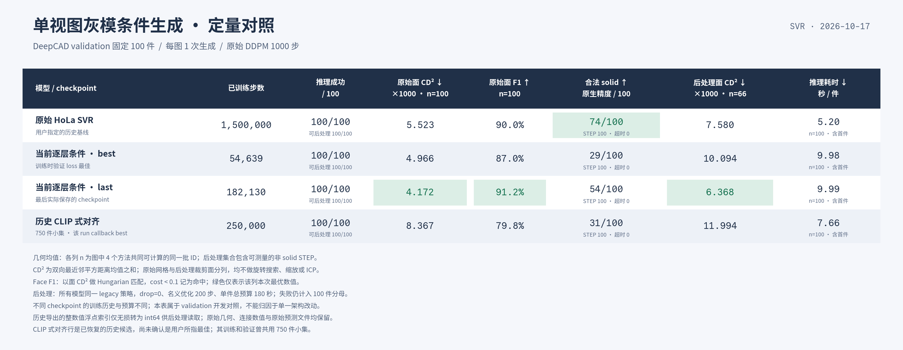

# 2026-10-17 SVR diffusion 与历史 HoLa 对照

已完成 5 份 checkpoint × 固定 100 件 validation 的单图生成、原始几何评估和 STEP 后处理；没有启动训练或修改网络。
主图展示用户指定 baseline、当前 best/last，以及按历史训练 callback 预先选定的 alignment best。150k 中间权重保留在完整报告。



## 实测结果与判断

当前 last 的原始面 CD² 比 HoLa 降低 **24.5%**，但原生合法 solid 从 **74/100 降至54/100**。
它改善了采样点集与 GT 的几何接近程度，尚未达到历史 baseline 的实体有效率；不能据此宣称整体重建能力超过 baseline。
本次全部 500 次推理成功，500 件都产出了可读 STEP，零超时；可读 STEP 和合法 solid 不是同一指标。

当前最低 validation loss 的 best（54,639步）只有 **29/100** 合法 solid，后续 last（182,130步）已提升到 **54/100**，
原始面 CD²、面 F1 和面数误差也都改善。这说明本次继续训练有下游收益，**最低 diffusion validation loss 不能单独承担 checkpoint 选择**。
best 的 val loss 为0.0424972，last为0.0520485；不能用这一上升直接推断生成质量全面退化。

全部模型的原始几何指标均可在100件上计算，数值如下；F1为primitive匹配指标，不是点级F1：

| 模型 | step | 原始面 CD² ×1000 ↓ | 原始边 CD² ×1000 ↓ | 面 F1 ↑ | 面数 MAE ↓ | 原生合法 solid /100 ↑ |
|---|---:|---:|---:|---:|---:|---:|
| HoLa SVR（用户指定） | 1,500,000 | 5.523 | 14.213 | 90.05% | 1.05 | 74 |
| 当前 best（最低 val loss） | 54,639 | 4.966 | 12.264 | 86.97% | 2.29 | 29 |
| 当前 last（最后保存） | 182,130 | 4.172 | 9.274 | 91.24% | 1.25 | 54 |
| 历史 CLIP 式对齐 150k | 150,000 | 8.089 | 23.000 | 79.56% | 2.35 | 29 |
| 历史 CLIP 式对齐 callback-best | 250,000 | 8.367 | 24.102 | 79.80% | 2.28 | 31 |

当前 last 的 B=1、FP32 推理均值 **9.99秒/件**，HoLa为 **5.20秒/件**（同型号4090、含首件，图像编码+1000步DDPM+AE，不含模型加载/文件读写）。
这是本次推理成本，不是训练吞吐对比。

## 差距的不确定性

对固定100件做逐CAD配对bootstrap（10,000次、seed42；95% percentile CI），以下方向均为右侧减左侧：

| 对比 | 原始面 CD² 差值 ×1000 [95% CI] | 面 F1 差值，百分点 [95% CI] | 合法 solid 差值，百分点 [95% CI] |
|---|---:|---:|---:|
| last − HoLa | −1.351 [−2.289, −0.509] | +1.20 [−1.25, +3.80] | −20 [−30, −10] |
| last − current best | −0.794 [−1.454, −0.119] | +4.28 [+2.31, +6.31] | +25 [+16, +35] |

last 的面距离改善与实体有效率差距，在本次CAD重采样区间中方向稳定；它相对HoLa的F1小幅增加仍有不确定性。
HoLa与last的有效性配对为：双方有效50件、双方无效22件、仅HoLa有效24件、仅last有效4件。
这些区间只估计已保存K=1结果在CAD对象间的变化，不覆盖生成seed、重训或checkpoint选择的不确定性，未作多重比较校正。
详见[配对统计](report/paired_analysis.json)及[统计协议](report/paired_analysis_protocol.md)。

## 图中后处理距离的分母

主图4个模型共同可计算的STEP几何集合为 **66件**：面CD²×1000依次为 **7.580、10.094、6.368、11.994**。
这个集合包含可测量的非solid STEP，不是共同合法solid集合，也不能替代固定100件的有效率。
若只比较HoLa和当前best/last三个主模型，共同集合为74件；其均值分别为7.033、9.582、5.868。
完整5模型共同集合为63件，另存于summary；脚本按主图显式选择的模型重新计算集合，没有混用分母。

各自几何不可计算数：HoLa8、current best20、current last10、alignment150k15、alignment250k16。
原因是原生曲面没有可用三角化或正有限网格面积；没有用原点几何替代，也没有剔除这些ID重算成功率。
部分实体先通过内核有效性、后续却无法采样，因此其有效性结果仍保留，几何均值另有分母。

## 历史 CLIP 模型核验

指定的 `Diffusion_svr_sq30_1500k.ckpt` 是原版DINO全局条件模型，完整1375个key与固定历史源码严格匹配。
另外恢复的模型使用 **DINO + CLIP式对称InfoNCE对齐**，不是OpenAI CLIP图像编码器。
它来自 `0413_deepcad_natural_blender_align / ya2o4xi1`；150k为另存中间权重，250k为该run原callback-best，选择发生在查看此次结果之前。

该run训练和验证曾共用750件小集，当前可恢复列表与本次100个ID无交集，但旧列表未受Git管理，不能确证历史字节未变或几何组完全无重叠。
未找到可可靠确证为全量灰模训练的其他alignment候选，**仍不能把这行认定为用户记忆中的全历史最佳**，也不能凭它的31%否定CLIP式对齐。
检索范围、候选排除原因、严格加载和历史工作树限制见[alignment溯源](report/alignment_provenance.md)。

## 固定协议与可比性

- 输入为同一100件DeepCAD validation、同一灰模view0、相同ImageNet预处理；500份输入像素与归一化tensor的hash逐ID完全一致。清单在推理前按固定hash排序冻结。
- 每图仅1次提议，1000步原生DDPM，FP32、TF32关闭、无CFG；不输入GT面数/拓扑/order，不按GT选候选，不做旋转/尺度/ICP对齐。
- 全量恢复每份checkpoint的冻结AE；已逐tensor核实HoLa与当前best/last的704个AE tensor相同。历史/当前原生解码及去重仍各自保留。
- 冻结100件的v6/v7视角0像素、几何与rotation0 latent逐元素一致；可恢复旧训练split与当前validation无精确ID交集。证据只覆盖这些资产与ID，不扩展到全部64/24视角。
- 当前训练只使用view0，旧HoLa训练有旧Euler多视角增强，训练步数与数据规模亦不同。这是checkpoint/系统对照，不是等预算架构消融。
- 固定每ID相同seed，但原始HoLa从CPU生成初始噪声，当前从GPU生成；保留原生路径，不宣称同一初始噪声tensor。
- 后处理统一当前legacy策略、drop=0、CPU、名义优化200（原实现可自适应扩展600）、每件180秒硬预算、16并发、无重采样/重试。GT只进入指标计算。
- 原生有效性先按STEP保存精度读取，再做TopAbs_SOLID与BRepCheck；不是强制0.1读取后报有效，也不保证工程公差或形状正确。
- 原始面/边CD²为双向最近邻平方距离均值之和；面F1使用Hungarian、面CD²<0.1。STEP几何每面1024点/每边128点，与原始网格CD分列。

冻结协议见[PLAN](PLAN.md)，权重文件的实际step、完整SHA256见[checkpoints.json](report/checkpoints.json)，源码/AE/数据/split见[溯源](report/provenance.md)。
源机环境为PyTorch2.4.1/cu124、PythonOCC7.8.1.1，不是迁移后的5090环境；完整版本见[environment.json](report/environment.json)。

## 停止时实际保存了什么

当前run日志至少训练到198,650步，但没有找到该时刻权重；最近落盘的last是 **182,130步**。
本表严格使用checkpoint元数据的步数，没有将日志进度充当已保存权重。
训练历史和进程核对见[current_training.json](report/audits/current_training.json)。

## 复现与产物

在源机保留数据、权重和本地DINO代码/配置缓存的环境中执行：

```bash
cd /mnt/d/python
/mnt/d/anaconda3/envs/torch/bin/python \
  checkpoints/diffusion/svr_comparison_20261017/run_comparison.py \
  --gpus 0 1 2 3 4 5 6 7
/mnt/d/anaconda3/envs/torch/bin/python \
  checkpoints/diffusion/svr_comparison_20261017/analyze.py
```

脚本先核验完整checkpoint哈希，严格加载并按GPU分片；已有同协议终态结果只读取，不重复生成。
源码/配置/输入/原始导出或后处理协议变化时拒绝混用旧结果。正式产物目录只包含本次比较，不写入训练run。
首次并行推理与后处理采用相同脚本接口分批调度，全部逐件日志与worker来源在`metadata/`保留。

- [PNG图](report/quantitative_comparison.png)、[SVG图](report/quantitative_comparison.svg)、[主表CSV](report/quantitative_comparison.csv)：图中4行，含可复核的逐格来源JSON。
- [完整summary](report/summary.json)、[raw CSV](report/raw_per_object.csv)、[post CSV](report/post_per_object.csv)、[inference CSV](report/inference_per_object.csv)：全部5模型、各100件。
- `raw_predictions/`保留模型原始NPZ；`post_inputs/`仅将历史整数值float连接索引无损转int64；`post/`保留STEP；`metadata/`保存状态与诊断。这些运行产物不提交Git。

初次接口记录升级与旧连接索引dtype兼容问题均已归档，见[infrastructure_repairs.json](report/infrastructure_repairs.json)。
后者在进入OCC之前被validator拒收；修复仅改变导出类型，原始预测字节、几何与索引值保持不变，没有根据结果重采样。
self-check覆盖已知CD距离、primitive F1、失败分母、无损dtype与非整数拒绝、配对统计及主图选择子集；500次正式输出均逐ID核验完成。

后续需要解释的是：生成几何距离为何改善，而面/边组合仍更难形成合法实体。本轮没有改网络或修复规则，尚不能把差距归因于某一个条件模块。
