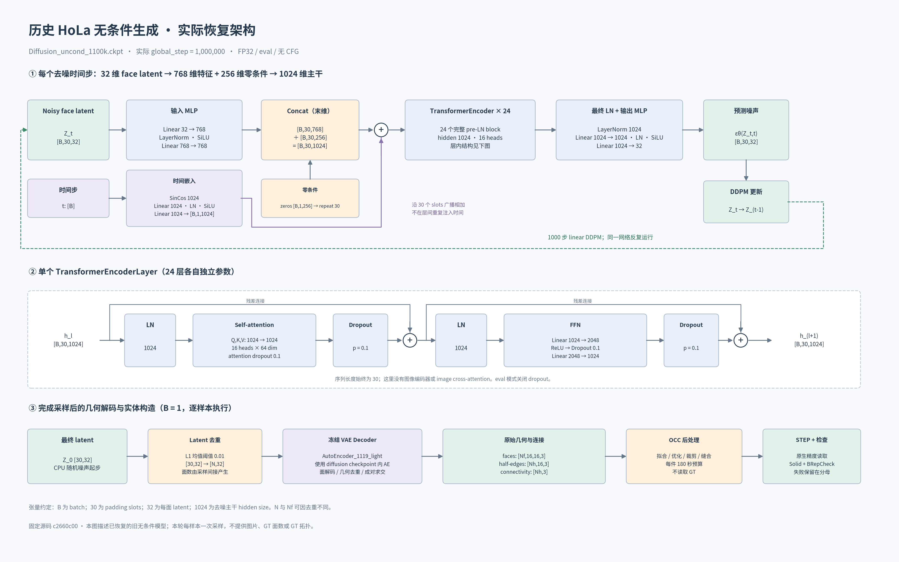
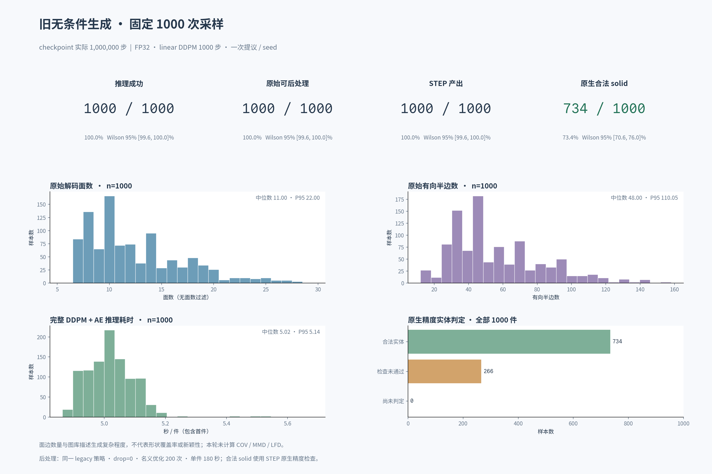

# 历史 HoLa 无条件生成基线

目的：先测指定旧无条件模型，在统一采样和后处理规则下建立参照；后续与真正接受无条件训练的新版模型比较。

## 旧模型的实际计算

每面latent仍是32维。它先经两层MLP投影到768维，再拼接256维零条件，成为1024维特征；
加上1024维时间嵌入后，进入24层Transformer。拼接后的1024维全部参与后续计算，不存在永久不参与计算的256维。



- 权重：`/mnt/d/ckpt/HoLa/Diffusion_uncond_1100k.ckpt`。
- 实际保存：1,000,000 steps / epoch324；完整checkpoint SHA256见[冻结协议](report/protocol.json)。
- 配置：epsilon prediction、L2、1000步linear DDPM、beta范围`[1e-4, 0.02]`、fixed_small variance。
- 无条件结构：1024维、16 heads、24层，FFN2048；每次从`[1,30,32]`高斯噪声开始。
- 使用checkpoint自带的冻结AE；该AE已在CPU逐值核对，与当前1119 AE的704个tensor相同。
- 旧代码`condition=null`在恢复构造时显式转换为空列表，表示不创建任何条件编码器；完整加载仍要求strict，不跳过未使用的classifier参数。

## 执行规则

完整协议见[PLAN](PLAN.md)。固定1000个编号和seed见[seeds.csv](report/seeds.csv)；每件一次采样，不按成功、面数或视觉效果补样。
FP32、TF32关闭、原生DDPM与去重逻辑；后处理为legacy、drop=0、每件180秒、16个CPU worker。
主有效率按STEP保存精度读取，检查solid类型及BRepCheck；0.1容差检查单列。
原论文§5.1使用过滤与不同有效性容差，不能将论文82.68%直接作为本轮应复现的数字。

## 状态与结果

完整严格加载、CPU前向、AE一致性和正式首件完整采样均已通过，见[恢复检查](report/runtime_validation.json)。
评估脚本的9项检查通过，见[评估检查](report/evaluation_validation.json)。2026-10-18在源机8张RTX4090完成全部1000件；没有推理失败、后处理超时、遗漏检查或来源校验错误。

| 指标 | 数量／1000 | 比例 |
|---|---:|---:|
| 原始推理及导出成功 | 1000 | 100% |
| 可读取STEP | 1000 | 100% |
| 按STEP保存精度检查的合法solid（主指标） | **734** | **73.4%** |
| 0.1容差兼容检查的合法solid（单列） | 733 | 73.3% |
| 超时／未完成 | 0 | 0% |

主有效率的Wilson 95%区间为 **70.58%–76.05%**。其余266件中，229件STEP顶层类型为Compound，37件为Shell；
其中239件虽通过BRepCheck，但不满足本轮“单一Solid”要求，另27件BRepCheck也未通过。
这说明STEP可读率不能代替实体有效率。上述计数来自冻结规则，无重新采样或按面数剔除。

原始面数平均12.506、中位11、范围6–29；仅1件少于7面，仍保留在主分母中。
单件完整采样平均5.02秒，P95为5.14秒；CPU后处理及检查平均4.21秒，P95为8.14秒。
推理使用FP32、每卡batch=1；并发采样与CPU后处理有重叠，上述数字是逐件耗时。



固定前24件的[STEP图库](report/gallery_post_first24.png)与[原始未裁剪面网格图库](report/gallery_raw_first24.png)保留全部位置。
STEP预览中000000、000011、000016有三角化显示失败；000016的独立实体检查为合法，显示失败不计作实体失败。

完整记录：[summary.json](report/summary.json)、[逐样本CSV](report/per_sample.csv)、[最终计数核对](report/final_audit.json)。
执行代码已提交为`97073393`；[运行来源记录](report/run_provenance.json)核对了实际执行的infer/runtime/evaluate文件hash与该提交一致。

## 复现命令

```bash
/mnt/d/anaconda3/envs/torch/bin/python \
  checkpoints/diffusion/uncond_baseline_20261018/run.py --phase prepare

/mnt/d/anaconda3/envs/torch/bin/python \
  checkpoints/diffusion/uncond_baseline_20261018/run.py \
  --phase all --gpus 0 1 2 3 4 5 6 7
```

推理与后处理可分开调用`--phase infer`、`--phase post`、`--phase summarize`。
`--limit 1`仅限制本次执行首件，预定分母仍为1000；同协议已完成样本只读取，算法失败不重试。
指定`--root /absolute/path/to/new_run`可另存完整运行，协议和seed保持相同。完成汇总后生成图表：

```bash
/mnt/d/anaconda3/envs/torch/bin/python \
  checkpoints/diffusion/uncond_baseline_20261018/visualize.py
```

## 结果的适用范围

本轮关注生成完成率、实体有效性和面边数量分布。随机图库使用预定前24件，包括失败格子。
数量分布和图库不能代替正式形状覆盖率、新颖性或工程精度评价；本轮没有逐件GT，也不计算单图重建误差。
“原生合法solid”按STEP中已经保存的容差读取；旧后处理写出的容差本身可能较宽，该指标不代表高制造精度。
本轮测量的是旧diffusion、配套VAE与固定legacy后处理的整条链路，不能把266件非solid全部归因于diffusion。
本轮没有训练新版无条件模型；后续比较需对齐VAE、训练数据／预算和评估规则，并明确1024→768的主干宽度变化。

参考：[HoLa原论文](https://arxiv.org/html/2504.14257v1)、[前次SVR比较](../svr_comparison_20261017/README.md)。
