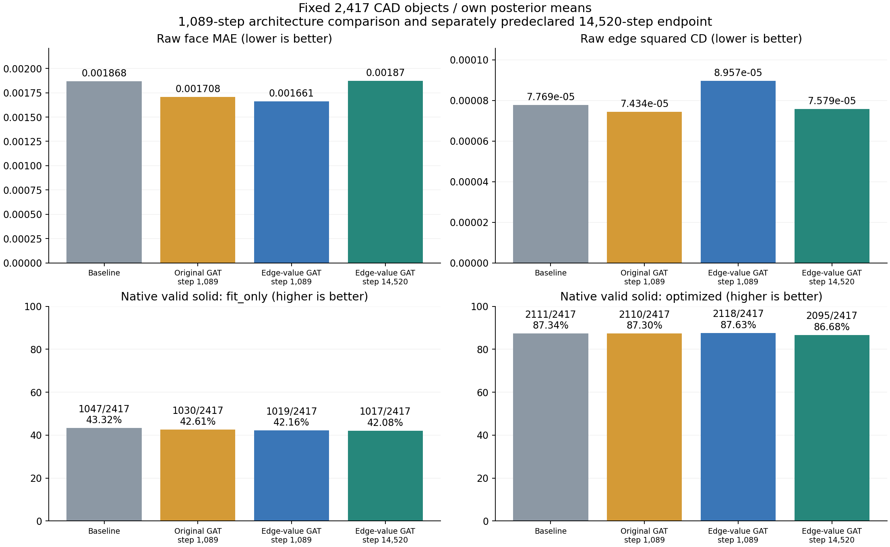

# Encoder 边内容 GAT：固定全集评估与续训记录

本轮新 GAT 的早期验证最优权重有小幅收益，训练终点没有保住这项收益。用户在知悉结果后明确选择从最后权重按原配置继续训练；这项实验决定与当前已测结果分开记录，见 [CONTINUATION.md](CONTINUATION.md)。四权重评估、三组完整失败统计、图表与离线页面均已完成。续训已完成首个完整 epoch 的验证与保存，正在继续运行。

固定accepted 2,417件，原始2,424件中的7件不支持合同单列；所有失败、缺失和超时保留在预定分母。各模型对同一规范CAD分别运行自己的Encoder并取posterior mean，不复用旧latent。Decoder没有GT筛边；存在阈值0.5、FP32推理、后处理算法及预算均与旧评估相同。本报告讨论VAE重建，不是单视图或旧diffusion兼容性结果。

| 权重 | 步数 | 仅拟合合法solid | 优化后合法solid | 优化后比例 |
|---|---:|---:|---:|---:|
| 保留的conditioning基线 | 原训练权重 | 1,047 | 2,111 | 87.34% |
| 原GAT全量解冻对照 | 1,089 | 1,030 | 2,110 | 87.30% |
| 新边内容GAT，验证最优 | 1,089 | 1,019 | **2,118** | **87.63%** |
| 新边内容GAT，最后保存 | 14,520 | 1,017 | **2,095** | **86.68%** |

这里的合法solid为原生`TopAbs_SOLID`加`BRepCheck_Analyzer`，不使用success.txt代替。原GAT与新GAT的1,089步权重均按共同验证窗口中的最小validation总loss选择，匹配训练曝光。14,520步是预先固定的最后状态补测，没有扫描test选择checkpoint；它没有同14,520步的原GAT对照。

早期新GAT对基线：54件救回、47件退步、2,064件共同成功、252件共同失败，净增7件。对相同步数原GAT：46件救回、38件退步，净增8件。末次新GAT对基线：48件救回、64件退步，净减少16件；对早期新GAT：44件救回、67件退步，净减少23件。小幅净收益伴随不少成败互换，不能描述为普遍、稳定的架构优势。

只拟合的成功率降低而优化后早期略升，说明目前的收益仍依赖与固定几何优化的配合，不能声称模型降低了后处理依赖。个别对象在已验证solid之后的几何测量阶段超时，仍计入相应solid成功数；可计算几何子集另列。

| 原始几何，全集对象均值 | conditioning | 原GAT 1,089 | 新GAT 1,089 | 新GAT 14,520 |
|---|---:|---:|---:|---:|
| 对应面XYZ MAE | 0.00186796 | 0.00170750 | 0.00166054 | 0.00187040 |
| 面采样CD² | 4.06114e-5 | 3.42997e-5 | 3.29658e-5 | 4.10670e-5 |
| 全边采样CD² | 7.76858e-5 | 7.43394e-5 | 8.95716e-5 | 7.57944e-5 |

CD²是离散点两向平方最近距离均值之和，不是CAD的线性tolerance。全边CD还会把不同边的采样混在一起，所以另做同一owner面对的曲线对应比较。

早期新GAT相对原GAT的面MAE再降2.75%、面CD²再降3.89%，提供了超出单纯解冻的正面信号；但全边CD²中位数高5.74%，只有901/2,417件的全边CD改善。三方共同GT有向owner pair覆盖141,114/141,320个pair及全部2,417件；在这些相同pair上，新GAT对原GAT的owner曲线CD²均值低7.33%，中位数却高5.80%，仅875件改善。均值与多数对象的方向并不一致。

一个具体尾部样本解释了不少均值变化：`00335203`在早期新GAT中漏掉面0和面6之间的一条边，两方向存在概率均约0.143，导致GT→预测的距离很大。这一件贡献了早期对基线全集边CD均值增量的118.5%；其余对象合计抵消了一部分。末次权重将该边概率提升至0.992并找回边，单件又贡献了末次对早期边CD均值下降的102.69%。主指标始终保留全部对象，没有删除这个样本。因此末次edge均值下降15.38%不能读成普遍精度提升；与此同时面MAE比早期增加12.64%，面CD²增加24.57%。

按相同owner pair检查还确认，尾部并非全是漏边：`00256640`三模型邻接均全对，但一个对应曲线pair的CD²均约0.426–0.428；`00772578`既有多漏边，也有已对应曲线的明显退化。详细分布、top1%贡献、owner覆盖与逐件记录见 [diagnostics.json](diagnostics.json) 和 [endpoint_diagnostics.json](endpoint_diagnostics.json)。

训练曲线需要保留两层解释。重新解冻Encoder/posterior后，KL重新贡献约0.0033，总validation与旧冻结版本不直接同口径；边feature的监督目标也随edge Encoder训练移动。完整训练前5与后5个epoch均值中，部分XYZ几何项改善、feature对齐项变差，不能只凭总loss上升断言全部几何恶化。但独立下游评估已经确认：最终14,520步的面几何和solid较早期权重退步。源码、checkpoint状态及完整数值曲线见 [TRAINING_AUDIT.md](TRAINING_AUDIT.md)。

失败分析沿用四阈值、正/负/未知、四组中文图及离线逐件页面：早期新GAT299件失败及54件救回；原GAT307件失败及51件救回；末次新GAT322件失败及48件救回。每组都有同ID基线侧，另检查仅拟合合法但优化后失败的路径。各组的失败分母不同，跨组标签百分比不能直接解释为因果改善。

| 末次权重的失败证据 | 确认件数 / 322 | 未知件数 |
|---|---:|---:|
| 原始无向面连接完全正确 | 240 | 0 |
| 周期替换后仍有边面贴合偏差，阈值0.006 | 308 | 0 |
| 选边后相邻端点仍对不上 | 293 | 3 |
| 孪生半边差异相对GT超限 | 272 | 6 |
| 某次所有候选环闭合并接纳，面仍裁不出来 | 186 | 0 |

上述观察可以重叠。末次322件失败的互斥末端阻断为：53件面没有做齐、264件进入拼接仍未得到solid、5件候选实体未通过保存检查。64件由基线成功转为失败的样本中，51件的面连接依旧完全正确；29件新增了“候选环闭合接纳后面仍失败”的现象，44件新增只属于一个面的自由边现象。这些是同ID阶段证据，不等于把唯一原因定位到了某个block。

边面贴合依然是高频问题，但末次48件救回样本中也有46件超过同一0.006阈值。因此不能仅凭贴合告警频率，把全部退步归咎于投影loss不足。少量漏边可以主导全边距离均值，而大多数最终失败仍在邻接正确时发生；两类问题都需要保留。

完整统计与四图：[末次14,520步报告](../failure_census_20261015/endpoint_14520_comparison/REPORT.md)、[末次离线页面](../failure_census_20261015/endpoint_14520_comparison/page/standalone.html)、[早期1,089步报告](../failure_census_20261015/REPORT.md)、[原GAT对照报告](../failure_census_20261015/control_comparison/REPORT.md)。

本轮推理/指标/后处理相关64项测试、失败统计35项测试及续训12项测试通过；真实两模型各2件smoke通过。主比较4,834份新原始预测逐份通过实际CAD来源、posterior字节摘要、checkpoint及协议核验，全部post记录终态。独立复核重算四组raw与八组post的固定2,417件统计，并核验终点汇总21个来源SHA，见 [final_numeric_review.json](validation/final_numeric_review.json)。生产后处理11个源码文件与历史基线一致；验证记录见 [main_validation.json](validation/main_validation.json) 和 [baseline_algorithm_audit.json](baseline_algorithm_audit.json)。

三组失败分析共2,162条双侧轨迹，全部复现原终态与STEP DATA，重放未知为0。每组普通页面与离线页面均通过4组样本×4阈值、四张图和390px窄屏检查；六项浏览器检查无脚本/资源错误，离线页面无外部请求。各组`completion.json`与`independent_review.json`记录完整核验范围。

续训从归档的14,520步末次权重恢复同一run，累计预算29,040步／80 epochs，模型、学习率、loss与优化器参数组保持原配置。2026-10-15 13:44 UTC核验：8 GPU已完成epoch40，step14,883的`val/loss=0.0420773`及`last.ckpt`保存成功，已进入epoch41。启动时一次`val/loss`尚不存在的checkpoint警告未在首轮验证后重复；训练、验证与保存均正常。两份已评估候选权重独立归档并验证SHA，原W&B run延续；见 [resume_validation.json](../validation/resume_validation.json)。这是续训恢复成功的验证，不代表新增预算已经完成。

主要复现入口：`run_evaluation.py inference|metrics|post`，终点补充为`run_endpoint.py`相同阶段；总表脚本为`summarize_results.py`及`summarize_endpoint.py`。既有输出目录拒绝覆盖，重现时需新的明确输出根。续训前的两份候选权重已按原SHA归档，入口脚本后续使用归档路径，原始调用元数据不改写；路径映射见 [CONTINUATION.md](CONTINUATION.md)。完整冻结协议见 [PLAN.md](PLAN.md)。
