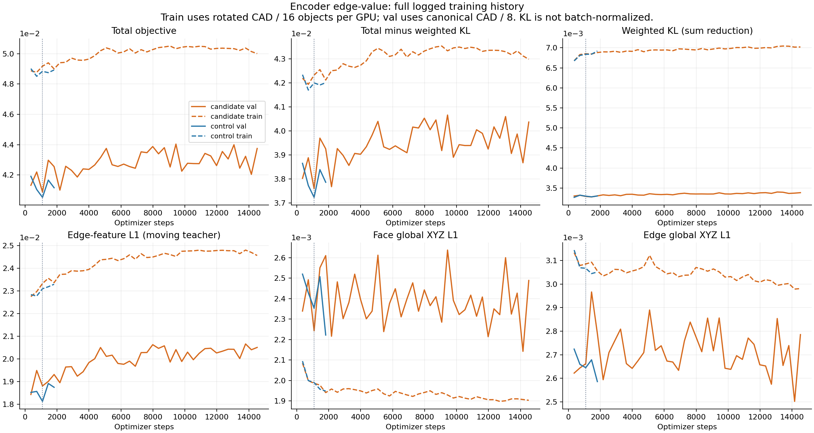
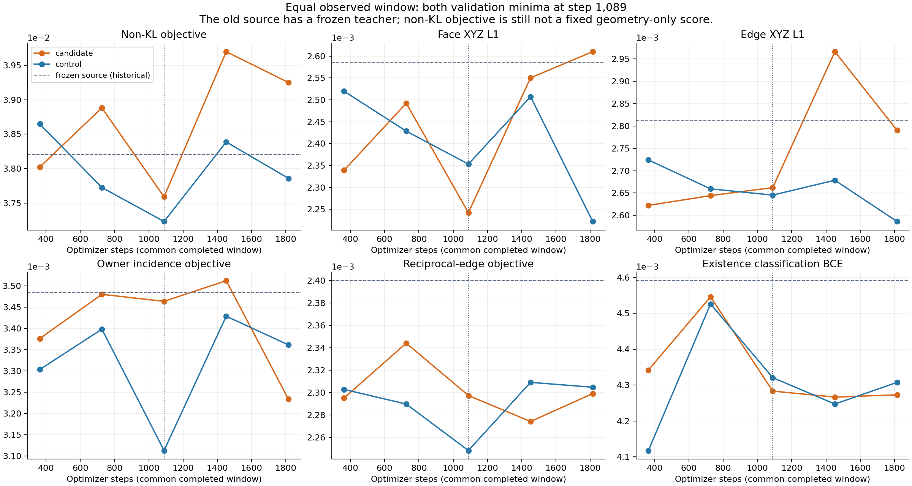
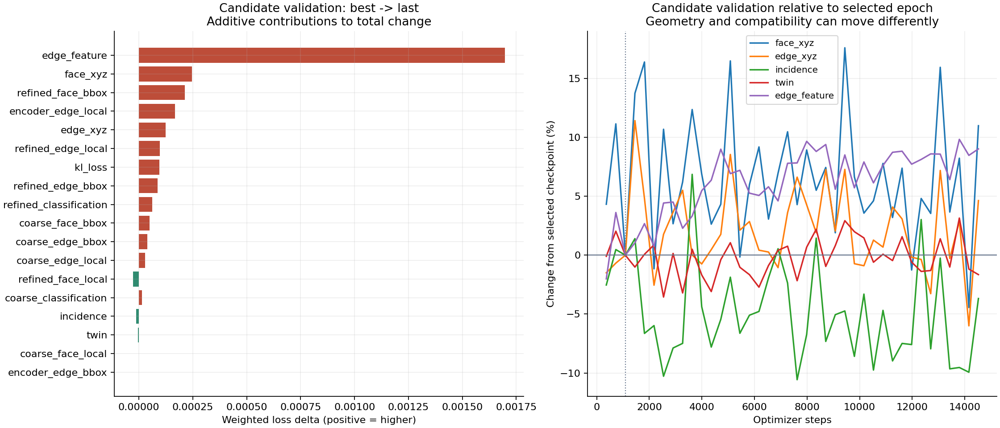

# Encoder 边内容消息：训练审计

按 [PLAN](PLAN.md) 只用 validation 选择权重，以下尚不是下游 solid 结果。所有曲线来自本地 W&B 数值流，不从截图估读。

候选已完成 **14,520 步 / 40 epoch**，随后启动的原 GAT 解冻对照被中断；对照最后完整保存 **1,815 步 / 5 epoch**。停止时 console 到 epoch5 的20/363 batch，没有包含这些额外步的 checkpoint，因此不能把这20个 batch 宣称为可恢复状态。

两组恰好都在 **epoch2 / step1,089** 达到各自已观察 validation 最优，且也是共同 **1,815步** 窗口的最优。本轮用这两个权重比较，checkpoint 训练曝光相同；完整运行预算不同，不据此声称完成了原定两组14,520步实验。

| 模型 | selected step | val total | weighted KL | total−KL | last saved step / val total |
|---|---:|---:|---:|---:|---:|
| 原 conditioning（冻结 Encoder） | 57354 | 0.03820358 | 0.00000000 | 0.03820358 | 历史源 |
| 原 GAT 解冻对照 | 1089 | 0.04052605 | 0.00329572 | 0.03723034 | 1815 / 0.04115958 |
| 边内容消息候选 | 1089 | 0.04087760 | 0.00328869 | 0.03758891 | 14520 / 0.04375051 |

两组解冻后恢复了原 KL 项，旧冻结模型的 weighted KL 为0，因此总 loss 不能直接横比。KL 本身按每卡 packed face×32 维 **sum×1e−6**；训练每卡16件、验证每卡8件，又有旋转增强差别，不能把 train/val 总值落差直接称为过拟合。即使减去 KL，仍含指向随训练变化的 edge CNN teacher 的 feature L1，不是固定几何误差。

| 验证指标（raw） | 冻结源 | 原 GAT 解冻 | 边内容消息 | 候选对对照 | 候选 last |
|---|---:|---:|---:|---:|---:|
| edge_feature | 0.01820486 | 0.01813140 | 0.01881318 | +3.76% | 0.02051090 |
| face_xyz | 0.00258563 | 0.00235335 | 0.00224227 | -4.72% | 0.00248877 |
| edge_xyz | 0.00281173 | 0.00264537 | 0.00266215 | +0.63% | 0.00278558 |
| incidence | 0.00348520 | 0.00311255 | 0.00346382 | +11.29% | 0.00333638 |
| twin | 0.00239994 | 0.00224824 | 0.00229735 | +2.18% | 0.00225945 |
| refined_face_local | 0.00210247 | 0.00210973 | 0.00204635 | -3.00% | 0.00201824 |
| refined_face_bbox | 0.00192997 | 0.00171874 | 0.00169084 | -1.62% | 0.00190367 |
| refined_edge_local | 0.00217937 | 0.00221943 | 0.00205192 | -7.55% | 0.00214802 |
| refined_edge_bbox | 0.00255121 | 0.00233183 | 0.00237429 | +1.82% | 0.00246016 |
| refined_classification | 0.00459105 | 0.00432092 | 0.00428334 | -0.87% | 0.00489745 |
| encoder_edge_local | 0.00115984 | 0.00128451 | 0.00112179 | -12.67% | 0.00128991 |
| encoder_edge_bbox | 0.00132117 | 0.00130141 | 0.00145359 | +11.69% | 0.00145366 |
| refined_precision | 0.99781686 | 0.99806327 | 0.99803716 | -0.00% | 0.99814081 |
| refined_recall | 0.99914861 | 0.99913085 | 0.99918908 | +0.01% | 0.99904495 |

候选 best→last 总值增加约0.002873，其中 KL 增加约0.000095；edge-feature 项增加约0.001698。这一对端点中 face/edge XYZ 升高，incidence 与 twin 略降。但 early-best 本身经过选择，不能将这一对端点当成验证几何持续退化的证据。

用前5个与后5个完整 epoch 均值检查整体趋势：

| 候选指标 | train 后5/前5变化 | val 后5/前5变化 |
|---|---:|---:|
| loss | +2.39% | +2.64% |
| non_kl_objective | +2.27% | +2.65% |
| edge_feature | +6.47% | +7.32% |
| face_xyz | -4.57% | -2.06% |
| edge_xyz | -3.17% | -1.10% |
| incidence | -4.17% | -5.23% |
| twin | -2.79% | -0.06% |

窗口均值下，验证面/边 XYZ 仍有小幅改善，而总 loss 和 edge-feature loss 上升。因此当前证据更直接指向 **特征对齐项与几何目标的变化不一致**，尚不能称为整体几何过拟合。edge CNN 现在会训练，teacher 的坐标系/尺度也可能改变；这是解释假说，实际 feature 分布和梯度冲突未在此审计中测量。也不能凭 feature 项数值大就判断其梯度一定占主导。

local 包含归一化 XYZ 与方向共6通道；bbox 是 center3+scale1。incidence/twin 有 GT 离散采样基线和容差处理，其损失值不是 CAD 最大偏差。分类 precision/recall 是训练日志批次归约，不是整件拓扑全对率。`delta_edge_mean` 是既有 refiner 的特征增量，与新增 GAT value 消息的输出幅度不同。

## 参数与来源

两组旧 Encoder、posterior 和 Decoder 均确实发生参数变化；不能再用旧 latent cache 评价新 Encoder。每件 GT 必须经各自 Encoder 重新计算 posterior mean。旧 diffusion 与新 latent 的语义兼容性没有经过验证。

| 参数组 | tensor数量 | 候选 best 已改变 | 原 GAT best 已改变 | 候选 best 相对L2变动 |
|---|---:|---:|---:|---:|
| model.encoder.face_coords | 47 | 47 | 47 | 0.00661133 |
| model.encoder.edge_coords | 47 | 47 | 47 | 0.0089231 |
| model.encoder.face_attn_proj_in | 2 | 2 | 2 | 0.00637708 |
| model.encoder.face_attn | 98 | 98 | 98 | 0.0124431 |
| model.encoder.face_attn_proj_out | 2 | 2 | 2 | 0.00989212 |
| model.encoder.graph_face_edge | 35 | 35 | 35 | 0.00487347 |
| model.encoder.global_feature1 | 4 | 4 | 4 | 0.0073663 |
| model.encoder.global_feature2 | 4 | 4 | 4 | 0.00741002 |
| model.posterior.projection | 4 | 4 | 4 | 0.00526492 |
| model.decoder.face_features | 100 | 100 | 100 | 0.00805076 |
| model.decoder.face_geometry | 105 | 105 | 105 | 0.00561121 |
| model.decoder.edge_geometry | 111 | 111 | 111 | 0.008191 |
| model.decoder.inter | 149 | 149 | 149 | 0.00957661 |
| model.decoder.classifier | 2 | 2 | 2 | 0.00110574 |
| model.decoder.refiner | 26 | 26 | 26 | 0.00945868 |

候选新增20个 tensor／51,680参数。5层 value MLP 的零初始化末层权重和 bias 在 best 已非零；所有20个 tensor 在 best→last 之间继续改变。这里只报告参数范数，不能由参数范数直接推断实际消息输出或几何位移幅度。

| Value层 | best末层weight L2 | last末层weight L2 | best末层bias L2 |
|---|---:|---:|---:|
| 1 | 0.02857686 | 0.10312885 | 0.00305295 |
| 2 | 0.02330645 | 0.09284285 | 0.00236142 |
| 3 | 0.01755848 | 0.07103316 | 0.00171849 |
| 4 | 0.01606051 | 0.07102889 | 0.00153859 |
| 5 | 0.01672139 | 0.07990326 | 0.00192338 |

源commit `0b145d5d2fe4d0e3140bd114bb1675047093ca97`；两次启动均clean，四个生产模型/训练/数据源码哈希仍一致。相同源 checkpoint、accepted split、seed42、8×16 batch、Adam2e−5、bf16、clip1；没有 scheduler。selected 每组新增139,392次对象呈现（1,089×128），不等于139,392件独立CAD。

- candidate：北京时间 2026-10-15 15:31:14 → 2026-10-15 20:13:34；exit=0；运行状态 completed。
  - selected: `/mnt/d/python_curve_eval/checkpoints/encoder_edge_value/candidate/20261015T073112.923985Z/weights/epoch=0002-step=00001089-val_loss=0.040878.ckpt`
  - SHA256: `d9e911e23a5dfc0e45fb90735a806706c9c89329898f0873df06927c8d2fb62d`
- control：北京时间 2026-10-15 20:13:36 → 2026-10-15 20:50:13；exit=1；运行状态 interrupted。
  - selected: `/mnt/d/python_curve_eval/checkpoints/encoder_edge_value/control/20261015T073112.923985Z/weights/epoch=0002-step=00001089-val_loss=0.040526.ckpt`
  - SHA256: `f1de7f11fee749e51921e0fb45d32ae7b6b7d7899316b248560bab4501d6c279`

全数值、所有完整训练/验证epoch、top-k保留、源码/输入哈希和参数统计见 [training_audit.json](training_audit.json)。复现：`/mnt/d/anaconda3/envs/torch/bin/python checkpoints/encoder_edge_value/evaluation_20261015/build_training_audit.py`。
