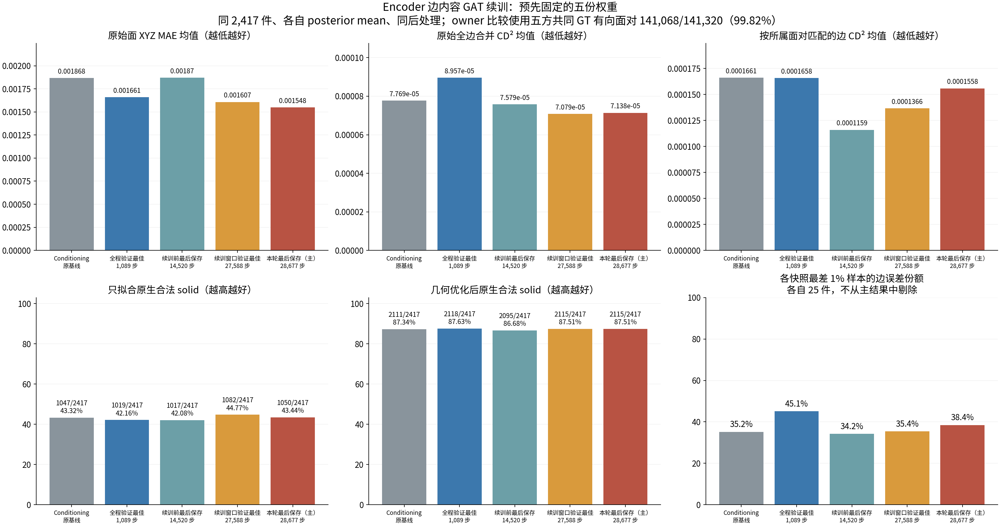
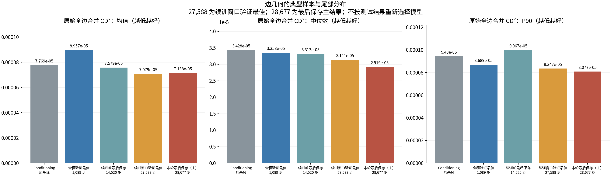

# Encoder 边内容 GAT 续训：固定全集测试

本次续训改善了原始面／边几何，但合法 solid 数只从续训前的2,095恢复到2,115，仍未超过早期验证最佳的2,118。两份预先固定的新权重最终均为2,115/2,417，不能把几何改善直接称为实体有效性突破。主评估、完整失败统计、独立数值复核和普通／离线页面检查均已完成。

本轮使用相同2,417件accepted CAD；原2,424件中的7件不支持合同仍单列。每个模型由自己的Encoder编码当前CAD，测试使用posterior mean，Decoder不使用GT筛边。FP32、阈值0.5、仅拟合与几何优化协议均与前轮相同；生产模型、指标公式和后处理代码没有修改。这是VAE重建结果，不是照片条件或diffusion结果。

## 固定权重与有效性

续训正常退出，但Lightning恢复后的epoch计数先触发80轮上限，实际最后保存28,677步，比计划29,040少363步。本次按实际快照测试，没有补训。主结果是最后完整权重28,677；补充结果是在本次续训窗口内validation总loss最低的27,588。全程validation最佳仍是1,089，两个新checkpoint都在查看test结果前固定，未按test换模型。详见[训练审计](TRAINING_AUDIT.md)。

| 权重 | 仅拟合合法solid | 优化后合法solid / 2,417 | 优化后比例 |
|---|---:|---:|---:|
| conditioning原基线 | 1,047 | 2,111 | 87.34% |
| 新GAT全程验证最佳，1,089步 | 1,019 | 2,118 | 87.63% |
| 续训前最后保存，14,520步 | 1,017 | 2,095 | 86.68% |
| 续训窗口验证最佳，27,588步 | **1,082** | **2,115** | **87.51%** |
| 本轮最后保存，28,677步 | **1,050** | **2,115** | **87.51%** |

合法solid必须同时满足原生`TopAbs_SOLID`类型与`BRepCheck_Analyzer`，不以success marker或兼容检查替代。所有失败与超时保留在固定分母。

最后权重相对基线：53件救回、49件退步、2,062共同成功、253共同失败，净增4件。相对续训前14,520：63件救回、43件退步，净增20件。相对早期1,089：54件救回、57件退步，净减少3件。

两份新权重虽然成功数相同，成功集合不同：从27,588到28,677，38件救回、38件退步，2,077件共同成功、264件共同失败。27,588的仅拟合表现更好，最终优化后的总数却持平，仍有明显的模型几何与固定后处理之间的交互。

## 原始几何改善覆盖了多数对象

| 全集指标 | 原基线 | 1,089步 | 14,520步 | 27,588步 | 28,677步 |
|---|---:|---:|---:|---:|---:|
| 对应面XYZ MAE均值 | 0.00186796 | 0.00166054 | 0.00187040 | 0.00160712 | **0.00154805** |
| 面CD²均值 | 4.06114e-5 | 3.29658e-5 | 4.10670e-5 | 3.10480e-5 | **2.88358e-5** |
| 全边合并CD²均值 | 7.76858e-5 | 8.95716e-5 | 7.57944e-5 | **7.07872e-5** | 7.13802e-5 |
| 全边合并CD²中位数 | 3.42813e-5 | 3.35320e-5 | 3.31310e-5 | 3.14069e-5 | **2.91946e-5** |
| 全边合并CD² P90 | 9.42996e-5 | 8.68881e-5 | 9.96698e-5 | 8.34653e-5 | **8.07728e-5** |

CD²为采样点双向平方最近距离均值之和，不是线性CAD公差，也不能保证连续几何最大误差小于1e-3或1e-4。

28,677相对基线：面MAE均值下降17.13%，2,127/2,417件改善；面CD²均值下降29.00%；边CD²均值下降8.12%，中位数下降14.84%，P90下降14.34%，1,654件改善。相对1,089，面MAE还低6.77%，边中位数低12.93%，分别1,587和1,684件改善。因此这次原始几何收益不只来自单个极端样本。

但尾部仍须单列。28,677边误差最差25件占全集误差38.45%，高于基线35.17%；对1,089的边CD²均值改善，约77.58%仍来自旧漏边样本`00335203`的恢复。主指标没有移除这些对象。

## 同一所属面对的边仍有局部严重偏移

五份权重共同存在的GT有向面对为141,068/141,320（99.82%），覆盖全部2,417件。在同一组面对上比较曲线，避免全边合并CD用其他边的点掩盖对应错误；漏边和额外边另计。最后权重漏164个GT有向pair、额外364个，不能把共同pair上的误差当作包含漏边的总指标。

最后权重相对基线，owner曲线CD²均值下降6.19%、中位数下降14.19%，1,671件改善。但相对续训前14,520，虽然中位数低11.38%、1,622件改善，均值却高34.41%。这个反向均值主要来自`00936203`：它贡献了owner均值净增量的96.36%。其面对(2,5)的GT曲线在z约−0.70至−0.68，28,677预测到了z约+0.74至+0.75；并非只是很小的tolerance偏差。同对象的另一方向也偏到上侧。原始数组经独立SciPy KDTree检查，见[尾部复核](validation/owner_tail_review.json)。这展示了“两条半边相互接近”和“位于正确边界”之间的区别，不据此断定具体损失项导致该错误。

无向面连接整件完全正确数：基线2,321、1,089步2,318、14,520步2,322、27,588步2,320、28,677步2,319。几何收益并未伴随明显的邻接全对率提高。

后处理几何也不是所有参照上都同向：最后权重与基线共同可测的2,228件中，face/edge CD均值分别下降5.76%/5.13%；与14,520共同可测的2,229件中，edge CD中位数下降11.67%，均值却上升10.94%。这些集合不只包含合法solid，且不同配对的集合不同，不跨集合直接解释均值差异。

## 失败分析与核验

两新权重各有302件失败。最后权重完整诊断302失败+53救回，共355个ID；27,588完整诊断302失败+51救回，共353个ID。每个ID都有同侧conditioning对照，另对全部fit-only合法但optimized失败对象做路径对照。

| 失败件中的观察 | 27,588步 / 302 | 28,677步 / 302 |
|---|---:|---:|
| 原始无向面邻接完全正确 | 217 | 217 |
| 独立拟合后边面贴合偏差 > 0.006 | 293 | 292 |
| 周期替换后边面贴合偏差 > 0.006 | 289 | 289 |
| 两份半边比GT更不一致 | 273（未知5） | 277（未知5） |
| 选边后端点仍对不齐 | 272（未知3） | 276（未知4） |
| 拼接时仍有自由边 | 242 | 236 |
| 某次全部候选环闭合并接纳，面仍失败 | 175 | 177 |
| 面做出来，但舍弃部分边界 | 124 | 118 |

这些观察可重叠，未知保留在302分母中；贴合阈值是固定采样的归一化长度，不是CAD公差保证。最后权重的互斥末端为49件面未做齐、246件拼接后非实体、7件保存检查拒绝。27,588则为47、246、7，以及2件保存检查通过但重读不是合法实体。

贴合偏差并不是失败的充分条件：最后权重53件救回中也有45件超阈值。更具体的成对变化是：相对conditioning基线，49件新失败中“全部闭环仍无法构面”新增22、消失1；53件救回中该观察消失20、新增2。丢弃边界在新失败中新增18，在救回中消失15。它们将问题定位到边界与曲面的联合可裁剪性，但不证明某一loss或某个OCC错误码是唯一原因。

相对14,520的259件持续失败都有双侧轨迹：边面贴合告警消失7、新增2；“全部闭环仍无法构面”却消失12、新增22。其他成败组的旧轨迹只覆盖部分对象，明确记未知。不能用不同checkpoint各自失败集的百分比代替这种同ID比较，详见[时间对照](../failure_census_20261016/temporal_REPORT.md)。

两组各有四张中文图、阈值筛选、逐件详情和自包含离线页：[最后权重完整失败分析](../failure_census_20261016/last/REPORT.md)、[27,588完整失败分析](../failure_census_20261016/resume_best/REPORT.md)、[全部交付入口](../failure_census_20261016/README.md)。失败轨迹与原终态及STEP DATA一致，独立复核共158,592项主观察判断、2,576项fit路径判断；两组1,416条双侧轨迹全部核验，原资产未变。四次浏览器检查各遍历16个分组／阈值组合，检查逐件跳转、四图、390px布局，无脚本或资源错误；离线版屏蔽HTTP/HTTPS且无外部请求。

两份新权重均成功导出2,417件原始预测，四组post全部终态。来源审计核验14,536份输入文件、实际posterior字节摘要、CAD源、checkpoint、split与原始/后处理对应；19份评估相关源码和11份生产post源码与既有审计版本一致。独立数值复核重算五快照、两种post模式、七组配对、尾部贡献及135组原NPZ owner抽样，12,537项检查通过。见[主验证](validation/main_validation.json)与[独立数值复核](validation/final_numeric_review.json)。

每个新checkpoint的8 GPU推理监督耗时约60秒，含启动和至多30秒轮询间隔。32个单线程CPU worker下，仅拟合／优化后两模式的实际墙钟耗时分别为：最后权重324／502秒，27,588权重231／401秒；各模式有并行调度，不能相加当总墙钟。最后权重仅拟合两件在几何测量阶段超时，此前已判为非法solid；优化后一件`00821433`也在测量阶段超时，但此前已确认合法solid，仍计入2,115成功数。27,588两模式无超时；所有超时均保留且没有重跑筛选。

本次没有同28k步数的原GAT对照，因此能确认的是当前模型续训后的几何进展，不能把全部收益因果归于新增边内容消息。当前结果支持保留这些权重作为几何改善的证据，同时尚不支持宣称solid有效性突破；本轮没有再次启动训练。

复现入口为本目录`run_evaluation.py`、`summarize_results.py`和`validate_results.py`，固定协议见[PLAN](PLAN.md)。完整`diagnostics.json`含重复逐件清单，仅保留本地；版本管理中的[紧凑数值](compact_summary.json)由`export_compact_summary.py`原样复制统计值，将超过30项的列表替换为数量及内容SHA，不重新计算指标。运行数据与权重保留本地、历史产物只读，新推理与汇总拒绝覆盖既有输出。两份新权重已以SHA文件名独立归档。
