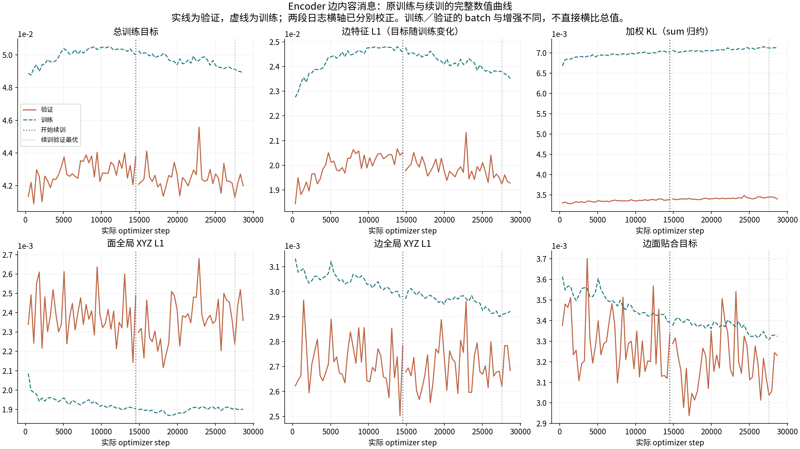

# Encoder 边内容消息：续训结束审计

协议见 [PLAN](PLAN.md)。本审计只解释训练状态和验证曲线；模型是否更好由固定测试集的几何与 solid 结果判断。

**训练正常退出，但没有完成 29,040 步预算。实际最后保存 28,677 步／epoch78，续训增加 14,157 步，即 39 个完整训练轮次。** 退出原因是 Lightning 的 `max_epochs=80` 先触发；不是 OOM、数据耗尽或用户停止。本轮只测试，不补训。

北京时间 2026-10-15T21:35:42.817569+08:00 → 2026-10-16T02:09:38.102160+08:00；进程 exit code 0，runner 正确保留 `incomplete`。

| 权重身份 | optimizer step | epoch 标签 | validation total |
|---|---:|---:|---:|
| 全程验证最优（原训练，已有测试） | 1,089 | 2 | 0.04087760 |
| 续训起点（已有测试） | 14,520 | 39 | 0.04375051 |
| 续训窗口验证最优（补充测试） | 27,588 | 75 | 0.04126333 |
| 实际最后权重（主测试） | 28,677 | 78 | 0.04198423 |

27,588 只在这次续训窗口内最优，尚未超过全程 1,089 的最优值。两份新权重在测试前按此规则固定，均完整报告；不根据 test 再挑权重。

## 少一轮的直接证据

本地版本为 PyTorch Lightning 2.5.0.post0。恢复的旧 checkpoint 已完成 40×363 次优化，但保存时 `epoch_progress` 为 ready/started/processed=40、completed=39。续训先执行旧轮末尾的恢复/收尾流程，`processed` 比实际完整轮数多计一次。最后 checkpoint 为 ready/started=79、completed=78、processed=80；优化器计数和训练 batch 数均为 28,677，即 79×363。

安装源码 `fit_loop.py:187` 用 `epoch_progress.current.processed` 判断 epoch 上限，`on_advance_end()` 的行462会增加此计数。日志明确写 `Trainer.fit stopped: max_epochs=80 reached`，且真实训练只有 epoch40…78。源码恢复路径与 checkpoint 计数共同说明，这是轮末恢复的计数问题；没有证据表明丢了一个已经执行的优化 epoch。

同一源码行431也用 `processed` 设置 DistributedSampler 的 epoch，因而计数偏差可能影响 shuffle 编号。未逐 batch 回放采样序列，不能声称续训与不中断训练逐步等价；这不影响对已保存快照的固定输入测试。

启动时 `ModelCheckpoint` 曾在首个新 batch 前提示缺少 `val/loss`，仅一次；随后39个完整验证和保存正常。`_batches_that_stepped` 也比优化器计数多1，因此原 W&B 流是 logged step+1=optimizer step，续训流则 logged step=optimizer step。曲线按各自偏移校正，并用 checkpoint 中真实 optimizer 计数验证。

## 验证变化

| 指标 | 14,520 | 27,588 | 28,677 | 续训前5轮→后5轮均值 |
|---|---:|---:|---:|---:|
| loss | 0.04375051 | 0.04126333 | 0.04198423 | -1.47% |
| weighted_kl_loss | 0.00338337 | 0.00344324 | 0.00339671 | +1.16% |
| non_kl_objective | 0.04036713 | 0.03782009 | 0.03858752 | -1.70% |
| edge_feature | 0.02051090 | 0.01922806 | 0.01927969 | -3.40% |
| face_xyz | 0.00248877 | 0.00223644 | 0.00235966 | +3.39% |
| edge_xyz | 0.00278558 | 0.00261902 | 0.00268390 | +1.33% |
| incidence | 0.00333638 | 0.00303659 | 0.00323124 | -1.73% |
| twin | 0.00225945 | 0.00230843 | 0.00233028 | +0.24% |
| refined_face_local | 0.00201824 | 0.00191292 | 0.00201801 | -1.77% |
| refined_face_bbox | 0.00190367 | 0.00171736 | 0.00180269 | +4.86% |
| refined_edge_local | 0.00214802 | 0.00207400 | 0.00218237 | -1.28% |
| refined_edge_bbox | 0.00246016 | 0.00232093 | 0.00237838 | +0.71% |
| refined_classification | 0.00489745 | 0.00435061 | 0.00422117 | -2.82% |

续训窗口中，feature L1 和边面贴合目标下降；前后5轮均值的面／边全局 XYZ 分别上升约3.39%／1.33%。但实际最后权重相对偏差较大的14,520端点仍有所改善。这两个说法对应不同参照，不矛盾；不能把单个噪声较大的端点或总 loss 当作整体精度结论。

训练与验证的 KL 均按 packed face×32维求和，batch 分别16和8，训练还做旋转增强；总 loss 不宜直接横比。edge-feature teacher 随解冻 Encoder 一起改变，即使扣除 KL，仍不是固定几何目标。模型验证使用 posterior 采样，本次几何测试使用各 checkpoint 自己的 posterior mean。



## 配置、参数与数据

原配置与实际续训配置仅4项不同：清空组件初始化、设置完整resume路径、步数上限14,520→29,040、轮数上限40→80。架构、loss、Adam学习率2e−5、optimizer参数组、8×16 batch、bf16、seed42、数据split和增强保持原配置。四个生产模型／训练／数据文件与原训练commit `0b145d5d` 字节一致。

两段全部数值日志未发现 NaN/Inf；最后模型756个state tensor与优化器756个parameter state均有限，未发现损坏权重。参数变化只说明训练在更新模型，不代表下游效果。训练、验证、测试split哈希仍一致，未做重分割。

## 权重归档与可复核数据

- last: `/mnt/d/python_curve_eval/checkpoints/encoder_edge_value/candidate/20261015T073112.923985Z/weights/evaluated_snapshots/040c05a45dd7edae825f2e6dd8e2cb3489a418146f9a7b2122cc54d38070618c.ckpt`
  - 原文件 `/mnt/d/python_curve_eval/checkpoints/encoder_edge_value/candidate/20261015T073112.923985Z/weights/last.ckpt`
  - SHA256 `040c05a45dd7edae825f2e6dd8e2cb3489a418146f9a7b2122cc54d38070618c`；独立 copy2，源文件与历史metadata未修改。
- resume_best: `/mnt/d/python_curve_eval/checkpoints/encoder_edge_value/candidate/20261015T073112.923985Z/weights/evaluated_snapshots/e1e579e7bc6bdf64b3c078d6b5414e33630222de989b180ca8f3eb22b59c6ccf.ckpt`
  - 原文件 `/mnt/d/python_curve_eval/checkpoints/encoder_edge_value/candidate/20261015T073112.923985Z/weights/epoch=0075-step=00027588-val_loss=0.041263.ckpt`
  - SHA256 `e1e579e7bc6bdf64b3c078d6b5414e33630222de989b180ca8f3eb22b59c6ccf`；独立 copy2，源文件与历史metadata未修改。

[training_audit.json](training_audit.json) 包含两段完整 train/val epoch、选择依据、配置差异、源码与输入摘要、归档映射和参数变化。任务脚本复用昨日审计的读取／哈希／参数比较函数；复现命令：

```bash
/mnt/d/anaconda3/envs/torch/bin/python /mnt/d/python_curve_eval/checkpoints/encoder_edge_value/evaluation_20261016/build_training_audit.py
```
