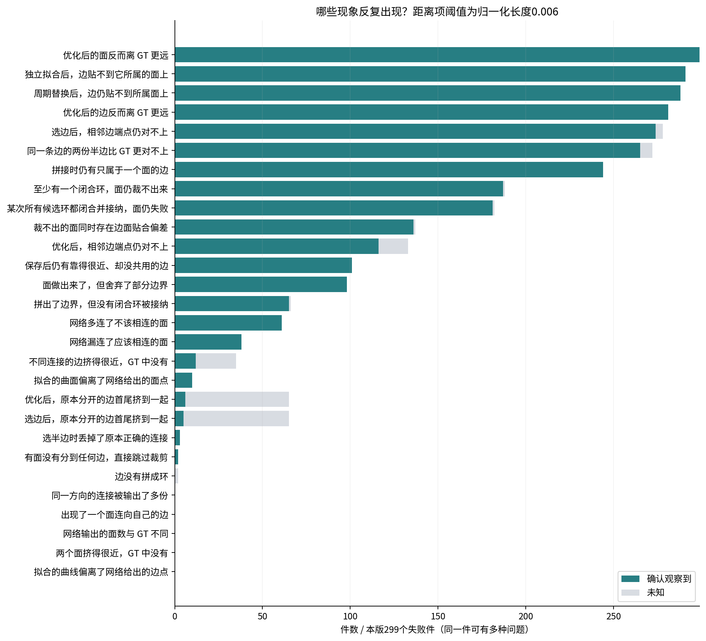
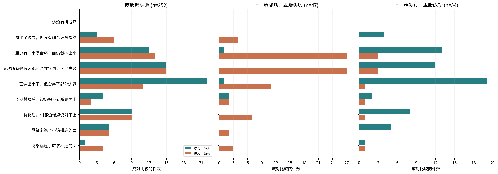
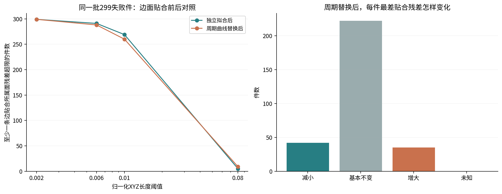
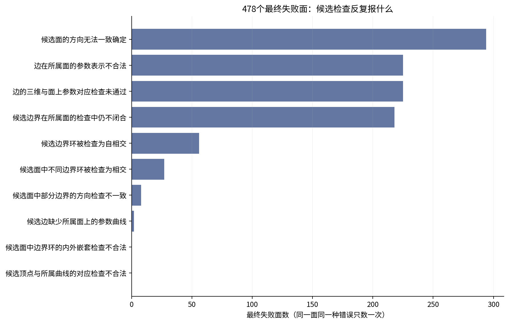

# Encoder 边内容消息：与曲线条件调制的失败对照

本版失败299件：持续失败252件，退步47件；另有54件救回。固定2417件中合法实体由2111变为2118。
失败件中，原始无向面连接完全正确有219件。某次全部候选环均闭合并接纳，面仍裁不出来有181件；该项未知1件。
阈值0.006下，本版失败件中288件在周期替换后仍观察到边面贴合偏差（未知0件）；救回组也有49/54件出现该观察。超阈值不是失败的充分条件。
本版存在13件fit-only成功而优化后失败，均纳入完整路径对照；比较的是整体路径，不是某个loss的因果消融。

[交互统计页面](page/index.html) · [紧凑统计](compact_summary.json) · [逐件CSV](cases.csv) · [冻结协议](PLAN.md)

本版失败轨迹完整一致 299/299。各行是可重叠观察，未知保留分母；阈值0.006为归一化长度。

## 常见观察

| 观察 | 确认 / 299 | 未知 |
|---|---:|---:|
| 优化后的面反而离 GT 更远 | 299 | 0 |
| 独立拟合后，边贴不到它所属的面上 | 291 | 0 |
| 周期替换后，边仍贴不到所属面上 | 288 | 0 |
| 优化后的边反而离 GT 更远 | 281 | 0 |
| 选边后，相邻边端点仍对不上 | 274 | 4 |
| 同一条边的两份半边比 GT 更对不上 | 265 | 7 |
| 拼接时仍有只属于一个面的边 | 244 | 0 |
| 至少有一个闭合环，面仍裁不出来 | 187 | 1 |
| 某次所有候选环都闭合并接纳，面仍失败 | 181 | 1 |
| 裁不出的面同时存在边面贴合偏差 | 136 | 1 |
| 优化后，相邻边端点仍对不上 | 116 | 17 |
| 保存后仍有靠得很近、却没共用的边 | 101 | 0 |
| 面做出来了，但舍弃了部分边界 | 98 | 0 |
| 拼出了边界，但没有闭合环被接纳 | 65 | 1 |
| 网络多连了不该相连的面 | 61 | 0 |
| 网络漏连了应该相连的面 | 38 | 0 |
| 不同连接的边挤得很近，GT 中没有 | 12 | 23 |
| 拟合的曲面偏离了网络给出的面点 | 10 | 0 |
| 优化后，原本分开的边首尾挤到一起 | 6 | 59 |
| 选边后，原本分开的边首尾挤到一起 | 5 | 60 |
| 选半边时丢掉了原本正确的连接 | 3 | 0 |
| 有面没有分到任何边，直接跳过裁剪 | 2 | 0 |
| 边没有拼成环 | 0 | 2 |
| 同一方向的连接被输出了多份 | 0 | 0 |
| 出现了一个面连向自己的边 | 0 | 0 |
| 网络输出的面数与 GT 不同 | 0 | 0 |
| 两个面挤得很近，GT 中没有 | 0 | 0 |
| 拟合的曲线偏离了网络给出的边点 | 0 | 0 |

## 最终阻断与最早观察

| 最终阶段 | 件数 |
|---|---:|
| 面没做齐，未进入实体拼接 | 50 |
| 进入拼接后仍未得到实体 | 247 |
| 拼出了候选实体，但保存检查没通过 | 1 |
| 保存检查通过，重读却不是合法实体 | 1 |
| 重放一致，但末端分支未细分 | 0 |
| 原结果已知，失败路径暂时无法核验 | 0 |

| 最早已观察到的位置 | 件数 | 更早阶段有缺测 |
|---|---:|---:|
| 网络输出时已观察到异常 | 274 | 0 |
| 半边选择时首次观察到异常 | 0 | 0 |
| 选择后的几何首先暴露偏差 | 19 | 0 |
| 优化阶段首次观察到偏差 | 6 | 0 |
| 独立拟合阶段首次观察到偏差 | 0 | 0 |
| 周期替换后首次观察到贴合偏差 | 0 | 0 |
| 裁剪阶段首次观察到阻断或丢边界 | 0 | 0 |
| 拼接/保存后首次观察到不共边 | 0 | 0 |
| 缺测且尚无确认异常 | 0 | 0 |
| 现有目录未确认异常 | 0 | 0 |

最早取得证据的位置不等于错误最早发生的位置；末端阻断也不等于唯一根因。

## 相同ID的成对变化

| 分组 | 件数 | 上一版完整重放 | 本版完整重放 |
|---|---:|---:|---:|
| 两版都失败 | 252 | 252 | 252 |
| 上一版成功、本版失败 | 47 | 47 | 47 |
| 上一版失败、本版成功 | 54 | 54 | 54 |

**两版都失败，n=252**

| 观察 | 原有→新无 | 原无→新有 | 两边都有 | 两边都无 | 未知 |
|---|---:|---:|---:|---:|---:|
| 网络多连了不该相连的面 | 5 | 5 | 53 | 189 | 0 |
| 网络漏连了应该相连的面 | 1 | 4 | 30 | 217 | 0 |
| 边没有拼成环 | 0 | 0 | 0 | 251 | 1 |
| 拼出了边界，但没有闭合环被接纳 | 3 | 6 | 55 | 188 | 0 |
| 某次所有候选环都闭合并接纳，面仍失败 | 15 | 15 | 138 | 83 | 1 |
| 面做出来了，但舍弃了部分边界 | 22 | 11 | 75 | 144 | 0 |
| 周期替换后，边仍贴不到所属面上 | 4 | 2 | 242 | 4 | 0 |
| 优化后，相邻边端点仍对不上 | 9 | 9 | 93 | 124 | 17 |

**上一版成功、本版失败，n=47**

| 观察 | 原有→新无 | 原无→新有 | 两边都有 | 两边都无 | 未知 |
|---|---:|---:|---:|---:|---:|
| 网络多连了不该相连的面 | 0 | 2 | 1 | 44 | 0 |
| 网络漏连了应该相连的面 | 0 | 3 | 1 | 43 | 0 |
| 边没有拼成环 | 0 | 0 | 0 | 46 | 1 |
| 拼出了边界，但没有闭合环被接纳 | 0 | 4 | 0 | 42 | 1 |
| 某次所有候选环都闭合并接纳，面仍失败 | 0 | 27 | 0 | 19 | 1 |
| 面做出来了，但舍弃了部分边界 | 1 | 11 | 1 | 34 | 0 |
| 周期替换后，边仍贴不到所属面上 | 2 | 2 | 42 | 1 | 0 |
| 优化后，相邻边端点仍对不上 | 0 | 7 | 4 | 33 | 3 |

**上一版失败、本版成功，n=54**

| 观察 | 原有→新无 | 原无→新有 | 两边都有 | 两边都无 | 未知 |
|---|---:|---:|---:|---:|---:|
| 网络多连了不该相连的面 | 5 | 0 | 6 | 43 | 0 |
| 网络漏连了应该相连的面 | 1 | 1 | 0 | 52 | 0 |
| 边没有拼成环 | 0 | 0 | 0 | 54 | 0 |
| 拼出了边界，但没有闭合环被接纳 | 4 | 0 | 0 | 50 | 0 |
| 某次所有候选环都闭合并接纳，面仍失败 | 12 | 3 | 1 | 38 | 0 |
| 面做出来了，但舍弃了部分边界 | 20 | 1 | 4 | 29 | 0 |
| 周期替换后，边仍贴不到所属面上 | 2 | 1 | 48 | 3 | 0 |
| 优化后，相邻边端点仍对不上 | 8 | 1 | 4 | 33 | 8 |

## 独立拟合与周期替换后的贴合

| 阈值 | 独立拟合后：确认 / 未知 | 周期替换后：确认 / 未知 |
|---|---:|---:|
| 0.002 | 299 / 0 | 299 / 0 |
| 0.006 | 291 / 0 | 288 / 0 |
| 0.01 | 269 / 0 | 260 / 0 |
| 0.08 | 5 / 0 | 9 / 0 |

同一边/所属面且两阶段测量完整时，对象最大残差下降42、增大35、基本不变222件；其余0件未知。周期替换可能改变参数域，不能解释为同一空间采样点的运动。

## 最终失败面的候选检查

| 通俗描述 / 原始错误名 | 面数 | 自身 / 上下文 | 件数 / 未知 |
|---|---:|---:|---:|
| 候选面的方向无法一致确定 / `BRepCheck_UnorientableShape` | 294 | 294 / 0 | 185 / 42 |
| 边在所属面的参数表示不合法 / `BRepCheck_InvalidCurveOnSurface` | 225 | 0 / 225 | 141 / 46 |
| 边的三维与面上参数对应检查未通过 / `BRepCheck_InvalidSameParameterFlag` | 225 | 0 / 225 | 141 / 46 |
| 候选边界在所属面的检查中仍不闭合 / `BRepCheck_NotClosed` | 218 | 0 / 218 | 144 / 58 |
| 候选边界环被检查为自相交 / `BRepCheck_SelfIntersectingWire` | 56 | 56 / 56 | 36 / 53 |
| 候选面中不同边界环被检查为相交 / `BRepCheck_IntersectingWires` | 27 | 27 / 0 | 24 / 59 |
| 候选面中部分边界的方向检查不一致 / `BRepCheck_BadOrientationOfSubshape` | 8 | 8 / 0 | 8 / 65 |
| 候选边缺少所属面上的参数曲线 / `BRepCheck_NoCurveOnSurface` | 2 | 0 / 2 | 2 / 65 |
| 候选面中边界环的内外嵌套检查不合法 / `BRepCheck_InvalidImbricationOfWires` | 0 | 0 / 0 | 0 / 66 |
| 候选顶点与所属曲线的对应检查不合法 / `BRepCheck_InvalidPointOnCurve` | 0 | 0 / 0 | 0 / 66 |

同一最终失败面同种错误跨容差去重。没有候选可检查或检查不完整，不能称为检查通过。

## fit-only成功、优化后失败

| ID | fit重放一致 | optimized重放一致 | 相同raw | 选择后面/边/连接相同 | 优化后阻断 |
|---|---|---|---|---|---|
| 00007551 | True | True | True | 是/是/是 | 进入拼接后仍未得到实体 |
| 00021937 | True | True | True | 是/是/是 | 进入拼接后仍未得到实体 |
| 00160940 | True | True | True | 是/是/是 | 面没做齐，未进入实体拼接 |
| 00381705 | True | True | True | 是/是/是 | 进入拼接后仍未得到实体 |
| 00468543 | True | True | True | 是/是/是 | 进入拼接后仍未得到实体 |
| 00551214 | True | True | True | 是/是/是 | 进入拼接后仍未得到实体 |
| 00617241 | True | True | True | 是/是/是 | 进入拼接后仍未得到实体 |
| 00794230 | True | True | True | 是/是/是 | 进入拼接后仍未得到实体 |
| 00798773 | True | True | True | 是/是/是 | 面没做齐，未进入实体拼接 |
| 00827871 | True | True | True | 是/是/是 | 进入拼接后仍未得到实体 |
| 00869029 | True | True | True | 是/是/是 | 进入拼接后仍未得到实体 |
| 00922203 | True | True | True | 是/是/是 | 保存检查通过，重读却不是合法实体 |
| 00928617 | True | True | True | 是/是/是 | 面没做齐，未进入实体拼接 |

相同原输入的fit-only与optimized完整路径比较；后续拟合/裁剪也会变化，不是单一优化loss因果消融。

[完整反事实路径](optimization_regressions.json)

## 图表

本版299失败件的多标签观察；灰色为未知，留白为确认未观察到。标签可以重叠。距离项阈值0.006。

相同ID的标签变化；各组分母见标题。任一侧未知不画成消失或出现；完整未知和稳定计数在页面及JSON中。

独立拟合与周期替换后的边面贴合对照。左图按阈值统计超限件；右图只在两阶段全部边/owner采样完整且对应一致时统计对象最大值变化。

只数最终仍失败的面，合并候选自身及所属上下文错误；同一面同一错误跨容差去重。未构造候选/未检查/检查不完整另列，不能称作唯一UV根因。

## 来源与解释边界

复用已有conditioned诊断319件，新增baseline对照34件；来源资产检查5537个，变化0个。

- 主分母只含本版失败；救回对照按结果选择，不代表全部成功件。接受集2417，原始2424中7件合同不支持。
- 同一ID的观察变化不等于因果改善；任何一侧未知都不算标签消失。多标签可以重叠，不能相加为失败总数。
- 只在原终态、STEP DATA精确一致且没有观测错误时采用阶段轨迹；缺测保留原分母。
- 边面距离是固定采样的归一化XYZ长度，不是毫米、Hausdorff距离或可裁剪性的证明。
- 面级错误只统计最终失败的decoder面；候选自身与所属上下文去重合并，OCC错误码不是唯一根因。
- 本页相对conditioned同时改变Encoder/posterior解冻、KL参与训练及微调曝光；新值消息的结构判断须另看同曝光原GAT对照，不能把全部差异归于消息MLP。
- 原HoLa的50件3D图库只作历史参考，页面不将其视作本版几何。
- 两侧核验相同CAD来源与GT面顺序，各自Encoder产生各自posterior mean；不要求latent相同，也不证明旧latent cache/diffusion兼容，不代表照片重建结果。
