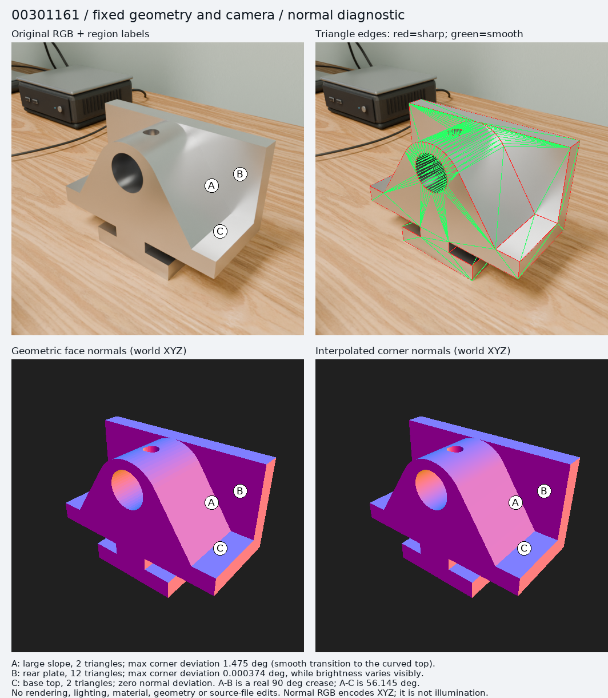

# 2026-10-29：三角形明暗分区的只读法线检查

**结论：00301161 原图存在明显明暗分区，但“异常 STL 三角法线造成这些区域”的解释没有成立。** 看起来像同一块曲面的右侧实际上包含大斜面 A、后方竖板 B 和底板 C。A–B 是 90° 真实折边，A–C 是 56.145° 真实折边，不能通过平滑法线抹去。B 的法线基本严格恒定，原图仍有显著明暗渐变，因此至少这部分变化不来自三角法线插值。照明／金属反射的具体贡献由独立 light-group 工作进一步判断。



## 方法与溯源

- 输入为 `/mnt/d/data/cad_scene_enhancements/lut_sweep_20261029_001/request.json` 中三件 STL，以及 `raw/office/<model_id>/metadata.json`、`rgb.png`、`mask.png`。
- `render_cases.py` 先保存 `raw/office/prepared_scene.blend`，再逐个导入零件；该 blend 本身不是每件零件的最终场景。本检查使用 request 指定的冻结 `source/pipeline/step3/part.py` 在 Blender 5.2.2 LTS 中重建同一导入结果，不假称读取了原始渲染时已保存的零件 mesh。
- 冻结源码与当前 `packages/cad_scene_factory/step3/part.py` 一致：`use_facet_normal=False`，全部三角形 `use_smooth=True`，按 30° 二面角设置 sharp edges。材质仅有统一 Principled 参数，未接入 bump/normal 节点。
- 三件 STL 的 SHA256 均与原 request 一致，导入顶点／三角数与原 metadata 一致。使用保存的物体矩阵和相机矩阵，以像素中心采样和透视校正插值投影。
- 法线图是 CPU 数值光栅化，RGB 编码世界坐标 XYZ 法线，**不是重新打光的渲染**。投影 mask 与原 mask 仅差 2、0、1 个像素（512² 分辨率），证明图中边界空间对应可靠；极少量边界差异不影响区域结论。
- 没有调用 Cycles、GPU 或 image generation，没有保存／改写输入 blend、STL、原图，没有更改生产代码、光照、材质、相机或几何。Blender 进程限定 `-t 8`。

## 已测结果

| 模型 | 顶点 / 三角形 | sharp edges | >30° 二面角边 | 边界 / 非流形边 | smooth 边角点法线跳变 >0.1° |
|---|---:|---:|---:|---:|---:|
| 00301161 | 223 / 446 | 240 | 240 | 0 / 0 | 0 |
| 00489180 | 294 / 584 | 294 | 294 | 0 / 0 | 0 |
| 00269315 | 204 / 412 | 210 | 210 | 0 / 0 | 0 |

三件均全部 smooth、无 custom normals。顶点焊接正常，没有发现同一 smooth 边两侧着色法线不连续的问题。此处“非流形边为 0”只描述网格邻接，不构成完整几何有效性认证。

00301161 的选定区域，以原图左上角为原点：

| 区域 | 代表像素 (x,y) | 共面三角形 / 可见像素 | 角点法线相对面法线最大偏差 | 可见像素偏差 p50 / p99 |
|---|---|---:|---:|---:|
| A 大斜面 | (350,250) | 2 / 12,553 | 1.474878° | 0.726204° / 1.432816° |
| B 后方竖板 | (400,230) | 12 / 11,858 | 0.000374° | 0.000006° / 0.000107° |
| C 底板上表面 | (365,330) | 2 / 3,952 | 0° | 0° / 0° |

A–B 边投影约为 `(330,182) → (384,300)`，A–C 边为 `(315,362) → (384,300)`。图中红线是 sharp，绿线是 smooth；真正的内部三角对角线不应与真实折边混淆。

A 靠顶部圆弧的角点被相邻曲面平滑约 1.5°，偏移沿大三角插值到平面内部。这是真实存在的着色变化，不能说整块 A 的法线完全恒定；但没有法线断裂，也没有证据把完整明暗分区归因于它。B 的几何法线为 `(0,-1,0)`，在几乎零法线变化下，原图编码亮度 p5/p50/p95 仍为 `0.637 / 0.691 / 0.844`。这些数值是 PNG 上的描述统计，不是线性辐射度或照明能量。

00489180、00269315 的大正面分别包含 121、104 个共面三角形，最大角点偏差只有 `0.000066°`、`0.000080°`。未发现需要修正的同等级三角法线伪影；圆柱／弧段的局部平滑偏移符合当前导入方式。

## 对后续工作的含义

保留现有几何和法线，继续本轮固定场景的分光源分析。不要为了让物体视觉上更“圆滑”而消除 A–B 或 A–C 的真实折边。若将来单独研究 CAD 渲染法线，可比较“解析曲面法线／保留面身份的网格法线”与当前 STL 邻域平均：前者可能更忠实，但需要 CAD 曲面身份，不是本次已验证改进；盲目提高 smooth angle 或全局 weighted normals 不由本次证据支持。

复现命令：

```sh
/mnt/d/natural/blender-5.2.2-linux-x64/blender -b -t 8 \
  --python checkpoints/image_generation/codex_scene_factory/light_mix_20261029/normals/inspect_normals.py -- \
  --request /mnt/d/data/cad_scene_enhancements/lut_sweep_20261029_001/request.json \
  --output checkpoints/image_generation/codex_scene_factory/light_mix_20261029/normals
python checkpoints/image_generation/codex_scene_factory/light_mix_20261029/normals/make_evidence.py
```

`mesh_normals.json` 保存紧凑数值结果及原始 STL 哈希；`*_edges.png`、`*_face_normals.png`、`*_smooth_normals.png`、`*_deviation.png` 保存三件原尺度诊断图。偏差图红色在 10° 饱和，数值精度以 JSON 为准。
