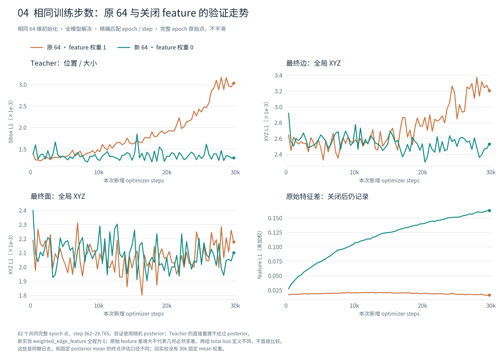
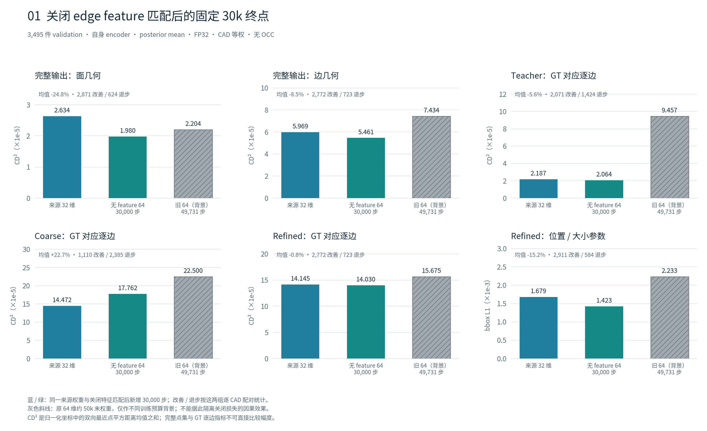

# 关闭edge_feature后，64维联合训练的边几何退化明显缓解

2026-10-24完成检查。**这次消融支持把强制边特征匹配视为原64维训练退化的重要因素；当前证据不足以把主要问题归咎于64维容量或intersection架构本身。** 同期曲线中的teacher位置/尺度持续恶化消失，最终边也恢复改善。coarse中间边和最终边的长尾问题仍然存在，不能宣称整个VAE已经解决。

## 训练与评估状态

142上的训练正常触及30,000步。`last.ckpt`内部global_step=30000、epoch=82，778个state tensor全部有限，Adam状态全部到30000，配置与启动记录完全一致。W&B为finished，tmux退出码0；NCCL/TCPStore警告出现在训练停止之后，属于退出清理阶段的警告证据。北京时间10月24日01:18:50完成日志记录，总训练约13小时28分。

本轮以固定预算的last为主，没有改选28,314步的总loss最佳权重。完整3,495件validation全部成功，199,092条GT有向边，8个独立评估进程均退出0。使用各自encoder、posterior mean、FP32、关闭TF32、无增强、batch1；无OCC修复，不使用test。全量新权重评估约57秒（8卡，含加载/统计；不含训练和准备）。

## 同步数比较：原先的恶化趋势没有重现

新旧64维使用同一初始化和训练协议，训练目标仅feature_weight由1改0。完整W&B历史精确对齐82个epoch，step362–29765；最后29999步的partial epoch单列。下表为25k–30k的14个完整epoch的validation均值，均越低越好。

| 指标 | 原64，匹配权重1 | 新64，匹配权重0 | 变化 |
|---|---:|---:|---:|
| teacher bbox L1 | 0.0028433 | 0.0013491 | **−52.6%** |
| coarse bbox L1 | 0.0040803 | 0.0024281 | −40.5% |
| refined bbox L1 | 0.0030253 | 0.0022301 | −26.3% |
| 最终edge XYZ L1 | 0.0031559 | 0.0025147 | **−20.3%** |
| 最终face XYZ L1 | 0.0021391 | 0.0020650 | −3.5% |
| incidence | 0.0032866 | 0.0026273 | −20.1% |
| KL日志项 | 0.0029657 | 0.0028749 | −3.1% |

训练曲线也支持边几何改善：同期edge XYZ低24.4%、teacher bbox低54.0%；train face XYZ高0.9%，不能说所有训练指标都提升。用前五与末五完整epoch比较，旧64的validation teacher bbox增加135.1%，新64下降7.0%；最终edge XYZ分别增加26.3%和下降7.1%。

新运行的83个train、82个validation分项记录中，weighted_edge_feature全部为0；其他weighted项重算总loss的最大差小于7e-9。raw feature差从约0.027上升到0.163，几何同时改善。它目前是两条特征路径差异的诊断量，不能继续当几何质量的代理指标。取消一项后total loss定义改变，因此不跨实验比较total loss高低。

这些日志使用随机posterior，和下面固定mean的CD²不同。旧64未保留30k权重，不能把约50k的几何评估当成同预算消融。

## 固定mean：最终输出改善，粗边仍有明显缺口

下表比较训练来源32维权重与本轮64维30k终点。mean扩维初始化的近等价已由前期全量诊断验证；这里体现整个新增联合训练的结果，单独关闭匹配的证据来自上面的同期64维对照。CD²为双向最近点平方距离均值之和，CAD等权，单位1e-5，越低越好。

| 指标 | 来源32维 | 无匹配64维30k | 均值变化 | 改善CAD |
|---|---:|---:|---:|---:|
| 最终raw face CD² | 2.634 | 1.980 | **−24.8%** | 2871/3495，82.1% |
| 最终raw edge CD² | 5.969 | 5.461 | **−8.5%** | 2772/3495，79.3% |
| teacher逐边CD² | 2.187 | 2.064 | −5.6% | 2071/3495，59.3% |
| coarse逐边CD² | 14.472 | 17.762 | **+22.7%** | 1110/3495，31.8% |
| refined逐边CD² | 14.145 | 14.030 | −0.8% | 2772/3495，79.3% |

raw使用完整阈值筛选后的预测点集；teacher/coarse/refined逐边指标使用GT对应，两种指标不可跨行比较绝对值。teacher是“真实边→EdgeCNN→共享几何头”的训练辅助路径，不是最终推理输出。

改善覆盖多数CAD：raw edge中位数2.654→1.922（−27.6%）、P90为6.480→4.798（−26.0%）；raw face中位数1.803→1.288，P90为3.915→2.620。仍有723件最终边退步，均值改善小于中位数改善，最终逐边CD²均值仍显著高于其中位数，长尾不能忽略。

图中旧64末权重是49,731步：raw edge CD²为7.434、teacher为9.457，保留作不同预算背景。它们不参与同预算因果结论。当前也不能据此宣布64维必然优于32维，或容量增加本身有效。

拓扑micro precision为99.8203%→99.8003%，recall为99.9005%→99.9116%，F1为99.8604%→99.8559%，整体接近原水平，precision略降。拓扑F1不能代替可裁剪、闭合的OCC solid验收。

## 位置/尺度恢复了什么，仍欠缺什么

相对来源权重，teacher center L1低3.4%、scale L1低2.7%，但local XYZ L1高8.2%，实际半径相对误差高10.2%，尺度指标并非全面改善。在两组都能完整执行平移/正统一缩放对齐的3490件CAD上，teacher对齐残差为0.26790→0.26848（CD²单位1e-5），基本不变。这支持“此前大幅位置/尺度退步得到缓解”，不表示所有局部形状指标都提升。

refined center L1低14.8%、scale低16.2%，实际质心误差低14.2%、半径相对误差低10.0%；local XYZ L1仍高6.1%。coarse center误差则高11.3%，coarse逐边均值、中位数、P90都变差。实际点集对齐后的coarse/refined残差也未全面改善。因此，原始intersection粗边和局部形状仍值得保留为明确问题，不能把final改进解释成每个模块都变好。

GT组件替换与对齐均为oracle诊断，不是可部署修复。它们本轮复用既有分解实现，没有训练新的读出探针。详见[位置/尺度图](figures/02_shape_center_scale.png)、[组件替换图](figures/03_oracle_component_substitution.png)和summary中的共同可对齐子集计数。

特征统计也没有重现旧64后期的明显收缩：teacher跨边centered RMS为1.113→1.153，coarse为1.114→1.201。匹配误差变大、特征差异保留、最终几何改善，可以同时发生；这些统计不等于信息容量测量。

## 研究判断

本轮应保留feature_weight=0作为后续候选基线，不能再默认恢复这个强制匹配。旧decoder-only阶段固定了编码表示，而全解冻阶段两条特征路径及共享读出都可改变；当前结果符合“逐坐标匹配限制了有利的表示调整”的解释。由于没有直接测量各loss的梯度冲突，不能把这一具体机制或detach本身写成已证明的唯一原因。

结论限于seed=42的这一组运行，尚未验证跨seed稳定性；不自动外推为所有VAE或所有特征匹配都无效。

这组证据使优先级更清楚：首先承认训练目标存在实质问题，保留取消匹配带来的收益；架构讨论应针对仍然存在的粗边和长尾几何问题，而不再以“全解冻必然退步”或“64维latent本身不可用”为前提。下一项决定模型能否作为正式候选的下游证据是固定validation协议下的OCC有效性及几何保真，本次没有运行它，也没有自动追加训练或结构实验。

## 核验、产物与复现

- 末权重SHA256：`4262f4998fe047e19c3ca21a835d74c183b7430f7a656c709ec8ed045262ada4`；远端路径见[SPEC](SPEC.md)。
- 网络训练提交7948c1b6；评估时HEAD12724437，网络及远端指标与旧评估一致，新脚本逐文件hash保存在protocol与summary中。本地dirty指标工具没有同步覆盖。
- source32三个真实样本共696项数值核对通过，最大相对差1.825e-5；新模型三个样本的compose、GT底噪及逐边分解检查通过。
- 全量3495个ID恰好一次，199092条边；模型、名单与代码hash跨8片相同。compose误差0，GT归一化底噪最大1.073e-6，新模型分解与逐边CD²最大相对差5.423e-16。
- 旧source raw与分解两轮原有微小FP32差异按原报告复核，未修改历史数字或放宽既定smoke容差。
- 独立从6990行压缩CSV，用标准库重算核心mean/median/P90、均值比及逐CAD改善/退步，全部一致。历史曲线亦离线独立复算通过。

关键文件：[训练审计](training_audit.json)、[历史复算](audit_reproduction_check.json)、[smoke](smoke_validation.json)、[全量核验](execution_validation.json)、[统计复核](summary_verification.json)、[数值汇总](summary.json)、[逐CAD表](per_object.csv.gz)。完整JSONL与分片保留在本地/142，未纳入Git。

在142仓库根目录用原torch环境执行 `launch_evaluation.py --out <新输出目录>` 可复现全量；已有输出拒绝覆盖。`aggregate.py --run <输出目录> --checkpoint-sha256 4262f4998fe047e19c3ca21a835d74c183b7430f7a656c709ec8ed045262ada4 --out <新汇总目录>` 复用旧基线；`plot_report.py --summary <summary.json> --audit <training_audit.json> --output <新图目录>` 绘图。`audit_training.py` 离线检查两份已保存W&B history，`verify_summary.py` 独立检查配对表。

[本轮W&B](https://wandb.ai/whatseven777/hola-brep/runs/8fd1dc1d1023) · [原64维W&B](https://wandb.ai/whatseven777/hola-brep/runs/f45ab7aa6bab)
