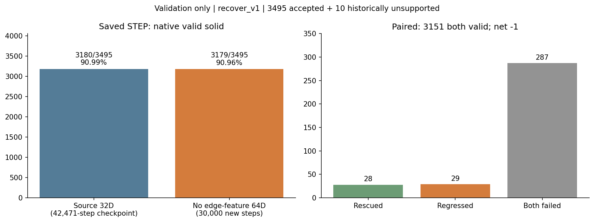
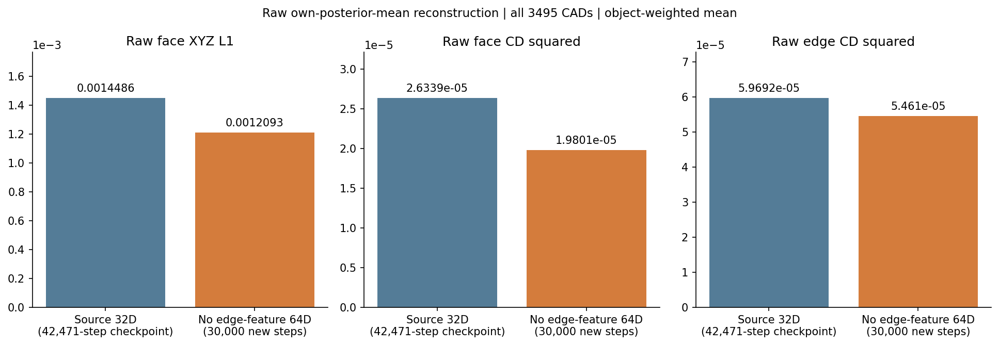
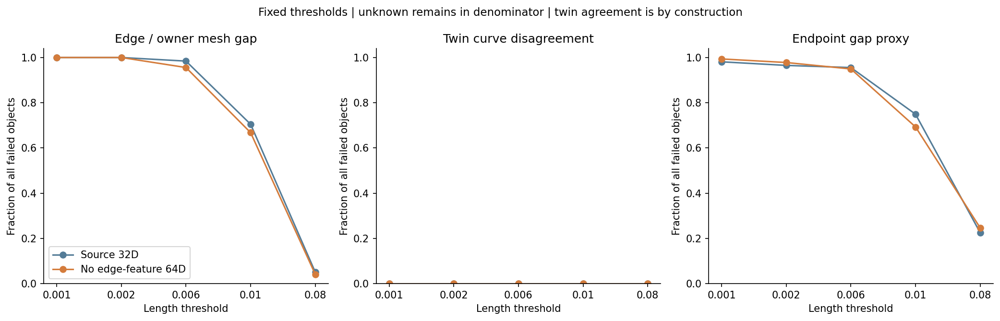
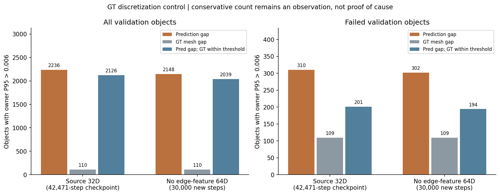
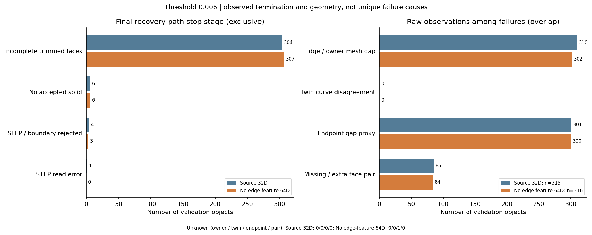
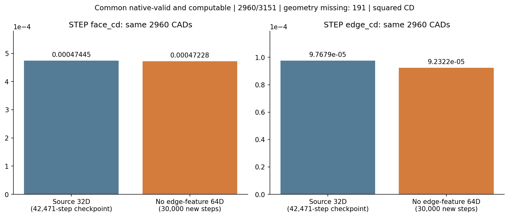

# 关闭 edge_feature 的64维全解冻 VAE：OCC 验证

2026-10-24完成。**固定30k模型得到3179/3495个原生合法solid（90.96%），来源32维模型为3180/3495（90.99%）。救回28件、退步29件，净少1件，合法率基本持平。** 双方共同合法且双方几何可测的2960件中，STEP边CD²均值下降5.48%、面CD²下降0.46%。因此，本轮有几何改善，没有得到合法率提升。

沿用 VAE Branch 的2026-10-20完整分析流程：同一validation清单、同一生产后处理、相同预算，保留失败与缺测。新模型316件失败中307件（97.15%）停在裁剪面阶段，232件失败的无序face-pair集合仍与GT一致。联合边界的可裁剪性仍是需要解决的问题；不能把原始CD改善等同于B-Rep合法性改善。

## 对照与固定协议

| 模型 | 实际权重 | SHA256 |
| --- | --- | --- |
| 来源32D，共享曲线+逐侧UV，encoder冻结 | best42471 | ce749416c1635dda1563161b971bd4260d064cfdb0c31f1fa9d06ad0e70961ff |
| 64D，全解冻，feature_weight=0 | 新run固定last30000 | 4262f4998fe047e19c3ca21a835d74c183b7430f7a656c709ec8ed045262ada4 |

来源权重位于`checkpoints/shared_curve_uv/candidate/20261019T064906.049992Z/weights/epoch=0116-step=00042471-val_loss=0.036517.ckpt`；候选位于142的`checkpoints/latent_expansion/d64_no_edge_feature/20261023T034042Z/weights/last.ckpt`。候选从同一32维来源扩容、另建optimizer训练30000步；不是旧64维后期权重的resume。step属于不同run，不能视为同预算模型比较。

固定3495件DeepCAD validation，清单SHA256为`ae607bfe5499e919d1e68a5110c0c211daf1158aedbe57a4756eda99f6f3f0ed`。原3505件中10件历史合同不支持，继续披露原分母。本轮未使用test，也未按结果选择checkpoint或调整后处理。

新模型在142用自身已训练encoder重新编码同一CAD，posterior mean、identity、FP32、无autocast/TF32、seed42、edge threshold=0.5、不去重面。没有复用32维latent。3495件新旧预测中的CAD SHA与187实际输入逐件相同；新预测回传SHA逐件与142一致。CAD几何与连接是VAE编码输入，decoder不额外读取GT拓扑/UV；这是VAE重建评估，不是照片重建评估。

OCC在187原评估环境运行：PythonOCC7.8.1.1/OCCT7.8.1、PyTorch2.4.1/cu124。142推理环境为PyTorch2.8/cu128。11个生产post文件与旧基线完全相同；实验wrapper只扩展明确的方法身份，未修改算法。固定`recover_v1`、optimized、优化200步/既有自适应上限600、drop_num=0、CPU单线程、32 workers、每件整个子进程180秒（包括几何测量）。没有GT修复或候选选择。

主合法标准：保存STEP后用`read.precision.mode=0`重读，as-read类型为`TopAbs_SOLID`且`BRepCheck`通过。`success.txt`、文件存在、可读、Compound或兼容0.1容差合法均不替代它。

## 合法率与逐对象成败

| 模型 | 原生合法solid | /3495 | /原3505 | 失败 |
| --- | ---: | ---: | ---: | ---: |
| 来源32D | 3180 | 90.99% | 90.73% | 315 |
| 64D，无feature匹配 | 3179 | 90.96% | 90.70% | 316 |

净变化为−1件、−0.0286个百分点。“基本持平”是这份固定集合的描述，不是统计等价性证明。

| 配对变化 | 件数 |
| --- | ---: |
| 共同合法 | 3151 |
| 来源失败→候选合法 | 28 |
| 来源合法→候选失败 | 29 |
| 共同失败 | 287 |
| 合计 | 3495 |

| 覆盖与附加检查 | 来源32D | 候选64D |
| --- | ---: | ---: |
| 导出raw / STEP存在 | 3495 / 3495 | 3495 / 3495 |
| 原生STEP可读 | 3494 | 3495 |
| success标记 | 3180 | 3179 |
| 兼容0.1容差检查合法 | 3174 | 3171 |
| 全部终态 | 3495 | 3495 |

两组各有1件在原生合法确认后，几何测量阶段达到180秒预算；都保留为合法、几何缺测，不重试挑结果。

## 原始几何：平均精度改善，但边界问题仍普遍

下表复用上一轮完整3495件mean诊断，并与本次导出的六项CD分量、面MAE逐件核验。冻结容差为rtol=1e-3、atol=1e-9；面/边CD最大绝对差为7.91e-9/9.00e-9，拓扑TP/FP/FN及边面数量完全相同。

| 全量对象均值，CD² × 10⁻⁵ | 来源32D | 候选64D | 相对变化 |
| --- | ---: | ---: | ---: |
| raw face | 2.633865 | 1.980060 | −24.82% |
| raw edge | 5.969158 | 5.461031 | −8.51% |

沿用同一测量函数和签名，owner间隙是16点预测曲线到owner面450个三角片的距离：每条边—面关系取P95，再取对象最大值。它是网格近似，不是精确CAD曲面距离。端点指标是所属面内其他边端点的连接代理，不证明wire正确；twin使用64点弧长采样到折线的双向P95。

| 全3495件，主阈值0.006 | 来源32D | 候选64D |
| --- | ---: | ---: |
| owner边面网格间隙超阈 | 2236 | 2148 |
| 端点间隙代理超阈 | 3210 | 3043 |
| 端点无法判定 | 0 | 1 |
| twin不一致 | 0 | 0 |
| 无序face pair缺失或额外 | 102 | 98 |
| GT同口径owner间隙超阈 | 110 | 110 |
| 预测owner超阈且同对象GT未超阈 | 2126 | 2039 |
| owner对象最大P95中位数 | 0.006724301 | 0.006671163 |

owner中位数只下降0.79%，P90从0.01250759降至0.01155544。端点超阈减少167件，同时有1件unknown，不能将unknown当作改善。两组twin都为0来自同一共享曲线表示，不是关闭feature匹配带来的新收益。face-pair异常对象减少也不代表所有拓扑指标都提升：此前micro F1为0.998604→0.998559。

固定阈值0.001/0.002/0.006/0.01/0.08未重新挑选；原始异常在OCC成功对象中也很常见，不能直接用单个阈值判定合法性。

## 失败仍主要停在裁剪面

最终恢复路径的停止阶段互斥，加总为失败总数；它描述程序在哪里终止，不证明唯一物理原因。

| 最终停止阶段 | 来源32D | 候选64D |
| --- | ---: | ---: |
| 裁剪面未构造齐 | 304 | 307 |
| 无可接受solid | 6 | 6 |
| STEP重读或边界检查拒绝 | 4 | 3 |
| 原生STEP读取失败 | 1 | 0 |
| 合计 | 315 | 316 |

候选307/316（97.15%）停在裁剪面阶段。失败集合的raw观察允许重叠：

| 失败集合，阈值0.006 | 来源32D（315） | 候选64D（316） |
| --- | ---: | ---: |
| owner间隙超阈 | 310 | 302 |
| 端点代理超阈 | 301 | 300（另1件unknown） |
| face-pair不匹配 | 85 | 84 |
| face-pair集合正确但仍失败 | 230 | 232 |
| GT网格近似也超阈 | 109 | 109 |
| 预测owner超阈且GT未超阈 | 201 | 194 |

29件新增失败中，owner异常反而从28降到23，端点异常仍为27，但face-pair异常从3增到12。28件救回中，face-pair异常从7降到3。这个配对现象说明平均几何改善不能保证每个对象跨过可裁剪、可缝合的条件；也不能把全部退步归于同一个几何代理。GT网格超阈只是采样近似背景，不能解释为GT CAD不合法。

## STEP几何：共同合法集合有改善

共同合法3151件，其中双方几何均可测2960件，缺测191件。下面只比较这2960个相同对象，单位为CD² × 10⁻⁵，越低越好。

| 指标 | 统计 | 同组来源32D | 候选64D |
| --- | --- | ---: | ---: |
| face | 均值 | 47.445010 | 47.227881 |
| face | 中位数 | 39.367427 | 38.820239 |
| face | P90 | 91.314688 | 90.875918 |
| edge | 均值 | 9.767883 | 9.232209 |
| edge | 中位数 | 6.886543 | 6.597124 |
| edge | P90 | 19.711840 | 19.565727 |

面均值下降0.46%，1602/2960件更低；边均值下降5.48%，1607/2960件更低（54.29%）。改善不是所有对象一致发生，也不代表失败或缺测集合达到同样质量。

| 几何覆盖 | 来源32D | 候选64D |
| --- | ---: | ---: |
| 全部几何可测（可含非法实体） | 3308 | 3361 |
| 原生合法且可测 | 3052 | 3099 |
| 原生合法但缺测 | 128 | 80 |
| 合法缺测中的geometry_error / 超时 | 127 / 1 | 79 / 1 |

缺测不从合法率分母删除，也不能假设缺测样本与可测子集同质。另一个“双方可测、不要求合法”的共同集合为3212件，面CD²均值增加2.51%，边下降4.02%；它包含非法实体，不能代替主表。

STEP采样沿用每面1024面积加权mesh点（deflection=.01/angular=.1），每边128原生参数均匀点，退化边用真实顶点；无对齐/缩放，双向最近点平方距离均值之和。raw与STEP的表示及采样方式不同，不能把两个阶段的CD数值或改善百分比直接相减，宣称后处理吞掉了多少收益。

每个合法solid的face/edge/vertex最大存储容差如下。这不是测得的几何误差，也不能据此声称达到某个精度等级。

| 内部最大容差 | 来源32D | 候选64D |
| --- | ---: | ---: |
| 中位数 | 0.005691641 | 0.005712377 |
| P90 | 0.01299012 | 0.01248464 |
| 最大值 | 0.5960777 | 0.2342375 |

## 研究判断

**保留关闭edge_feature是有依据的，但当前不能声称它提高了OCC合法率。** 上一轮与旧64维25–30k同期曲线比较，已看到最终边XYZ及teacher bbox改善；本轮补上了“合法率持平、共同合法STEP边几何改善”的下游证据。

应区分两个问题。第一是解冻后的训练目标是否把几何推坏：去掉强制特征匹配后，64维全解冻在原始面边几何上优于来源32维，因而“全解冻必然退步”或“64维容量本身不行”都缺少支持。第二是输出是否构成能裁剪的联合边界：307件裁剪失败、232件face-pair正确仍失败，说明这项约束没有随平均CD改善而解决。现有结果支持将合法性研究重点放在边面贴合、端点衔接与裁剪边界的一致性上；没有证据要求现在整体推翻encoder/decoder，也没有证据表明继续扩维即可跨过这个瓶颈。

本次OCC比较是来源32D与新64D终点，维度、encoder状态和训练预算不同。旧64D没有保留30k权重，也没有本轮同预算OCC对照，因此不能将所有差异唯一归因于feature loss，更不能据一个seed认定机制已完全证明。本轮未启动任何新训练或修改架构/后处理。

旧VAE Branch已完成的是GT形状与位置/尺度替换、对齐残差诊断；固定边特征后重新训练读出头当时仍是计划。这两者回答不同问题，本轮没有把它们重复列为必须先跑的实验。

## 执行与复查

142的8GPU全量导出45.18秒；187的32CPU worker OCC运行730.91秒（12.18分钟）；8worker原始失败测量325.77秒，与OCC并行。基线后处理为历史结果复用，不能据此比较严格运行速度。

全部3495件预测、终态、输入SHA、checkpoint身份、后处理源码及测量签名已独立核验。6990行两组CSV、配对四格、失败阶段守恒、共同合法且双方可测集合及mean/median/P90均独立重算通过。11个生产post文件在运行期间未改变。

- [固定协议](SPEC.md)
- [导出核验](validation/export_validation.json)、[回传校验](validation/export_transfer_receipt.json)、[三方CAD输入一致性](validation/input_source_identity.json)
- [执行版本与命令](validation/execution_record.json)、[独立raw/结果审计](validation/independent_audit.json)
- [完整汇总](failure_analysis/summary.json)、[逐对象CSV](failure_analysis/samples.csv)（[版本管理的压缩副本](failure_analysis/samples.csv.gz)）、[汇总守恒检查](failure_analysis/aggregate_validation.json)
- [上轮mean与训练曲线报告](../evaluation_20261024/REPORT.md)

原始预测、STEP及逐件运行日志保留在本目录的`raw_predictions/`、`post/`、`metadata/`，不提交Git。图表为六张总体统计图；未按test个例调整规则或挑选版本。
