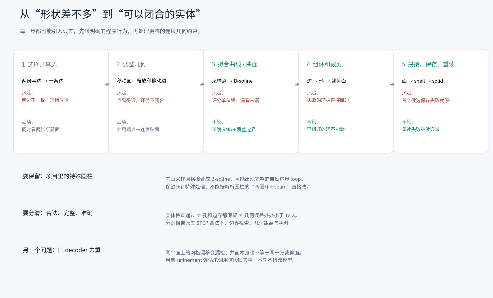
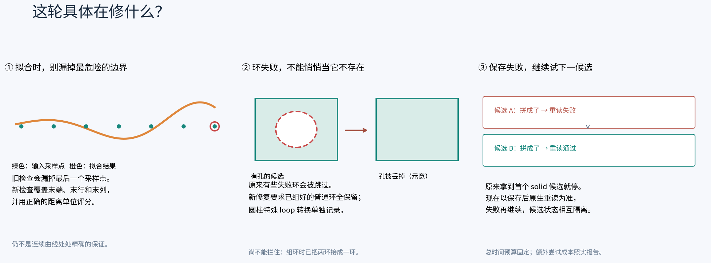

# 后处理：问题、改法与验证

固定最初的 Intersection refinement VAE（epoch 10 / step 3993），只修改从预测采样点到 STEP 的后处理。开发数据为 DeepCAD validation；ABC 未参与本轮。执行口径见 [PLAN](PLAN.md)，完整结果见 [2026-10-16 报告](validation_20261016/REPORT.md)。

已完成3495件、四种策略的全量对照：`recover_v1` 将原生合法 solid 从3076件（88.01%）提高到3147件（90.04%），净增71件，原有合法件无退步。平均每件测得墙钟8.28→9.24秒。新增成功中也存在几何退步、较大内部容差和两件非周期平面边界结构差异，因此保留为显式可选修复策略，不视作1e-3精度认证，也不替换默认旧路径。

随后固定该方案完成[2417件test评估](test_20261016/REPORT.md)：原生合法solid为2111（87.34%）→2155（89.16%），净增44件、零退步，提升1.82个百分点；共同可计算集合的面/边平均CD²均下降。此次只测量test数据，没有按test结果改规则或开展个例失败分析；后续方法设计继续使用validation。

用于周报的[修改动机、源码对应与流程图](weekly_report_20261016/WEEKLY_REPORT.md)已整理，附三张可导出的 PNG／SVG，区分单项实验和最终恢复流程的收益。

随后完成[原始 VAE × 两项模型改进 × 后处理的 2×2 对照](ablation_20261016/REPORT.md)。两项模型改进按用户要求合并为 refinement＋最终曲线 face-pair conditioning；它与上文仅 refinement 的权重分开。统一输入均值后，原模型＋原后处理到改后模型＋新后处理，validation 从2994/3495（85.67%）到3151/3495（90.16%），test 从2052/2417（84.90%）到2161/2417（89.41%）。只换模型、保留原后处理，分别为3066和2114；在改后模型上再换后处理，分别救回85和47件、零旧成功退步。整套组合仍分别有38和21件退步，不能将后处理单独的零退步推广到全部改动。完整四格、原始分母、几何误差与成本见报告，附[改进前后内部 block 图](ablation_20261016/architecture.png)与[合法率图](ablation_20261016/report/native_validity.png)。这是现有训练权重的系统对照，未补做等预算训练的单模块因果消融。

## 当前能确认的问题

下表区分源码行为和待验证的研究方向。一个失败件可能同时出现多个问题，不能把它们当成互斥原因相加。

| 环节 | 用普通话说，哪里可能出问题 | 优化办法与本轮状态 |
|---|---|---|
| 从两份半边选一条共享边 | 同一条边的两份预测不完全一致，选其中一条可能只照顾到一侧的面。不同边很接近时也不能直接当重复。 | 后续候选应同时检查两侧面与相邻端点。本轮保持原选择，避免把模型、选边和 OCC 修复混在一起。 |
| 几何优化的调整范围 | 现在主要移动面、缩放和平移边。边如果局部弯错，仅移动整条边修不好。 | 后续可以小幅调整曲线控制点，约束它仍接近原预测，同时让两张面共用同一条边和同一组端点。先不扩大自由度，避免把曲线越调越怪。 |
| 几何优化的目标 | 最近采样点距离变小，不保证连续曲线贴面，也不保证环闭合、互不相交。当前也没有恢复历史最优参数状态的完整机制。 | 后续将“边同时贴两面”“连接处共用端点”“保留孔和环”直接写入优化；记录真正的最佳状态与移动量。求解器不限于 Gurobi。 |
| 曲线、曲面独立拟合 | 优化的是点，OCC 随后分别拟合曲线和曲面。点靠拢了，拟合后的连续几何仍可能分开。 | 后续针对拟合后的连续曲面检查和修正公共边；同时维护边在两张面上的参数曲线。不能只把三维边投影到其中一张面。 |
| 拟合候选评分 | 旧实现对“距离均值”开平方，不是真正 RMS；评分检查没有覆盖最后一行／列的索引和曲线最后采样点。 | **本轮 F1**：真正 RMS＋最大距离，在原稀疏评分网格加入末端索引，拟合仍使用全部输入点。当前候选检查点最大误差 ≤1e-3 时提前停止，最后仍按总分选候选；因此不是最终检查点或连续几何的误差保证。 |
| 项目特殊圆柱 | 这里是网格拟合的 B-spline，用户观察到自相交面及完整自然 loop。不能当作标准解析圆柱处理。 | **保留**周期边替换、完整自然 wire 特殊处理。新的完整性检查允许并记录这种已知转换。以后改动必须有此类真实样本回归证据。 |
| 边组成环、环裁剪面 | 旧流程有失败的环直接跳过的路径；甚至有面没做出来，仍可能尝试拼实体。得到了实体也可能漏了边界。 | **本轮 B1**：已组好的普通环必须全部接纳，要求面齐全；每次尝试用独立对象，避免前一次修复影响后一次。实测两件对应GT有两个wire的非周期平面，在传入裁剪时已经只有一个wire；数量检查拦不住，也尚未确定差异最初来自预测边还是组环。下一步检查组环前后的连接与分环。 |
| 三维边与面上边界 | OCC 不仅看三维曲线，还检查它在每张面参数空间里怎么走、方向及参数是否一致。三维点看起来贴合仍会失败。 | 后续显式检查、重建 pcurve 和 SameParameter；按错误类型做局部修复。这是几何优化和 PythonOCC 都值得深入的方向，本轮不盲目增加修复函数。 |
| 拼实体与保存 | 旧流程拿到第一个非空 solid 候选就退出；它保存后若失败，后面更合适的候选没有机会。 | **本轮 B1**：候选保存、原生重读并检查后才算成功；失败继续原容差序列。不同候选不共享已被修复修改的 OCC 对象。 |
| 优化也可能伤害少数样本 | 原先失败后的“原始备份”是在优化之后保存，并不是网络最初预测。 | **本轮 B2**：原流程先跑；失败才从不可变原始预测重新尝试 B1、跳过优化的 B1、修正拟合的 B1。每条路径独立，全部共用180秒预算。 |
| 合法性口径 | success.txt、STEP 文件存在、Compound、shell、合法 solid 是不同结果；统一放宽容差会掩盖差距。 | 主结果用保存后原生读取的 TopAbs_SOLID＋BRepCheck。另报兼容0.1口径、内部容差、几何距离和耗时。原生检查仍使用 STEP 内部容差，不等于工程精度达到1e-3。 |
| 更早的 decoder 去重 | 对齐比较16×16网格，可能漏掉同平面漂移；旧函数还有去重后相关数组索引同步的问题。共面也不等于同一张裁剪面。 | 后续先找共面候选，再比较边界与邻接，统一重排全部关联数组。**当前 refinement 评估没有调用旧去重，本轮不修改。** |

## 为什么先这样改

这些修改能检查一个具体判断：现有预测里是否已经有足够好的几何，只是被程序的提前退出、状态互相污染或不完整边界处理浪费了。它们不需要重新训练，也不会扩大 VAE 的表示能力。

其中更严格的边界要求可能降低合法率：旧代码可能靠丢掉一部分边界得到实体。单列 B1 可以暴露这种代价。B2 则保留旧流程已经成功的输出，只对失败件增加修复；所以其收益必须连同额外尝试成本一起报告，不能包装成同等一次尝试下的算法优势。

更难、但可能有较大空间的下一步，是让“曲线在两张连续曲面上走同一条公共边、在端点真正接到一起”成为优化目标。简单增加修复函数或只压低采样点误差，未必能解决这个问题。

## 本轮固定输入

- 原始 validation 3505 件；沿用已记录的合同审核接受3495件，10件拒绝保留在总体分母。
- 原 refinement 权重 SHA256：`9b18509de2a21f50d8fad41b8c37695842fe2e92745dc779713b0ecac06e2107`。
- 固定 CAD identity、posterior mean、FP32、TF32关闭。3495件推理全部成功，8卡墙钟34.94秒。
- 同一份raw预测供所有策略读取；推理清单 SHA256：`6b6fd15bab6d702efc8fa3cadec2f76e2087d57bfcd0913cf0c7504dc155c597`。
- 这是已知CAD的VAE重建：encoder读取输入CAD几何/拓扑并取posterior mean，decoder不读取GT拓扑。后处理和候选选择不读取GT；后处理阶段GT只用于事后几何评估。当前validation此前参与过模型选择，结果属于开发评估。

## 接口

生产入口为 `construct_brep_for_sample(..., post_policy="legacy")`。新策略显式选择 `roundtrip_retry`、`fit_score_v2` 或 `recover_v1`，默认行为保持旧路径。模型、trainer及checkpoint没有修改。

隔离评估沿用 `python -m tools.vae_compare_post`，新增 `--post-policy`；不同策略使用独立comparison root，但只读链接到同一raw根。跨策略报告使用 `python -m tools.postprocess_validation_report`，拒绝不一致的split、输入hash、协议、非终态或缺失记录。
