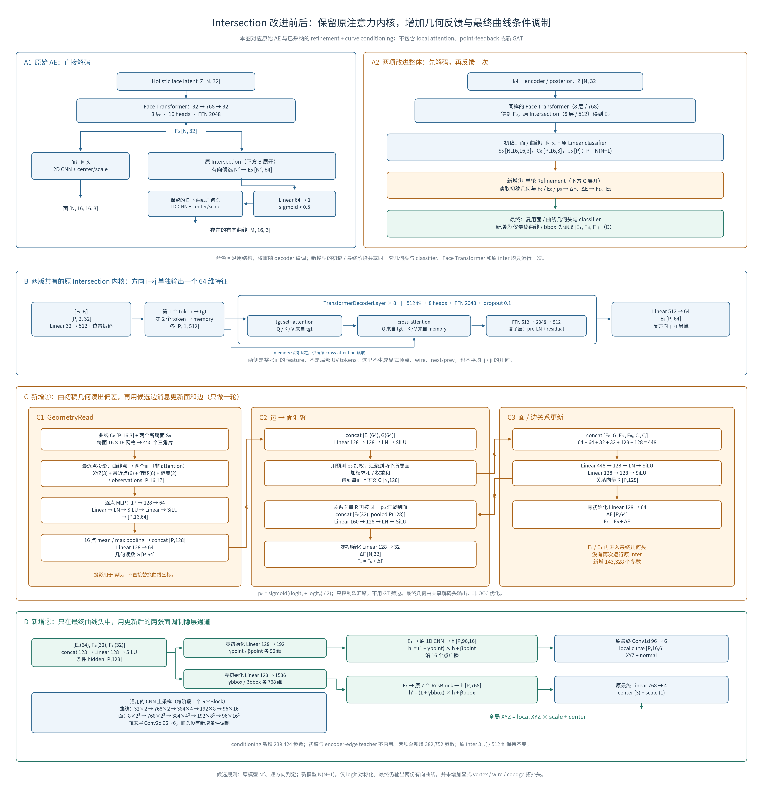

# Intersection 改进前后结构图：核对说明

本图把已保留的单轮 refinement 与最终曲线头 conditioning 视为一个整体。图中的改进模型不包含局部面注意力实验、逐点坐标反馈或 encoder 的 edge-value GAT。

## 周报用四张简图

按用户反馈，将总图拆成四张 16:9 图，只保留改进思路与主要数据流。层数、维度和内部算子留在下方详细图中。每张图均提供 PNG / SVG，另有[四页 PDF](story_figures/intersection_story.pdf)。

| 图 | 要说明的问题 | 下载 |
|---|---|---|
| 1. 改进动机 | 边面不贴合是高频失败现象；沿着边的生成路径，找到 intersection 及后续解码作为改进入口。 | [PNG](story_figures/01_motivation.png) / [SVG](story_figures/01_motivation.svg) |
| 2. 原始结构 | 两个面特征经过成对注意力得到边特征；classifier 判断存在性，曲线 decoder 生成几何。 | [PNG](story_figures/02_original.png) / [SVG](story_figures/02_original.svg) |
| 3. 新增结构 | 保留原结构，加一轮面边几何反馈，并在最终曲线头注入两所属面特征。 | [PNG](story_figures/03_additions.png) / [SVG](story_figures/03_additions.svg) |
| 4. 机制与证据 | 读取几何偏差，再带着所属面信息解码；附原后处理下模型整体的合法率对照。 | [PNG](story_figures/04_mechanism.png) / [SVG](story_figures/04_mechanism.svg) |

图 1 / 4 的面与边是绘制的机制示意，不是真实失败样本或实测位移。投影读出偏差，最终坐标仍由网络解码；并不直接用投影点替换曲线。历史失败观察只作为研究动机，不证明 intersection 是唯一根因；历史统计协议与本轮分开，见[原模型历史失败统计](../../joint_boundary/legacy_failure_census_20261011/REPORT.md)。简图没有新增实验，也不拆分两项模型改进的独立收益。

生成入口：[render_story_figures.py](render_story_figures.py)。PNG 为 2560×1440；SVG 字体转路径，PDF 嵌入字体。图像已渲染并逐张检查。

补充：[新增②条件调制的插入位置](story_figures/05_conditioning_detail.png) / [SVG](story_figures/05_conditioning_detail.svg)。此图单独展开两路隐层调制，不加入上述四页 PDF。输入为 refinement 后的 E、Fᵢ、Fⱼ；两个零初始化输出头分别产生形状分支和中心／尺度分支的 γ、β，作用于最终输出层之前。只有最终曲线头启用，初稿、面头与 classifier 不经过此模块。

## 完整 block 图

[PNG 原图](architecture.png) · [可缩放 SVG](architecture.svg) · [生成脚本](render_architecture.py)

## 权重与结构来源

| 版本 | 实际权重 | 核验结果 |
|---|---|---|
| 原始 AE | `/mnt/d/data/ae_checkpoints/1119_deepcad_aug1_11k.ckpt` | epoch 8499 / step 1045500；704 个 state keys；181,583,229 参数 |
| 两项改进整体 | `/mnt/d/python/checkpoints/intersection_refinement/curve_conditioning/20261013T083729.740439Z/weights/epoch=0157-step=00057354-val_loss=0.038204.ckpt` | epoch 157 / step 57354；736 个 state keys；181,965,981 参数 |

本次以 `torch.load(..., mmap=True)` 读取两份实际 checkpoint，核对 inter 的投影、attention、FFN、classifier、refiner 输出和 conditioning 参数形状。改进权重 SHA-256 为 `4c7910b8169206c74fcf38c358cf171359149e0429c8debbc227d391aa56613f`；来源与冻结 encoder 的逐位核验另见 [已有训练审计](../../intersection_refinement/curve_conditioning/evaluation_20261014/training_audit.json)。

总新增 382,752 参数，其中 refinement 143,328，conditioning 239,424。图中蓝色表示沿用网络结构，不表示微调后的 decoder 权重仍与旧权重相同。新模型内部的 coarse / final 阶段共享几何头及 classifier；face Transformer 与原 inter 均只运行一次。

关键源码：

- [原 inter](../../../src/brepnet/models/blocks.py)：`AttnIntersection`，8 层 TransformerDecoderLayer，512 维、8 heads、FFN 2048。`tgt` 与 `memory` 各只有一个 token；原位置参数形状为 `[1,2,512]`。
- [refinement](../../../src/brepnet/models/blocks.py)：`GeometryRead`、`weighted_incident_mean`、`IntersectionRefiner`。
- [最终曲线调制](../../../src/brepnet/models/blocks.py)：`FacePairConditioning`、`PrimitiveDecoder.forward`、`IntersectionDecoder._decode_stage`。
- [原几何头与旧推理](../../../src/brepnet/models/vae.py)：`_make_face_points_decoder`、`_make_edge_points_decoder`、`_make_bbox_decoder`、`AutoEncoder.decode`。
- [采纳状态依据](../../encoder_edge_value/PLAN.md)：后续 encoder 实验从“已保留的 curve-conditioning checkpoint”开始，并明确不沿用已放弃的 point-feedback。

## 读图时需要保留的细节

1. `N` 是当前对象的面数，`P` 表示当前版本的有向候选数。原模型枚举 `N²`，包括 self pair，逐方向判定存在性后只解码保留曲线；新模型枚举 `N(N−1)`，先解码全部候选供几何读取，再以最终概率筛选导出。新模型只平均 `ij/ji` 的 logits，不平均曲线几何或 edge feature。
2. `GeometryRead` 对每张预测 `16×16` 面网格建立 450 个三角片。最近点投影是对这个分片平面网格的几何计算，不是 attention，也不是对未知光滑 CAD 曲面的精确投影或求交。
3. 最近三角片的离散索引在 `torch.no_grad()` 中选择。随后从仍连接计算图的面坐标取出所选三角片，并重新计算投影。因此梯度能传到曲线点和所选面顶点，但不对三角片索引切换本身求导。没有将整条几何读取通路 detach。
4. 曲线点的 17 维观察经过逐点 MLP，再沿 16 点 mean / max pooling 成一个候选级几何向量。投影坐标被用于读取信息，不直接替换预测曲线坐标。refiner 预测的是特征残差 `ΔF/ΔE`，随后由共享几何头生成坐标。
5. conditioning 只在最终 refined 曲线头启用；coarse 阶段与 encoder-edge teacher 走原几何头。它在最终 `Conv1d(96,6,1)` 和 `Linear(768,4)` **之前**做通道 scale / shift，不是最后 XYZ 的逐点坐标残差。
6. 一个 `ResBlockXD` 内为两层 Linear / Conv，各接 LayerNorm，带 ReLU 与 residual；改变通道数时另有投影 shortcut。图中 CNN 相邻分辨率之间由 kernel/stride 为 2 的转置卷积上采样；每个分辨率阶段一个 ResBlock。bbox 为 7 个 ResBlock，主宽 768。
7. 输出保留既有有向曲线合同。显式 vertex、wire、coedge next/prev 等结构没有作为新增输出。图中的“拓扑相关”作用来自面对候选、预测概率和沿候选的特征汇聚，不能描述成已构造完整 B-Rep 拓扑。

## 结果解释边界

原始 AE、refinement、conditioning 的训练预算并不相等；conditioning 在 refinement 最佳权重之上又微调了 57,354 步。此图展示已评估模型之间的结构差异，不能把 checkpoint 净收益全部归因为某一个 MLP。此前 conditioning 单独比较的合法 solid 为 2113→2111，面几何与部分后处理几何有改善；该历史运行不是本轮统一输入均值的重算，数字不混入当前结果表。本轮整体消融的结果另见主报告，不提前假定每一项都会提高合法率。

图像经实际渲染、字体检查与可视检查；PNG 为 4320×4500，SVG 的字体转为路径，便于周报缩放与跨机器查看。
