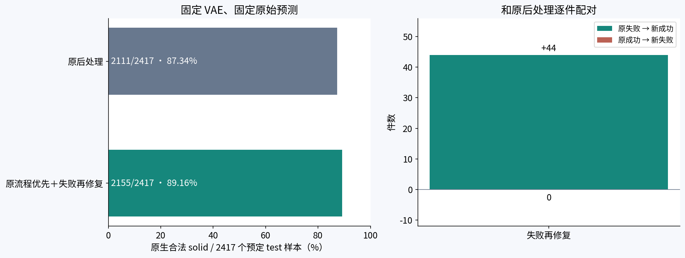

# 固定后处理方案的 DeepCAD test 评估

2026-10-16，已完成。方案在validation确定后冻结，本轮只统计test数据，没有根据test修改模型、规则、容差或候选顺序，也没有开展test个例失败原因分析。

**原生合法solid从2111/2417（87.34%）提高到2155/2417（89.16%）：新增44件、零退步，提升1.82个百分点。** 失败数306→262，减少14.38%。validation上对应提升为2.03个百分点，test上方向一致。



## 合法率与validation并列

| 数据集 | 原后处理legacy | 固定recover_v1 | 提升 | 新增成功 / 原成功退步 |
|---|---:|---:|---:|---:|
| validation，3495件 | 3076（88.01%） | 3147（90.04%） | +2.03个百分点 | 71 / 0 |
| test，2417件 | 2111（87.34%） | 2155（89.16%） | +1.82个百分点 | 44 / 0 |

test沿用此前数据合同审核的accepted清单2417件；原清单2424件中的7件拒绝没有删除或重新挑选，按原始分母计数为**2111/2424（87.09%）→2155/2424（88.90%）**。两边共用同一份原始预测，均完整保留失败样本。

原有2111件成功均由recover_v1的第一条legacy路径保留。44件新增成功的固定路径计数：B1不做几何优化28件、B1保留优化15件、F1+B1保留优化1件。这只是已冻结路径的统计，不据test样本重新设计方案。B2最多4条路径共用180秒总预算，额外尝试的成本另报。

主指标是STEP保存后以原生精度重新读取，为TopAbs_SOLID且通过BRepCheck；不是success.txt或STEP存在。辅助旧0.1容差检查为2111→2152件，不作为主结果，两个检查集合也不保证包含关系。

## 几何数据

共同可计算的2311件，使用与validation完全相同的原生STEP采样及双向平方CD协议，无对齐或缩放：

| 指标 | legacy均值 / 中位数 / P90 | recover_v1均值 / 中位数 / P90 |
|---|---|---|
| face CD² | 6.54404e-4 / 4.02139e-4 / 1.02226e-3 | 6.31162e-4 / 3.95949e-4 / 9.72593e-4 |
| edge CD² | 3.82000e-4 / 1.02418e-4 / 3.06617e-4 | 3.58909e-4 / 1.00640e-4 / 2.94855e-4 |

共同合法且双方几何可计算的2064件，face/edge CD²逐件完全一致。新增44件中，37件可作完整配对：面指标改善35件、退步2件；边指标改善31件、退步6件。另7件无法完整配对，没有当成改善。

这说明合法率提升同时伴随共同可计算集合的平均几何距离改善，但不是每件都改善。CD²是平方距离的均值指标，不是最大误差，也不能当作1e-3工程精度证明。

44件新增成功的最大存储容差中位数0.01138、P90为0.02649、最大0.21641；27件超过0.01、1件超过0.08。这里报告的是OCC文件内部记录的容差，不是实测几何误差。本轮仅汇总数据，没有打开这些test样本作个例分析或重新设阈值；validation已发现的边界完整性限制仍然适用。

## 覆盖与耗时

| 指标 | legacy | recover_v1 |
|---|---:|---:|
| 预定/终态对象数 | 2417 / 2417 | 2417 / 2417 |
| STEP存在且可读取 | 2417 | 2417 |
| 几何可计算 | 2313 | 2315 |
| 几何评估错误 | 104 | 102 |
| 缺失原始预测 / 超时 / 崩溃 | 0 / 0 / 0 | 0 / 0 / 0 |
| 每件总墙钟均值 | 4.90秒 | 6.15秒 |
| 中位数 / P90 | 4.14 / 7.36秒 | 4.20 / 10.90秒 |

两策略同时运行，各32个CPU worker，每进程单线程。上述是本轮并发条件下实测，均值增加约25.6%；不能与validation四策略同时运行时的绝对速度直接比较。后处理整轮墙钟540.80秒，原始预测推理29.57秒。几何评估错误不抹去已经完成的合法性结果，也不改变分母；没有NaN/Inf/负的face或edge指标混入均值。

## 固定条件与核验

- 生产代码冻结于`1fe0ebb854d8db970f5b06646263684d0ae5054e`；后处理和评估runner的12个文件SHA与validation冻结版一致，未修改算法。
- 模型为原Intersection refinement，epoch10 / step3993。checkpoint SHA256：`9b18509de2a21f50d8fad41b8c37695842fe2e92745dc779713b0ecac06e2107`。
- 已知CAD的VAE重建：encoder读取输入CAD几何/拓扑，canonical posterior mean、FP32、TF32关闭、seed42；decoder不读取GT拓扑。后处理不读取GT或按GT选候选，GT只用于事后测量。
- 重新生成本轮raw，不直接沿用历史test分数作为baseline。2417件全部推理成功，raw manifest SHA256：`618da7bb98741afc1ada05db59b729cf7dfafa16a4011f37deb902f48891c9ed`。
- 两策略协议与validation各自对应策略只改变split、分母和输出根。名义优化200步、既有自适应上限600步、drop_num=0、同一容差序列、同一180秒预算；圆柱特殊完整自然loop处理保留。
- accepted test与本项目原始/accepted train、validation均无identity交集，ABC未使用。历史DeepCAD test曾参与研究，本轮冻结测量不能追溯改变这一历史。
- 4834条终态与事件全部精确唯一覆盖；2417份raw、2417份源CAD、2份checkpoint、18个推理/后处理/runner源码哈希、固定候选顺序与预算独立核验通过。
- 仅给已有报告工具增加`--policies`和`--split-label`，18项相关测试通过；内存重算validation全部四策略及两策略子集，与已保存汇总逐字段一致，未覆盖旧结果。

本轮保留validation确定的`recover_v1`结论。下一轮若要设计新的后处理方法，仍回到validation分析和修改；test只用于冻结方案后的数据比较。

## 文件与复现

- [冻结执行协议](PLAN.md)
- [完整汇总](report/summary.json)
- [独立几何/容差汇总](validation/data_audit.json)
- [输入和运行完整性核验](validation/final_integrity_audit.json)
- [原始预测核验](validation/inference_full_validation.json)
- [报告工具验证](validation/report_tool_validation.json)

完整启动命令、代码快照、配置及运行日志保存在本目录`metadata/inference_launch/`、`metadata/post_launch/`；逐件结果在`post_variants/<policy>/metadata/post/optimized/`。运行几何与日志不提交Git。

重新生成汇总图表，不重新运行修复：

```bash
cd /mnt/d/python_curve_eval
OMP_NUM_THREADS=1 OPENBLAS_NUM_THREADS=1 /mnt/d/anaconda3/envs/torch/bin/python \
  -m tools.postprocess_validation_report \
  --run-root checkpoints/postprocess_refinement/test_20261016 \
  --split-list checkpoints/joint_boundary/validation/test_contract_audit/accepted.txt \
  --original-count 2424 --policies legacy recover_v1 --split-label test
```
