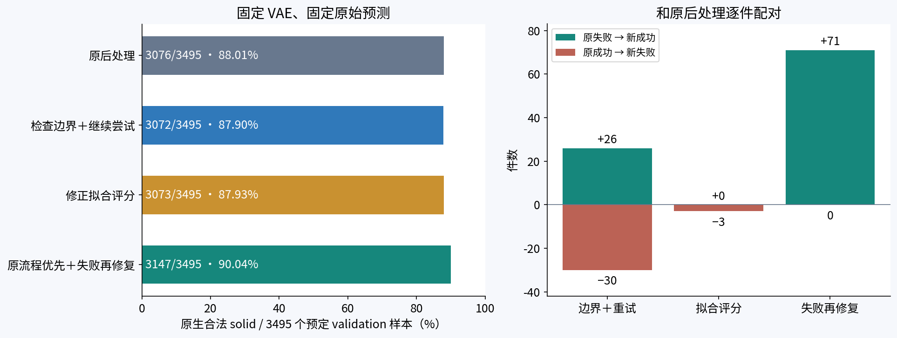
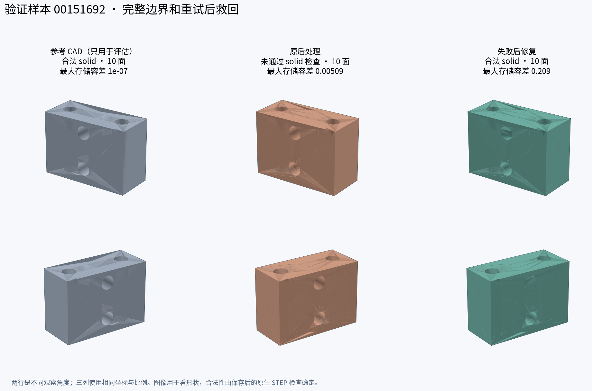
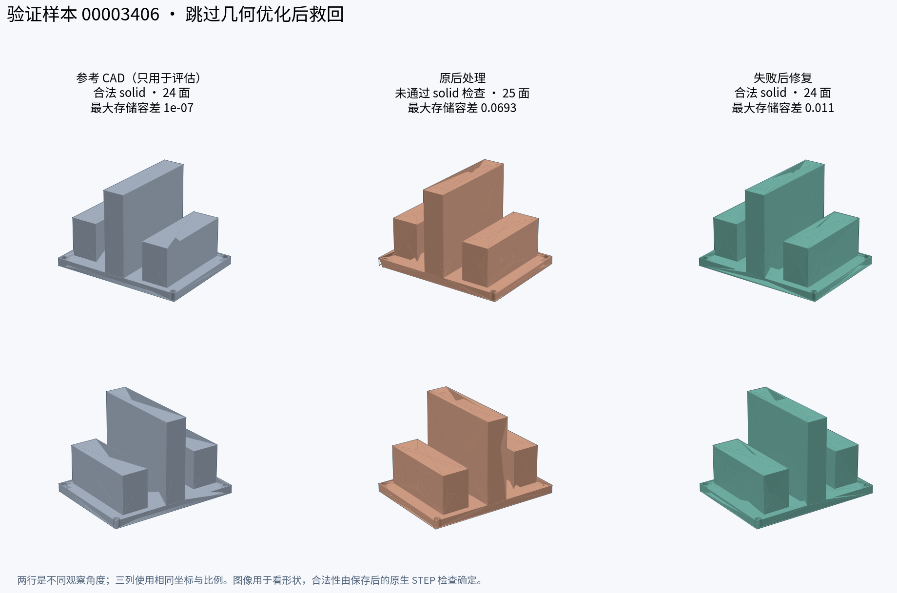
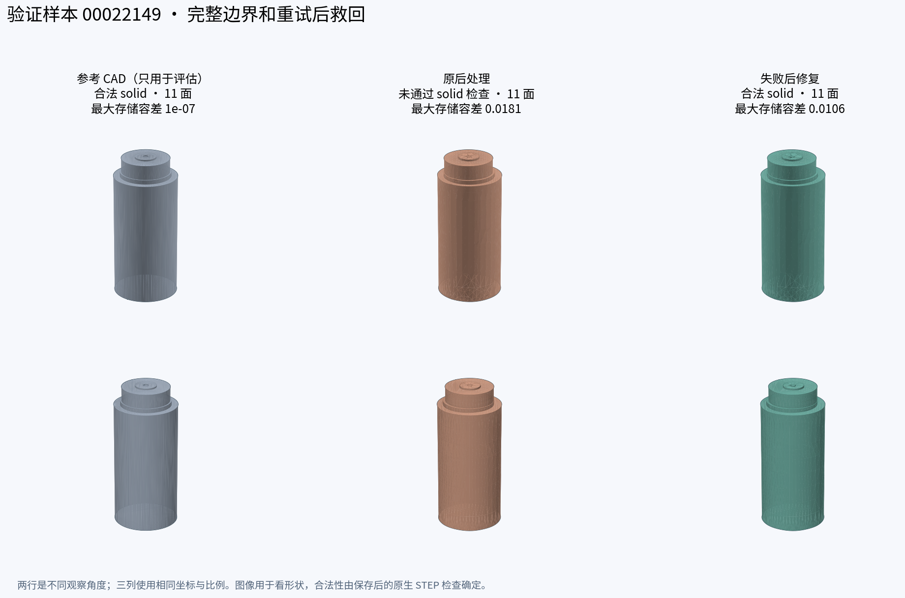

# 固定原 Intersection refinement VAE 的后处理对照

2026-10-16。已实现、已完成全量验证；没有训练或修改 VAE。

**原生合法 solid 从3076/3495（88.01%）提高到3147/3495（90.04%），净增71件、+2.03个百分点；原有3076个合法输出全部保留。** 失败数从419降到348，减少16.95%。但新增成功并非都更准确，部分具有较大内部容差，两件还有非周期平面边界结构差异。本轮证明了后处理存在可利用的空间，没有证明精度达到1e-3。

全部后处理问题、改法及范围见 [图文总览](../README.md)，预先固定的协议见 [PLAN](../PLAN.md)。

## 固定了什么

- 模型：最初明确有效的 Intersection refinement，epoch10 / step3993；没有采用后续 conditioning、point-feedback、GAT 变体。
- checkpoint：`/mnt/d/python/checkpoints/intersection_refinement/frozen/20261011T123836.485257Z/weights/epoch=0010-step=00003993-val_loss=0.039476.ckpt`。
- checkpoint SHA256：`9b18509de2a21f50d8fad41b8c37695842fe2e92745dc779713b0ecac06e2107`；243个 encoder/posterior 张量与原 AE 完全一致。
- DeepCAD v7 validation 原清单3505件，沿用此前数据合同审核接受3495件；10件此前拒绝保留在总体分母。当前运行与 train/test identity 无交集；ABC 未使用。此前研究用过 DeepCAD test 的失败分析，不能因此声称整个方法从未看过 test。
- canonical CAD、posterior mean、seed42、FP32、TF32关闭；推理3495/3495成功。四种策略读取完全相同的原始预测。这是已知CAD的VAE重建：encoder读取输入CAD几何/拓扑，decoder 不读取 GT 拓扑；后处理不读取GT或用GT选择修复候选，GT只用于事后评估。
- 同一名义优化200步、既有自适应上限600步、drop_num=0、原拟合/缝合容差序列。圆柱完整自然 loop 的特殊处理保留。每件总上限180秒；B2的多路径共用这一上限。
- 合法主指标：保存后的 STEP 用原生精度重新读取，为 `TopAbs_SOLID` 且通过 `BRepCheck`；不把 Compound、shell、文件存在或 success.txt 当作成功。原生检查依然使用文件内部记录的容差。

## 四种策略都报告



| 策略 | 原生合法 solid | /3495 | /原3505 | 救回旧失败 | 旧成功变失败 |
|---|---:|---:|---:|---:|---:|
| B0 原后处理 `legacy` | 3076 | 88.01% | 87.76% | — | — |
| B1 检查边界、隔离候选、保存重读后再接受 `roundtrip_retry` | 3072 | 87.90% | 87.65% | 26 | 30 |
| F1 修正拟合评分和末端检查 `fit_score_v2` | 3073 | 87.93% | 87.67% | 0 | 3 |
| B2 原流程优先，失败再修复 `recover_v1` | **3147** | **90.04%** | **89.79%** | **71** | **0** |

**单独替换为B1或F1都没有提高合法率。** 本轮有效方案是保留原有成功结果，对失败件从相同原始预测重新尝试。B2最多尝试四条路径，不能把它称为和B0相同一次尝试预算的算法优势。

B2固定顺序：原后处理 → B1加原几何优化 → B1但跳过几何优化 → 修正拟合评分的B1加原几何优化。每条路径从干净的raw和相同随机种子开始；一旦得到原生合法候选即停止，不按GT几何挑最好者。

71件的最终成功路径：

| 路径 | 件数 | 能说明什么 |
|---|---:|---|
| B1、不做几何优化 | 44 | 未优化预测配合新构造能救回一批样本，几何优化不应成为没有退路的必经步骤；这是组合效果，不能把44件全部单独归因于优化器。 |
| B1、保留几何优化 | 26 | 候选隔离、边界检查与验收流程组合有收益。 |
| 修正拟合评分的B1、保留优化 | 1 | 拟合评分修正确实触发了额外救回，但整体收益很小。 |

只有3件在**最终成功路径内**实际经历了“保存后原生重读失败，再尝试后续候选”：00151692、00583906、00962845。另两件00062835、00331081在此前失败路径中也发生过重读拒绝。其余很多早期候选只是没有形成solid，而旧程序对这种情形本来也会继续尝试；因此不能把71件都归功于“增加重试”。

## 几何和边界核验

对共同可计算的3351件，均值如下。CD²是双向最近点**平方**距离之和，不能直接当成长度误差，更不是最大误差保证。

| 指标 | 原后处理 | B2 |
|---|---:|---:|
| face CD²均值 | 0.000746306 | 0.000727550 |
| edge CD²均值 | 0.000413587 | 0.000407295 |

原有成功且两侧可计算几何的3013件，face/edge CD逐件完全相同。71件新增成功中，58件能与旧输出完整比较：edge CD²改善45件、退步13件；face CD²改善50件、退步8件。另13件不能作完整配对比较，没有当成改善。

71件都通过当前输入面数与已组装wire数量保护，原生面数也与GT一致。**这些检查没有证明原始拓扑被正确还原。** 专门复查发现：

- 00325996：GT总wire数12，旧输出与B2均10；两处差异位于非周期平面。该对象没有触发自然wire替换。
- 00962845：GT总wire数12，旧输出与B2均11；圆柱自然loop转换所在面两侧都是1个wire，差异发生在另一张非周期平面上。
- 这些平面在组环阶段已经输出1个wire，后续“不能跳过已有环”的检查会通过。可确认的是**非周期面的边界结构差异**，不能仅凭数量把具体物理孔的封闭情况说死。它们也不是B2新造成的wire数量退步，旧输出已有同样数量差异；变成合法solid仍不代表该问题已解决。

逐面依据见 [边界结构复查](validation/wire_structure_audit.json)，全体新增成功几何核验见 [geometry_outcome_audit.json](validation/geometry_outcome_audit.json)。

## 内部容差：合法率还不是精度认证

OCC记录的容差描述它接受边、面、顶点一致性的范围，**不是已经测量的真实几何误差**。容差大不等于真实误差必然同样大，但通过检查也不能反过来证明处处达到1e-3。

- B0合法件最大存储容差的中位数约0.00556，P90约0.01206。
- 71件新增成功中位数约0.01097，P90约0.03206；42件超过0.01。
- 4件超过0.08：00197713（0.22294）、00151692（0.20897）、00962845（0.18597）、00460745（0.08438）。这轮没有设定或回头加入容差拒绝门槛，全部如实计入并披露。
- 原生合法口径本身不使用统一`SetTolerance(0.1)`，但修复和缝合过程中仍可能形成较大的内部容差。

反例00151692：原输出不合法，新输出合法，但edge CD²约从0.00014677升至0.00029087，face CD²约从0.00084714升至0.00222765；最大存储容差从约0.00509升到0.20897。**这件不能叫作精度改善。**



## 真实样本图

图中为实际GT与STEP输出，同坐标、同尺度、两个固定视角；不是生成式示意图。前两件分别展示较早出现的fit-only救回与保留圆柱处理的救回，另附上述明确反例，不按GT最佳质量筛选展示。





## 还失败在哪里

B2剩余348件最后一条路径的终止记录：337件未构造齐全部裁剪面、10件未拼出solid、1件保存后原生重读拒绝。这些是**最后失败阶段**，不是已经证明且互斥的物理原因。

因此下一步优先检查：边如何分组为独立环、环在面参数空间里的走向、共享边在两张连续曲面上是否一致，以及端点是否真正共用。比继续堆叠通用修复函数更有针对性。几何优化还需要恢复最佳参数状态，并考虑约束曲线控制点；本轮没有改动优化器本体。

旧decoder的同平面漂移去重另列在总览，当前refinement评估没有调用它。本轮不以删除相似面提高合法率。

## 耗时、覆盖和验证

| 策略 | 每件总墙钟均值 / 中位数 / P90（秒） | STEP文件 | 几何可计算 | 几何评估错误 | 无STEP |
|---|---|---:|---:|---:|---:|
| B0 | 8.28 / 7.45 / 11.84 | 3495 | 3353 | 142 | 0 |
| B1 | 8.14 / 7.38 / 11.47 | 3072 | 3011 | 61 | 423 |
| F1 | 8.15 / 7.20 / 11.62 | 3495 | 3348 | 147 | 0 |
| B2 | 9.24 / 7.21 / 15.94 | 3495 | 3358 | 137 | 0 |

四策略同时运行，各32个CPU worker、每进程1线程；以上是并发条件下的实测，不是隔离性能基准。B1不生成可选STL及单面导出，运行量与B0并不完全相同。B2均值增加约11.6%。四策略全量墙钟约17.24分钟，另推理34.94秒。13980条预定对象记录全部终态，无超时、崩溃或遗漏。几何评估错误不抹掉已经完成的原生合法性检查，也不移出分母。

兼容旧0.1口径下，B0/B1/F1/B2分别3078/3069/3075/3142个合法；这是独立重新读取并修改容差的辅助口径，不是主结果，也不一定是原生合法集合的超集。

验证包括55项相关测试，以及8件固定validation样本的旧HEAD与新默认路径独立回放：两侧均6/8原生合法，STEP DATA、面/边数、几何采样数组完全一致。该逐点一致结论仅针对这8件回放，不外推为全量逐点证明。

独立完整性核验重新检查3495份raw、3495份源CAD、2份checkpoint、18个冻结源码文件，以及13980条终态/输入哈希、预算和候选选择记录，全部通过。详细依据：

- [汇总数据](report/summary.json)
- [输入与完整性审计](validation/final_integrity_audit.json)
- [策略结果审计](validation/policy_outcome_audit.json)
- [旧流程回放](validation/legacy_replay_summary.json)
- [推理核验](validation/inference_full_validation.json)

## 使用与复现

保留`recover_v1`为显式可选策略，默认`legacy`不变。生产模块改动位于已有`construct_brep.py`、`occ_topology.py`、`occ_fit.py`；没有新增模型或trainer。评估沿用`tools.vae_compare_post`的`--post-policy`。每次运行的完整argv与冻结文件记录在本目录`metadata/post_launch/launch.json`及`post_variants/<policy>/metadata/post/optimized/protocol.json`。

重新生成本报告所用汇总及图示：

```bash
cd /mnt/d/python_curve_eval
OMP_NUM_THREADS=1 OPENBLAS_NUM_THREADS=1 /mnt/d/anaconda3/envs/torch/bin/python \
  -m tools.postprocess_validation_report \
  --run-root checkpoints/postprocess_refinement/validation_20261016 \
  --split-list checkpoints/joint_boundary/validation/val_contract_audit/accepted.txt \
  --original-count 3505 \
  --case-ids 00003406 00022149 00151692
```

原始预测、权重、STEP、临时日志和逐对象运行文件不提交Git；图文、紧凑审计、代码和测试保留。当前结论适用于固定权重、这一开发validation和上述预算；ABC的泛化验证尚未做。
