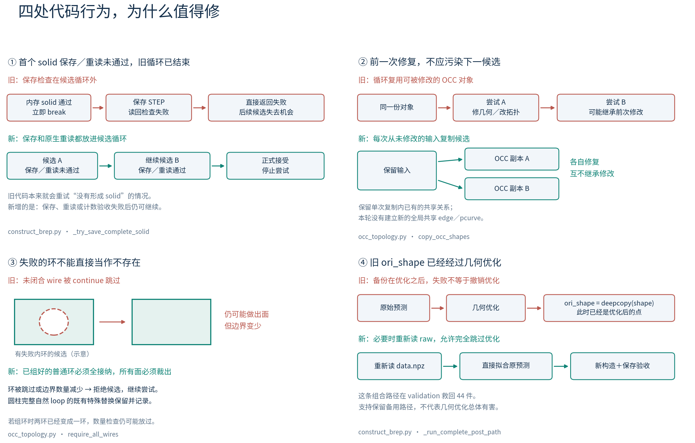
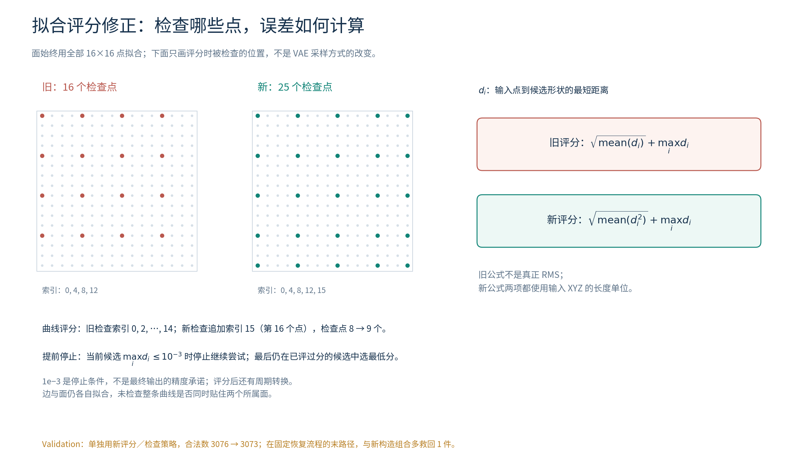
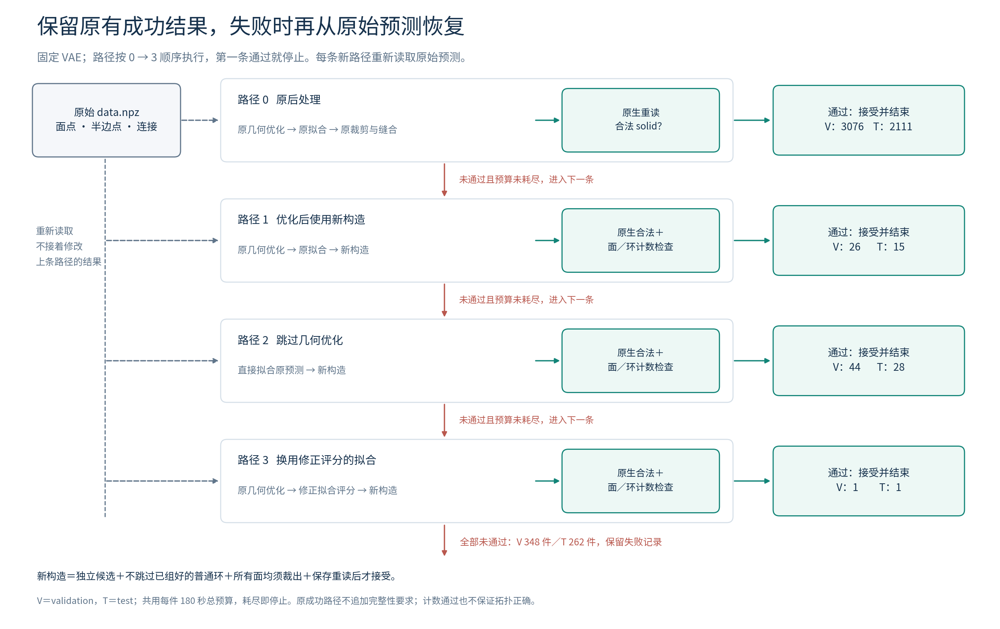

# 固定 VAE 的后处理修复：动机、代码改动与结果

2026-10-16。本文整理已经完成的实验，不引入新算法或重跑结果。生产改动提交为 `1fe0ebb8`，冻结方案的 test 评估提交为 `47c02d7b`。代码位置对应该版本。

## 可直接用于周报的概述

本轮固定此前有效的 Intersection refinement VAE，检查从预测采样点到 STEP 实体的后处理。源码中发现：首次得到内存中的合法 solid 后就结束候选循环，保存重读失败不能继续；不同修复尝试复用可被修改的 OCC 对象；无法闭合的环可能被跳过；原流程缺少退回未经几何优化预测的恢复路径。针对这些行为，增加独立候选、环和面数量检查、保存重读验收，以及从原始预测重新构造的固定备用路径。最终采用的 `recover_v1` 保留旧流程已经成功的输出，其中新增恢复路径只接手失败件。DeepCAD validation 原生合法率由 88.01% 提升至 90.04%，冻结后在 test 上由 87.34% 提升至 89.16%，分别新增 71、44 件合法 solid，均未损失原有成功件。这说明现有预测中有一部分可以通过改进后处理恢复，但尚不能证明所有新增结果的几何精度达到 1e-3。

## 1. 为什么转向后处理

用户此前观察到：不少重建件外形已经接近正确，失败经常发生在边裁剪面、面之间连接和最终拼实体的阶段。这里需要区分两种情况：网络预测已经缺失或弄错了几何；网络给出了可利用的几何，但后处理没有把它稳定地构造成实体。仅凭最终没有 solid，不能区分两者。

这一轮要回答的具体问题是：**保持同一个 VAE、同一份预测采样点和连接关系，修正后处理的执行与验收方式，能否救回一部分失败？** 因此从已知 CAD 的 VAE 重建开始，不把网络训练变化混进来。

原流程依次进行：选择边和整理连接关系 → 几何优化 → 分别拟合 B-spline 曲面、曲线 → 由边组环 → 用环裁剪面 → 缝合并构造 solid → 保存 STEP。每一步的成功含义不同：

- 点之间距离小，不保证分别拟合后的连续曲线和曲面仍然贴合。
- 某张面能构造出来，不保证原来准备裁剪它的所有环都被保留。
- 内存中的实体合法，不保证保存并重新读取后仍合法。

本轮先处理源码中能明确指出的执行问题。几何优化的目标、变量、步数和拟合容差序列均保持原协议；没有更换求解器、重训网络或修改 decoder 去重。

## 2. 四处执行行为，以及具体修改



图中孔与外框是机制示意，不是某个失败样本的实测结果。

### 2.1 保存检查放在循环外，可能过早放弃后续候选

原 [construct_brep.py:287](/mnt/d/python_curve_eval/src/brepnet/post/construct_brep.py:287) 的 `_try_save_valid_solid` 简化后如下：

```python
for tolerance in CONNECT_TOLERANCE:
    solid = get_solid(trimmed_faces, tolerance)
    if solid is not None:
        break

if solid is None:
    return False
save_step_file(step_path, solid)
if not check_step_valid_soild(str(step_path)):
    return False
```

`get_solid` 本身已经检查内存中的 solid，并非随便返回一个非空对象。问题在于：**第一次通过内存检查后，候选循环就结束了。** 如果 STEP 写出或重读检查失败，后面的连接容差没有机会继续尝试。

新增 [construct_brep.py:451](/mnt/d/python_curve_eval/src/brepnet/post/construct_brep.py:451) 的 `_try_save_complete_solid`，把完整验收放回每次尝试中。以下是逻辑示意，略去了异常记录和预算检查：

```python
for tolerance in CONNECT_TOLERANCE:
    faces = copy_occ_shapes(trimmed_faces)
    solid = get_solid(faces, tolerance)
    if solid is None:
        continue
    _save_step_checked(candidate_path, solid)
    _, result = _read_native_post_step(candidate_path)
    if result["native_valid_solid"] and boundary_counts_match(result):
        return accept(candidate_path)
```

新验收检查 STEP 写出返回值，再以原生读取方式检查 `TopAbs_SOLID` 和 `BRepCheck`，并确认面数、环数没有不允许的减少。失败就继续原来的容差序列。

需要准确归因：旧代码对“没有拼出 solid”本来就会继续尝试；新增的是保存、重读或数量验收失败后继续。在 validation 新增成功中，只有 3 件在其最终成功路径内明确经历了“原生重读拒绝 → 后续候选成功”。不能把全部 71 件都解释成这一处循环修改的收益。

### 2.2 修复会修改 OCC 对象，各次尝试需要独立输入

原 [occ_topology.py:228](/mnt/d/python_curve_eval/src/brepnet/post/occ_topology.py:228) 对 `ShapeFix_Wire` 开启了修改几何和拓扑的能力，随后还会调整对象容差；`get_solid` 也会打乱面列表的顺序。旧循环重复使用这些对象，后一次尝试可能继承前一次修复留下的状态。

这就像第一次拼装时已经移动或修改了零件，第二次却把这些零件当成最初的输入。换一个 tolerance 后结果不同，可能同时包含“容差变了”和“输入已经变了”两种影响。

新增 [occ_topology.py:184](/mnt/d/python_curve_eval/src/brepnet/post/occ_topology.py:184) 的 `copy_occ_shapes`，将一次候选涉及的对象放进一个 compound，再使用 `BRepBuilderAPI_Copy(compound, True, False)` 复制拓扑和几何。具体在两处调用：

- 每张面、每个裁剪容差开始前，一起复制当前曲面对应的自然面和所属边。
- 每次拼 solid 前，一起复制所有已接受的裁剪面。

这样各次尝试从未被上次修复改写的输入开始，同时保留单次复制内部原有的共享关系。**这不是重新建立全模型共享边的算法**，也没有自动解决两张面上的参数曲线一致性。

代码能够确认对象复用与可变状态的风险；当前实验没有把“复制对象”单独拆出来做消融，因此不能为它单独分配救回数量。

### 2.3 某个环失败，不能直接当作它不存在

原 [occ_topology.py:236](/mnt/d/python_curve_eval/src/brepnet/post/occ_topology.py:236) 遇到未闭合 wire 会 `continue`，随后仍可能用剩余的 wire 构造面。举例说，一张面需要外环和内环，如果内环被跳过，程序可能还构造出一张面，但它的裁剪范围已经变了。

原 [construct_brep.py:740](/mnt/d/python_curve_eval/src/brepnet/post/construct_brep.py:740) 还允许在裁剪成功面数大于总面数的 80% 时尝试拼 solid；因此即便 `drop_num=0`，也不代表每张预测面都成功参与了构造。

新恢复路径增加了几层数量检查：

1. 普通分支组环后的边出现次数不能少于输入边数。
2. 已组好的普通 wire 必须全部通过修复并被接纳；面修复后 wire 数不能减少。
3. 所有预测面都裁剪成功，才进入拼 solid。
4. STEP 重读后面数必须与输入裁剪面数一致，总 wire 数不能减少。

这保护的是“程序已经拿到的边界不要在后续静默丢失”。它**不能证明环分组正确**：如果两个环在更早的组环阶段已经被拼成一个，数量检查仍可能通过。validation 逐面核验确认了两件非周期平面的数量差异：GT 面有两个 wire，预测边的组环输出只有一个。尚未确定差异最初来自预测边还是组环算法；旧输出也有同样差异，本轮没有解决它。

项目的圆柱特殊处理保持原样。[occ_topology.py:214](/mnt/d/python_curve_eval/src/brepnet/post/occ_topology.py:214) 对特定周期曲面使用完整自然 loop；新的数量检查在这一已知转换之后进行，并记录转换发生的位置。这里的拟合 B-spline 不能直接套用“两个圆环加一条 seam”的标准解析圆柱假设。

### 2.4 旧 `ori_shape` 不是优化前的预测，需要真正的退回路径

原 [construct_brep.py:708](/mnt/d/python_curve_eval/src/brepnet/post/construct_brep.py:708) 的执行顺序是先几何优化，再 `ori_shape = copy.deepcopy(shape)`。这个备份用于后续构造尝试，已经包含优化后的点；它不是优化前预测的备份。

几何优化有用，但它优化的采样点目标和最终可裁剪、可缝合并不完全相同。某些样本可能原始预测就更适合后续构造。因此应保留一个明确选项：原流程和第一条新构造路径均失败时，重新读取原始 `data.npz`，直接拟合，再进行新构造和验收。

新增 [construct_brep.py:496](/mnt/d/python_curve_eval/src/brepnet/post/construct_brep.py:496) 的 `_run_complete_post_path` 每次重新读取预测，以显式 `optimized` 参数决定是否优化。这里没有改变优化器本身，也不把“跳过优化”设为普遍默认。

在固定候选顺序下，这条“原预测直接拟合＋新构造”组合路径在 validation 救回 44 件、test 救回 28 件。它说明备用路径值得保留；不能把这些数字解释为优化器单独造成了同等数量的错误。

## 3. 拟合候选的评分：公式和检查点都有明确问题



原 [occ_fit.py:80](/mnt/d/python_curve_eval/src/brepnet/post/occ_fit.py:80) 与曲线评分中的 `errors` 是输入检查点到候选曲面或曲线的最短距离。旧代码的 `rmse` 实际为：

```python
rmse = np.sqrt(np.mean(errors))       # 旧：距离均值开方
rmse = np.sqrt(np.mean(errors ** 2))  # 新：真正的均方根距离
score = rmse + np.max(errors)
```

旧式不是真正的 RMS，开方项与最大距离项的量纲也不一致。新 [occ_fit.py:31](/mnt/d/python_curve_eval/src/brepnet/post/occ_fit.py:31) 改成 RMS＋最大距离，两项均使用输入 XYZ 的长度单位。

另外，旧面评分用 `points[::4, ::4]`，16×16 网格只检查索引 0、4、8、12 的交点，没有覆盖索引 15。新评分在两个方向加入索引 15，检查点由 16 个变成 25 个。曲线原检查索引 0、2、…、14，新检查追加索引 15，由 8 个变为 9 个。**拟合本身始终使用全部 256 个面点或全部 16 个曲线点**，变的是选候选时检查的位置。

提前停止也从旧混合评分小于 1e-2，改为当前候选的检查点最大距离不超过 1e-3。这是评分和停止规则的修正，不能笼统说成“把所有拟合容差收紧到 1e-3”：原拟合容差序列、失败后的粗拟合和周期曲面转换都保留。

还有一个实现细节：提前停止后，仍然从所有已经评分的候选中选最低总分，最终可能选到更早的候选。因此，**连最终候选的检查点最大误差都不是被硬约束为 1e-3**；连续几何的整体精度更不能据此保证。曲线的末端检查也是“该输入点到整条候选曲线的最近距离”，不等价于强制两者端点对应。

单独启用这套评分／检查策略，validation 合法数从 3076 降至 3073，没有救回旧失败。因此本轮没有用它替换默认拟合；它只作为最后一条恢复路径的一部分，在前面路径均失败后额外救回 1 件。这个结果是公式、检查点、停止条件与新构造的组合效果，不能单独归因于 RMS 修正。

## 4. 最后保留的是固定恢复流程



`recover_v1` 在 [construct_brep.py:574](/mnt/d/python_curve_eval/src/brepnet/post/construct_brep.py:574) 中明确列出四条路径，按顺序执行，第一条验收通过就停止：

| 顺序 | 几何优化 | 拟合与构造 | Validation 最终在此成功 | Test 最终在此成功 |
|---|---|---|---:|---:|
| 0 | 原优化 | 原拟合＋原构造，原生重读验收 | 3076 | 2111 |
| 1 | 原优化 | 原拟合＋新构造 | 26 | 15 |
| 2 | 跳过 | 原拟合＋新构造 | 44 | 28 |
| 3 | 原优化 | 新评分／检查的拟合＋新构造 | 1 | 1 |

每条新路径都重新读取相同 raw，并恢复相同 Python/NumPy 随机状态，全部共用每件 180 秒总预算。实际选择仅依据合法性与新路径的数量检查，不读取 GT，也不按 GT 挑最接近的候选。

原路径已得到原生合法 STEP 时直接保留；不为这些旧成功输出追加新完整性要求。已保存合法 STEP 后，若可选的 STL/debug 导出失败，也尽量保留该有效 STEP。因此“零旧成功退步”包含方案设计带来的保护，不能被描述成新构造在每个样本上都优于旧构造。

## 5. 结果支持什么

先在 validation 比较单项与组合，方案冻结后再测 test。没有根据这次 test 个例修改规则、容差或路径顺序，ABC 未使用。历史 DeepCAD test 曾参与项目开发，本次冻结比较不等于完全未见测试集的独立盲测。

| Validation 策略 | 原生合法 solid / 3495 | 合法率 | 救回旧失败 / 旧成功退步 |
|---|---:|---:|---:|
| 原后处理 `legacy` | 3076 | 88.01% | — |
| 新构造 `roundtrip_retry` | 3072 | 87.90% | 26 / 30 |
| 新拟合评分／检查 `fit_score_v2` | 3073 | 87.93% | 0 / 3 |
| 固定恢复流程 `recover_v1` | **3147** | **90.04%** | **71 / 0** |

| 数据集 | 原后处理 | `recover_v1` | 提升 | 新增 / 退步 |
|---|---:|---:|---:|---:|
| Validation，3495 件 | 3076，88.01% | 3147，90.04% | +2.03 个百分点 | 71 / 0 |
| Test，2417 件 | 2111，87.34% | 2155，89.16% | +1.82 个百分点 | 44 / 0 |

主指标为保存后原生读取的 `TopAbs_SOLID`＋`BRepCheck`，不以文件存在、Compound、shell 或 `success.txt` 代替。模型固定为原 Intersection refinement epoch 10 / step 3993，canonical posterior mean、seed 42、FP32、TF32 关闭；两侧使用相同原始预测。这是已知 CAD 的 VAE 重建，不是单张真实照片重建实验。encoder 读取输入 CAD 几何和拓扑，decoder 不读取 GT 拓扑。

3495/2417 是沿用此前数据合同审核的 accepted 清单。若将此前被拒绝的 10/7 件也保留在原始分母，validation 为 3076/3505（87.76%）→3147/3505（89.79%），test 为 2111/2424（87.09%）→2155/2424（88.90%）。当前运行失败、缺失、超时均不移出分母。

收益与代价需要一起看：

- 两个数据集共同可计算集合的面／边平均 CD² 均下降；但新增合法件并非每件几何都改善。validation 的 58 件可完整比较新增成功中，面指标 50 改善、8 退步；边指标 45 改善、13 退步。另 13 件无法完整比较。
- 原生读取没有统一把检查容差改成 0.1，但仍使用 STEP 内部记录的容差。validation 新增成功中 42/71 件最大存储容差超过 0.01，4 件超过 0.08；这不是实测误差，却说明“合法”不能直接写成“达到 1e-3 精度”。
- 每件实测平均耗时 validation 为 8.28→9.24 秒，test 为 4.90→6.15 秒。前者四策略并发，后者两策略并发，绝对速度不跨运行直接比较。最多四条路径共用 180 秒，并不意味着尝试次数与原单路径相同。

**本轮可以支持的结论是：固定预测下，后处理的候选管理和失败恢复存在实际改善空间。** 仍不能证明网络精度问题已经解决、所有孔和环都正确，或新评分一定提高合法率。

## 6. 代码范围与后续边界

| 文件 | 本轮实际修改 |
|---|---|
| [construct_brep.py](/mnt/d/python_curve_eval/src/brepnet/post/construct_brep.py) | 增加显式策略、原始预测重载、固定路径顺序、共用预算、保存重读验收和逐次诊断；默认仍为 `legacy`。 |
| [occ_topology.py](/mnt/d/python_curve_eval/src/brepnet/post/occ_topology.py) | 增加 OCC 候选深复制、可选的全部 wire 接纳和数量检查；保留周期面的完整自然 loop 特殊处理。 |
| [occ_fit.py](/mnt/d/python_curve_eval/src/brepnet/post/occ_fit.py) | 增加可选的 RMS＋最大距离评分、末端检查点和提前停止条件，保留原拟合与粗拟合接口。 |
| [vae_compare_post.py](/mnt/d/python_curve_eval/tools/vae_compare_post.py) | 显式选择后处理策略，记录统一输入、原生合法性、存储容差及成本。 |
| [intersection_evaluate_inference.py](/mnt/d/python_curve_eval/tools/intersection_evaluate_inference.py) | 核对和严格加载当前模型自身的 encoder/posterior，独立导出固定原始预测。 |
| [postprocess_validation_report.py](/mnt/d/python_curve_eval/tools/postprocess_validation_report.py) | 聚合配对成败、几何与耗时；test 阶段仅增加策略与 split 的显式选择，未改生产算法。 |

仍待解决的方向包括：边在组环前后的连接与分组；一条公共边是否同时贴住两张连续曲面；端点是否真正共用；边在面参数空间中的曲线和三维曲线是否一致。几何优化的最佳参数恢复、曲线局部形状调整，以及旧 decoder 的同平面漂移去重，都未在本轮实现。当前 refinement 评估没有调用那段旧去重。

生产修改已完成 55 项相关测试，并对 8 件固定 validation 样本比较旧 HEAD 与新默认路径，STEP DATA 和几何采样一致；该逐点结论仅适用于这 8 件。test 汇总工具有 18 项相关测试，且重算 validation 汇总与既有结果逐字段一致。本次周报工作只核对源码、结果和图示，没有重新训练、改修复规则或新增测试集分析。

## 附件与依据

- [Validation 完整报告](/mnt/d/python_curve_eval/checkpoints/postprocess_refinement/validation_20261016/REPORT.md)：单项对照、真实案例、失败阶段及边界复查。
- [Test 冻结评估报告](/mnt/d/python_curve_eval/checkpoints/postprocess_refinement/test_20261016/REPORT.md)：固定方案的数据与核验。
- [Validation 策略审计](/mnt/d/python_curve_eval/checkpoints/postprocess_refinement/validation_20261016/validation/policy_outcome_audit.json)、[几何审计](/mnt/d/python_curve_eval/checkpoints/postprocess_refinement/validation_20261016/validation/geometry_outcome_audit.json)、[边界结构审计](/mnt/d/python_curve_eval/checkpoints/postprocess_refinement/validation_20261016/validation/wire_structure_audit.json)。
- 图 1 代码问题：[PNG](/mnt/d/python_curve_eval/checkpoints/postprocess_refinement/weekly_report_20261016/repair_motivation.png)／[SVG](/mnt/d/python_curve_eval/checkpoints/postprocess_refinement/weekly_report_20261016/repair_motivation.svg)。
- 图 2 拟合评分：[PNG](/mnt/d/python_curve_eval/checkpoints/postprocess_refinement/weekly_report_20261016/fitting_checks.png)／[SVG](/mnt/d/python_curve_eval/checkpoints/postprocess_refinement/weekly_report_20261016/fitting_checks.svg)。
- 图 3 恢复流程：[PNG](/mnt/d/python_curve_eval/checkpoints/postprocess_refinement/weekly_report_20261016/recovery_flow.png)／[SVG](/mnt/d/python_curve_eval/checkpoints/postprocess_refinement/weekly_report_20261016/recovery_flow.svg)。

图示来自本地代码绘制，SVG 使用字体轮廓，可直接插入周报或幻灯片。图中路径计数来自已有冻结结果，不代表各路径若独立运行时的全部潜在成功数。
